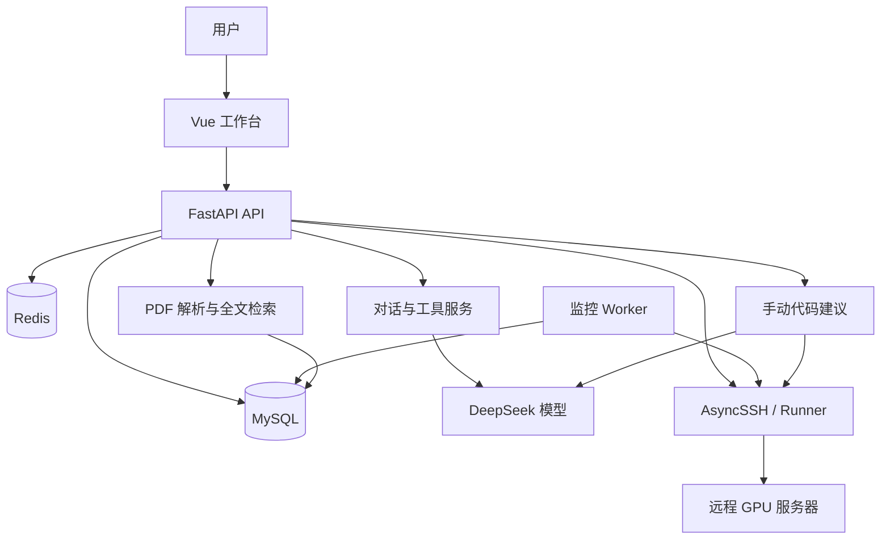

# 炼丹神器：面向深度学习实验的 AI Agent 工作台

将对话式任务配置、远程训练、实验监控、论文资料检索与网络代码建议整合到一个工作台，帮助开发者集中管理从训练启动到结果分析的实验流程。

> Python · FastAPI · LangChain · DeepSeek · MySQL · Redis · AsyncSSH · Vue 3 · TypeScript

## 项目背景

深度学习实验经常需要在聊天工具、SSH 终端、训练日志和论文资料之间切换：训练参数分散、运行状态难追踪，日志与代码也缺少统一的分析入口。

本项目围绕这些实际流程构建 AI Agent 工作台：用户保存自己的服务器、模型 Key 和训练任务，通过对话或页面操作管理实验；系统采集运行指标和日志、保存事实报告，并在用户手动触发后结合主网络代码生成建议。

## 核心功能

| 模块 | 功能 |
| --- | --- |
| 对话与上下文 | 多轮聊天、SSE 流式输出、历史摘要、原文回查，以及按用户和会话隔离的上下文缓存 |
| 训练任务 | 选择服务器上的 Python 环境、项目入口、参数、GPU 与主网络文件，保存可复用配置 |
| 远程执行 | 通过 SSH 启动、查询和停止受控训练，保留执行绑定、运行状态和日志读取位置 |
| 资源查询 | 读取 `nvidia-smi`，展示 GPU 型号、显存和利用率，辅助用户选择训练设备 |
| 实验监控 | 后台 Worker 持续推进状态与指标采集；支持手动采集、指标曲线和事实报告 |
| 通用日志解析 | 支持结构化日志及自定义普通文本匹配规则，提取损失值、学习率、MAE 等指标，兼容大小写 |
| 主网络代码建议 | 用户选定 `.py` 文件，后端读取代码和原始文本日志，手动调用模型生成中文 Markdown 建议 |
| 论文资料库 | 上传文本 PDF、解析分页与分块、全文检索、阅读带物理页码的原文片段，以及资料删除 |
| 个人 Skill | 创建、查看和删除个人提示词模板；Redis 1 号库按用户缓存，保留历史轮次使用的快照 |
| 数据与诊断 | 实验、运行和训练配置删除；数据库关联清理；每日统一 TXT 日志与追踪号排查 |

### 对话、缓存与历史原文

MySQL 保存用户、会话、消息及业务记录，Redis 保存可复用的上下文缓存。消息先持久化，再更新缓存；缓存失效或不可用时从数据库恢复。

上下文由摘要和未被摘要覆盖的原文组成。用户询问摘要中缺失的细节时，可通过历史回查工具检索 MySQL 原文，而不是只依赖摘要补全事实。

聊天使用 SSE 持续推送生成内容；完整回复保存后发送完成事件，使前端展示与持久化状态对应。

### 训练配置与运行分离

保存任务只保存配置，不启动训练。用户明确提出启动意图或通过页面执行启动操作后，系统才进入受控执行流程。

服务器项目发现支持读取环境、目录和 GPU 资源；训练入口、项目路径、参数及服务器身份由后端校验。已有运行关联冻结的配置，避免后续编辑覆盖历史执行信息。

### 事实报告与代码建议分离

- **事实报告**：程序汇总已经采集的状态与指标，不需要调用模型。
- **代码建议**：用户手动触发，后端读取所选主网络文件与原始文本日志，再发送一次普通模型请求。
- **展示结果**：围绕具体代码片段给出问题、依据、修改方向和验证方法，区分已确认问题与待验证假设。

建议提示词采用 ReAct 启发的证据核对流程：

```text
检查主网络实现
    → 核对代码行与日志依据
    → 根据证据更新判断
    → 输出修改建议与验证方法
```

这里是基于现有资料的提示词分析流程，不要求模型输出内部思考或工具协议，也不通过建议按钮自动修改远端代码。

输入形式为：

````text
以下是日志内容：
{原始文本日志}

下面是网络代码：
文件：{选定文件路径}
```python
{带实际行号的源码}
```
````

优先保留完整选定网络文件；长日志根据剩余预算选取头尾并明确说明省略范围。日志不可用时可仅检查代码；代码超出输入预算时提示选择更具体的模块。

## 技术栈

| 层级 | 技术 | 职责 |
| --- | --- | --- |
| Web 前端 | Vue 3、TypeScript、Vite、Element Plus、ECharts | 对话界面、任务配置、资源查询与训练曲线 |
| API 服务 | Python、FastAPI、Pydantic、Uvicorn | 接口、参数校验、身份隔离及流式响应 |
| 模型接入 | LangChain、DeepSeek、HTTPX | 模型调用、工具接入、提示词与请求预算 |
| 数据持久化 | MySQL | 用户、会话、实验、运行、指标、PDF 分块与建议结果 |
| 缓存与事件 | Redis | 会话上下文、个人 Skill 缓存，以及事件通信相关能力 |
| 远程训练 | AsyncSSH、Python Runner | SSH 认证、受控执行、源码与日志读取 |
| PDF 解析与检索 | pypdf、MySQL 全文索引 | 文本提取、分块存储与关键词检索 |
| 凭据保护 | Argon2、cryptography、哈希化 Token | 密码校验、敏感凭据加密和登录会话验证 |

## 系统结构



后端按照路由、业务服务、仓储、数据模型和远程执行分层。网络读取与模型调用不占用长时间的数据库事务；运行监控使用持久化任务、租约和续租机制协调处理。

## 代码目录

以下为后端目录；Vue 前端源码目前独立维护。

```text
.
├── app/
│   ├── api/              # API、身份依赖与请求处理
│   ├── models/           # 请求响应、业务契约与配置
│   ├── repositories/     # MySQL 持久化
│   ├── services/         # 对话、训练、资料和建议业务
│   ├── runner/           # 远程执行和源码读取
│   ├── security/         # Token、密码及凭据保护
│   ├── workers/          # 独立后台进程
│   ├── database.py       # 建表与增量迁移入口
│   ├── logging_config.py # 按日统一日志
│   └── main.py           # FastAPI 应用入口
├── config/               # 部署配置与示例
├── sql/                  # 建表、迁移和查询 SQL
├── skills/               # 文件型公共 Skill
├── examples/             # 参数、评测和训练项目示例
├── scripts/              # 本地验收和集成验证工具
├── tests/                # 自动化测试
├── docs/                 # 模块设计与操作说明
└── requirements.txt
```

## 本地运行

### 环境准备

- 支持项目依赖及 `asyncio.timeout` 的 Python 环境，建议 Python 3.12。
- MySQL 与 Redis。
- 调用模型时需要用户自己的 DeepSeek API Key。
- 使用远程训练时，需要可访问的 Linux SSH 服务器及对应 Python / 深度学习环境。
- 运行前端时需要符合其 `package.json` 要求的 Node.js 和 pnpm。

### 启动后端

在后端仓库根目录执行：

```bash
python -m venv .venv
```

激活虚拟环境后安装依赖：

```bash
python -m pip install -r requirements.txt
```

复制 `config/.env.example` 为 `config/.env`，填写实际配置：

```dotenv
MYSQL_PASSWORD=填写数据库密码
MODEL_CREDENTIAL_ENCRYPTION_KEY=填写固定的Fernet主密钥
REDIS_URL=redis://127.0.0.1:6379/0
CHAT_CONTEXT_CACHE_ENABLED=true
MODEL_TRUST_ENV=false
```

Fernet 主密钥可在本机生成，保存后保持稳定：

```bash
python -c "from cryptography.fernet import Fernet; print(Fernet.generate_key().decode())"
```

当前 MySQL 连接的主机、端口和用户名在 `app/database.py` 的 `get_connection()` 中，默认是 `127.0.0.1:3306`、`root`。按部署环境调整连接账号，再执行初始化：

```bash
python -m app.database
python -m uvicorn app.main:app --host 127.0.0.1 --port 8000
```

- 健康检查：<http://127.0.0.1:8000/health>
- API 文档：<http://127.0.0.1:8000/docs>

训练监控需要单独启动 Worker：

```bash
python -m app.workers.monitor_worker
```

当前代码建议以页面手动触发为主，无需为此启用全局自动分析 Worker。远程访问还需由部署者配置 `SSH_ALLOWED_NETWORKS` 或对应允许网段文件，具体参数见 `app/config.py` 与 `config/` 中的示例。

### 启动前端

在独立的前端源码目录执行：

```bash
pnpm install --frozen-lockfile
pnpm dev
```

默认访问 <http://127.0.0.1:5173>。开发服务器将 `/api` 请求代理到后端，代理目标可通过前端的 `API_PROXY_TARGET` 配置。

## 使用流程

1. 注册并登录，在设置中保存自己的模型 API Key。
2. 添加训练服务器，配置 SSH 凭据、工作目录和主机指纹，测试连接。
3. 创建实验和评测定义，选择服务器环境、训练入口、参数、GPU 与主网络文件。
4. 保存训练任务，再通过明确的启动指令或页面操作开始运行。
5. 查看运行状态、训练日志和指标曲线，必要时调整普通文本日志解析规则。
6. 完成采集并生成事实报告后，手动点击“生成代码建议”。
7. 上传论文 PDF、检索原文片段，或创建个人 Skill 复用分析提示词。
8. 删除不再需要的资料、配置、实验或运行记录，按相应接口清理关联数据。

## 主要接口

| 方法 | 路径 | 说明 |
| --- | --- | --- |
| POST | `/sessions/{session_id}/messages/stream` | 流式对话 |
| POST | `/training-tasks` | 保存训练任务配置 |
| POST | `/training-projects/resources` | 查询 GPU 资源 |
| POST | `/runs/{run_id}/metrics/sync` | 手动采集指标 |
| POST | `/runs/{run_id}/report` | 生成事实报告 |
| PUT | `/runs/{run_id}/code/main-network` | 选择主网络源码 |
| POST | `/runs/{run_id}/analysis/start` | 手动生成代码建议 |
| GET | `/runs/{run_id}/suggestions` | 读取已保存建议 |
| POST | `/papers/search` | 检索个人论文片段 |
| POST | `/skills` | 创建个人 Skill |
| DELETE | `/experiments/{experiment_id}` | 删除实验及系统内关联数据 |
| DELETE | `/runs/{run_id}` | 删除单次运行及系统内关联数据 |

完整路径和字段以运行中的 `/docs` 为准。

## 验证与维护

可运行针对相关链路的测试：

```bash
python -m unittest tests.test_direct_code_advice tests.test_manual_analysis tests.test_logging -q
```

前端提供：

```bash
pnpm typecheck
pnpm test
pnpm lint
pnpm build
```

`scripts/` 中包含临时数据库集成验收工具；部分脚本需要 MySQL、Redis 或指定的本地测试环境，不宜直接对生产数据运行。

业务日志按服务器本机日期写入 `logs/YYYY-MM-DD/app.txt`，API 与 Worker 共用同一文件，包含追踪号、进程号、源码位置和固定错误分类。凭据、完整提示词及模型思考正文不写入日志。


