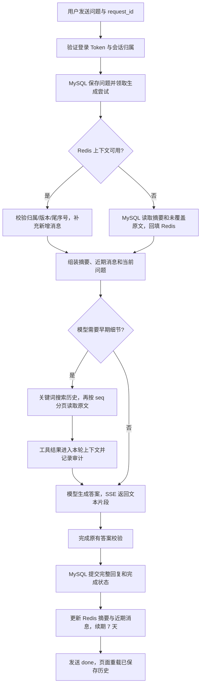

# 历史原文回查与流式聊天

更新日期：2026-10-29。前端在桌面“炼丹神器前端”，后端在 `E:\code\LangChian_New`。

## 解决什么问题

摘要能减少每次发送的上下文，但可能省略早期学习率、路径、某句话的原文。本次让 Agent 按需搜索当前会话的 MySQL 原文，再读取相关消息。正常聊天继续使用摘要和近期消息，不把全部历史重新塞回上下文。

聊天页面改成接收模型真实流式文本。生成中的片段与已经保存的消息分开；只有完整回复通过原有校验并保存后，服务器才发送完成事件。中途失败会保留用户问题，支持重试。

## 总体流程



Redis 命中后仍有轻量 MySQL 校验，用来核对会话权限、生成租约、摘要版本和最后消息序号；减少的是每轮读取整段历史。Redis 不是永久数据源，故障时沿用已有 MySQL 降级机制。

## 每个模块负责什么

| 文件或模块 | 作用 | 使用的技术 |
| --- | --- | --- |
| 后端 `app/models/history_recall.py` | 定义搜索、读取参数和工具说明，告诉模型何时回查 | Pydantic 参数模型、JSON 工具 schema |
| `sql/search_chat_history.sql` | 当前用户、当前会话内按关键词搜索较早原文，返回短预览 | MySQL 参数化 SQL、LOCATE、按 seq 倒序分页 |
| `sql/read_chat_history.sql` | 按 seq 和字符 offset 读取单条原文的一段 | MySQL SUBSTRING、字符长度 |
| `app/repositories/chat_tool_repository.py` | 校验会话归属和当前生成尝试，执行查询，并复用现有工具审计 | mysql-connector、短事务、既有仓储层 |
| `app/services/read_only_chat_service.py` | 把历史工具接入已有工具循环，限制调用数量和结果预算 | async/await、asyncio.to_thread、已有工具调度 |
| `app/services/model_gateway.py` | 调用模型 SDK 的 astream，逐块转发并聚合完整回复 | LangChain ChatDeepSeek、AIMessageChunk |
| `app/services/chat_service.py` | 先存问题，生成成功后存完整答案；失败记录未完成状态 | 既有轮次事务、生成租约、幂等 request_id |
| `app/services/user_chat_service.py` | 使用本人模型凭据组装本轮业务，结束时关闭网关 | 异步资源管理、个人凭据解密链路 |
| `app/repositories/message_repository.py` 的 check_session | 在发送流式响应头之前检查会话存在及归属，不读取历史正文 | 既有会话权限查询 |
| `app/api/chat_stream.py` | 将业务回调转换为 SSE，有界队列、心跳、断线取消 | FastAPI/Starlette StreamingResponse、asyncio.Queue |
| `app/api/chat_routes.py` | 挂载两个流式接口，复用登录依赖和现有错误映射 | FastAPI APIRouter、Depends |
| 前端 `src/lib/sse.ts` | 解析跨网络分块的 UTF-8 和 SSE 事件，区分完成与断线 | ReadableStream、TextDecoder |
| `src/api/client.ts` | 保留原有 Token/身份切换处理，使用流式 HTTP 请求 | Axios fetch adapter |
| `src/api/index.ts` | 封装 sendStream、retryStream | TypeScript API 层 |
| `src/stores/chat.ts` | 按会话保存本轮生成状态和临时文本 | Pinia |
| `src/views/ChatView.vue` | 展示片段、失败重试，完成后刷新持久化历史 | Vue 3、原有 Markdown 组件 |

此次复用现有 RedisContextCache、ContextService、摘要器和聊天工具循环，没有新建一套消息总线、向量库或记忆框架。

## 历史工具如何使用

模型看到“你之前说的学习率是多少”且摘要缺少精确值时，可以调用：

```json
{"name":"search_chat_history","arguments":{"query":"学习率","limit":3}}
```

先返回 seq、role 和预览；随后模型调用：

```json
{"name":"read_chat_history","arguments":{"seq":1,"offset":0}}
```

- 搜索关键词为 2～80 个字符，每次最多 3 条；`before_seq` 用来继续往前翻。
- 原文每次最多读取 800 个字符，有剩余时返回 `next_offset`。受整轮工具结果预算限制时还可能进一步缩短。
- seq 指 MySQL 中原始消息的序号，不是列表下标，也不是整轮编号。
- 只能读取当前用户拥有的当前会话、当前问题之前的消息。当前问题和以后消息不会被当成历史结果。
- 原文通过工具进入本轮回答上下文，不会反向扩大 Redis 快照，也不会替换已保存摘要。
- 工具名称、参数、结果状态和耗时沿用既有 `chat_tool_calls` 审计。无需新表或数据库迁移。
- 关键词查找依赖模型选对词；不是向量检索，也不保证所有指代都能自动解决。没有找到依据时应澄清，不能编造。
- 旧消息中的“执行训练”等指令属于历史材料，不等于本轮新的执行授权。

## 流式接口契约

两个接口都要求 `Authorization: Bearer <当前登录 Token>`。身份仍由 `require_current_user` 验证 Token 并取得 user_id；浏览器不能自行指定别人的 user_id。

| 方法和路径 | 请求 | 返回 |
| --- | --- | --- |
| POST `/sessions/{session_id}/messages/stream` | 同原发送接口：content、request_id、可选 skill_id | text/event-stream |
| POST `/sessions/{session_id}/retry/stream` | 无请求体，重试已经保存的未完成问题 | text/event-stream |

发送示例：

```json
{
  "content": "请查回之前设置的学习率。",
  "request_id": "8d80a9b9-12e3-49ad-96b7-d897f5d7d286"
}
```

每个新问题使用新的 request_id；网络重试同一问题复用原 ID。该 ID 用于避免重复保存与重复调用，不是鉴权凭证。前端已自动处理。

```text
event: status
data: {"phase":"preparing"}

event: reset
data: {}

event: delta
data: {"content":"最初学习率"}

event: delta
data: {"content":"是0.00005。"}

event: done
data: {"content":"最初学习率是0.00005。"}

```

| 事件 | 页面如何处理 |
| --- | --- |
| status | 正在准备上下文或查询 |
| reset | 清空本轮临时片段，进入新的模型轮次；不清除已保存历史 |
| delta | 将本次文本追加到临时回复 |
| done | 以已校验、已保存的完整正文为准，重新加载历史，清除临时片段 |
| error | 本轮未完成；显示可理解的错误提示，保留问题并提供重试 |

等待工具、摘要等操作时，约每 15 秒发送注释心跳，防止代理将空闲连接误判为超时。工具参数、模型思考过程、内部摘要和压缩过程不向页面输出。

有些答案还要补充引用或修正执行状态，因此 done 正文可能与临时片段略有差异；页面明确将片段标记为“正在生成，尚未保存”。失败片段也不当作正式 AI 消息保存。

在发送响应头之前，未登录/会话不可访问等仍返回正常 HTTP 401/404。流已经建立后不能修改 HTTP 状态，业务失败通过 `event: error` 的 `status` 和 `detail` 表达，例如 `{"status":503,"detail":"请稍后重试。"}`。前端必须读到 done 才判定成功，HTTP 200 本身不足以证明生成完成。

## Redis 和部署

- Redis 缓存摘要和未被摘要覆盖的原文，TTL 为 604800 秒，即 7 天，有效访问/写入沿用现有续期逻辑。
- MySQL 保存完整用户原文、完整 AI 回复、摘要状态和工具审计；Redis 过期不会删除这些内容。
- 会话删除、旧版本写回和并发失效沿用已有缓存实现，本次没有另加一套失效标志。
- 本机原先 Redis 要求认证但后端缺少 REDIS_URL，实际在走 MySQL 降级。现已从 `D:\Redis\redis.windows-service.conf` 读取并验证现有配置，写入后端 `config/.env`。文档、前端和日志不包含该密码。
- 其他环境由部署者在后端设置 REDIS_URL，不在前端录入。不要复制本机凭据到生产环境。
- `deploy/nginx.conf` 沿用长请求超时，后端返回 `X-Accel-Buffering: no`。如另有 Ingress 或网关，需要确保 SSE 不被额外缓冲；网络本身也可能将小片段合并。
- 原有非流式 messages/retry 接口继续兼容；聊天页面使用新接口。Swagger Docs 适合查看契约，逐片段效果优先在聊天页或 `curl -N` 中观察。

## 验证方式与边界

前端：37 项测试通过，含 UTF-8 字节分块、心跳、reset、缺少 done、同轮重试和切换身份；类型检查、Lint、构建和 88 项接口路径/方法对照通过。

后端：新增 7 项测试覆盖模型 SDK 流式聚合、提交后完成、断线取消、失败不存半截 AI、历史查询范围、越权会话在响应头前被拒绝，以及结果裁剪后分页游标不跳过历史消息。相关 Redis/研究/流式测试共 59 项通过；其他既有选定回归结果沿用本轮前面的验证，不重复执行全部仓库。

隔离联调脚本：

```powershell
cd E:\code\LangChian_New
python -m scripts.verify_stream_history_mysql_redis
```

脚本复用现有验收工具，创建随机临时 MySQL 库和独立 Redis，使用模型替身。验证摘要未包含的学习率能从原文查回、工具审计、7 天 TTL、生成中只有用户消息、完成后保存完整回复、重复 request_id 不重复生成，以及带登录凭证的 SSE 路由。退出时清理本次临时库和 Redis，不修改真实聊天数据。

此次没有付费模型调用或新 GPU 训练。真实供应商的首字等待时间、实际流式粒度和生产网关效果，需要在配置个人 Key 的聊天页面观察。

## 本次文件清单

### 后端新增

- `app/models/history_recall.py`
- `app/api/chat_stream.py`
- `sql/search_chat_history.sql`
- `sql/read_chat_history.sql`
- `tests/test_stream_history.py`
- `scripts/verify_stream_history_mysql_redis.py`
- `docs/2026-10-29-历史原文回查与流式聊天.md`

### 后端修改

- `app/models/chat_tools.py`
- `app/repositories/chat_tool_repository.py`
- `app/repositories/message_repository.py`
- `app/services/model_gateway.py`
- `app/services/read_only_chat_service.py`
- `app/services/chat_service.py`
- `app/services/user_chat_service.py`
- `app/api/chat_routes.py`
- `tests/test_research.py`
- `config/.env`

### 前端新增

- `src/lib/sse.ts`
- `tests/sse.test.ts`
- `docs/09-历史原文回查与流式聊天.md`

### 前端修改

- `src/api/client.ts`
- `src/api/index.ts`
- `src/stores/chat.ts`
- `src/views/ChatView.vue`
- `scripts/check-api-contract.mjs`
- `tests/chat.test.ts`
- `docs/api/openapi.json`
- `src/types/api-schema.d.ts`
- `README.md`
- `docs/01-模块与技术栈.md`
- `docs/02-接口与交互.md`
- `docs/03-验证流程与记录.md`
- `docs/04-部署与故障排查.md`
- `docs/05-新增与修改文件清单.md`

`config/.env` 仅补齐本机 Redis 认证连接，不在文档公开内容。`app/config.py` 仅更新时间以触发现有热重载，源代码内容未改变。`dist/` 已重新构建，产物清单见前端 docs/05；没有新增 SQL 表或数据库迁移。
