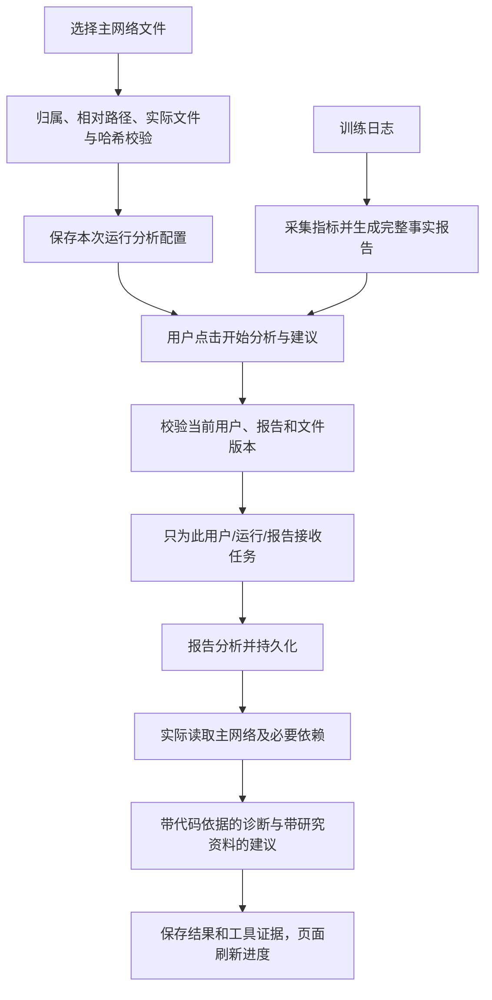

# 主网络选择与手动分析建议

日期：2026-10-30。

## 现在怎么使用

1. 新建“选择我的项目”训练配置：训练入口选择启动脚本，另外在“主网络代码（用于分析）”选择模型结构与 forward 所在的 Python 文件。两者职责不同，不互相替代。
2. 已有运行无需重新训练。在运行详情 → 分析与建议 → 主网络代码与手动分析，点击“选择主网络文件”，进入模型所在目录选择 .py 文件。选中后会实际只读检查文件并保存选择。
3. 等训练结束并完成指标采集、事实报告。页面会明确提示是否就绪、是否缺主网络文件。
4. 点击“开始分析与建议”，才使用当前用户已保存的模型 Key 处理这一次运行。只打开页面、选择文件、训练完成或采集指标不会触发模型请求。
5. 页面显示处理进度、报告分析、主网络代码诊断及有据研究建议。诊断逐条显示实际文件、行号、源码片段、原因判断、修改方向、适用条件和验证方式。

当前全局分析与建议 Worker 开关保持关闭；没有启动全局模型消费者，也没有把用户的自动处理偏好改为开启。设置页移除了自动开关，改为引导用户在运行页手动提交。旧的受控维护 CLI 仍可按原有显式命令使用。

## 流程与每个模块的作用

| 文件/模块 | 技术 | 职责 |
| --- | --- | --- |
| NetworkFilePicker.vue | Vue 3、TypeScript、Element Plus | 复用已有服务器项目目录和运行源码 API，浏览目录选择 .py，支持分页 |
| TrainingTaskForm.vue、TrainingTaskDetails.vue | Vue 3 | 将主网络路径与训练入口分开配置、展示 |
| RunAgents.vue | Vue 3、现有串行轮询 | 查询就绪状态，选择已有运行的主网络，只在按钮点击时提交任务；处理时禁用重复提交 |
| CodeFindingCard.vue | Vue 3 | 从后端实际保存的 code_evidence 中取对应行，显示代码片段与逐条解释，模型不能自行提供伪造片段 |
| source_code.py、source_code_service.py | Pydantic、asyncio、现有只读 SSH 通道 | 校验相对 .py 路径、运行归属和服务器绑定，读取文件及 SHA256；默认源码读取优先使用已选主网络 |
| run_network_repository.py | mysql-connector、MySQL 事务 | 保存用户/运行的主网络路径、SHA256 和选择时间，继续检查运行归属 |
| manual_analysis_routes.py | FastAPI、BackgroundTasks | GET 只查询；POST 明确授权后返回 202 并处理本次任务，不扫描其他用户队列 |
| manual_analysis_service.py | asyncio、现有 AnalysisService/SuggestionService | 检查完整终态报告，处理本次事件、失败重试和已完成去重，顺序执行报告分析及代码建议 |
| analysis_repository.py、suggestion_repository.py | MySQL 短事务、租约令牌 | 手动服务使用独立仓储实例，只授权当前用户、运行与事件；复用原有任务、续租、审计和结果存储，不修改全局偏好 |
| suggestion_service.py | 现有模型原生工具调用 | 先实际读取选定主网络首段并保存证据，占用同一轮工具额度；模型再按 next_line/哈希检查后续 forward 及依赖 |
| suggestion.py、suggestion_tools.py | Pydantic、证据校验 | 分开校验 code_findings 与研究 suggestions；聊天可查询已保存的代码诊断 |

没有新增第三方依赖，继续使用现有 DeepSeek/LangChain 网关、个人 Key 加密存储及按用户解密流程。

## 代码诊断与研究建议

- `code_findings`：必须引用报告中真实存在的事实路径和本轮实际读取的源码行。可输出代码检查结论或明确标为 hypothesis 的待验证推测，不强制论文引文。
- `suggestions`：研究架构/方法改进继续要求报告事实、实际代码和已读论文或官方资料正文，不能用搜索摘要或模型记忆代替。
- 没读到代码不会输出代码诊断；没取得论文不会伪造论文建议。证据不足仍显示具体局限。
- 输入是日志采集而来的事实报告，不声称逐字读完所有原始日志；源码也只是读取时的当前文件，不能据此证明它与历史训练的全部依赖完全相同。
- 主网络可能跨多个文件，工具可以继续读取必要依赖；每次最多读取 60 行，并保留实际读取范围和版本证据。不执行用户源码。

## 数据与旧记录兼容

新增 `run_network_sources`：run_id 为主键，保存 user_id、相对 path、file_sha256、selected_at。关联 `(run_id,user_id)` 外键，运行硬删除时级联删除本选择，服务器代码和权重不受影响。不在该表存储 API Key、SSH 密码或任意绝对根路径。

新任务的主网络路径进入原有项目配置和启动快照。字段未填写时从项目 spec 中省略，保留旧启动快照的规范 JSON 和摘要兼容性。

已有运行的补选是独立分析配置，不改写过去的启动快照。手动提交前再次核对文件版本，文件变更会要求重新选择，不静默混用版本。

原有指标/报告/分析/建议表继续使用。新增 code_findings 默认空列表，旧建议结果仍可读取。有完整结果的同一任务不覆盖、不再次调用模型；失败或仅有零建议的缺证据结果可通过显式提交重试。手动任务若因进程重启中断，可在租约失效后再次提交，旧令牌不能写回。

页面后台处理运行于当前 API 进程，任务和结果由既有 MySQL 租约机制保存；本次没有启动新的全局或全用户 Worker。

## 接口文档

所有接口均需 Bearer 登录，用户身份取自 token，不能通过请求体指定 user_id。

| 接口 | 用途 | 是否调用模型 |
| --- | --- | --- |
| POST /training-tasks | 项目配置中可提交 project.main_network，例如 models/network.py；仍不启动训练 | 否 |
| GET /runs/{run_id}/code/main-network | 返回 path、file_sha256、selected_at；未选择时 path=null | 否 |
| PUT /runs/{run_id}/code/main-network | 请求 `{ "path": "models/network.py" }`；实际检查文件后保存 | 否 |
| GET /runs/{run_id}/analysis-readiness | 返回 report_ready、main_network、processing、can_start、message | 否 |
| POST /runs/{run_id}/analysis/start | 无需请求体；202 返回 accepted 与就绪信息；accepted=true 后处理此运行 | 是，仅明确点击后 |
| GET /runs/{run_id}/analyses、/suggestions | 读取已保存结果；建议内容新增 code_findings | 否 |

主要状态：401 登录失效；404 记录不存在或不属于当前用户；409 报告/主网络尚未就绪、文件版本或绑定变化；422 格式不正确；502/504 远端读取失败/超时；503 存储等暂时不可用。详细底层异常仅写后端日志。

## 验证证据

- 后端相关回归与新增测试覆盖：当前用户/运行范围、GET 不触发模型、明确 POST 才排队、缺主网络拒绝、同一任务去重、租约及事件限定、源码只读与哈希、旧快照兼容、无论文的代码诊断及错误代码行拒绝。
- 前端 58 项测试通过，包括手动点击、处理状态禁用、未选主网络禁用、运行文件选择、实际代码行展示；TypeScript、ESLint、生产构建与 98 处 API 契约检查通过。
- `python -m scripts.verify_manual_analysis_mysql` 使用随机临时 MySQL 库和 HTTP：两种自动偏好关闭，选择主网络后手动触发，报告分析和代码诊断均保存成功；重复提交不新增模型调用，自动偏好保持关闭。
- 验证中的模型和 SSH 均为替身，未调用真实付费模型，未启动 GPU 训练，未处理其他用户的生产待办。
- 当前真实运行的事实报告已经就绪；主网络选择和就绪状态可由页面读取。真实模型能否返回还受其网络连接与 Key 状态影响，测试替身不证明外部模型当前可用。
