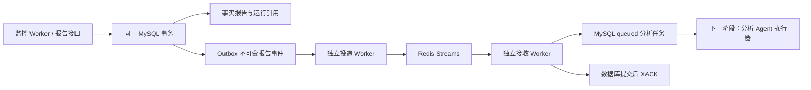

# Redis 事件通信与事务 Outbox 模块说明

日期：2026-10-27。项目：`E:\code\LangChian_New`。本阶段只做后端。

## 1. 现在做到哪里

Redis 已用于真实事件交付。监控生成完整终态训练报告后，独立进程通过 Streams 把报告事件送到分析任务 Inbox。当前接收器只创建 queued 任务，尚未执行独立大模型分析，也未实现建议 Agent；不能把通信完成说成分析已完成。

聊天 Agent 的工具循环、SSH 训练、MySQL 监控 Worker 仍沿用原有实现。本阶段没有把聊天原文、上下文或用户凭据迁移到 Redis，没有自动调用付费模型，也没有再次启动 PRNet。



## 2. 为什么保留 MySQL

报告与事件在同一个事务里提交，避免“报告成功，但事件发送失败后再也没人处理”。Redis 暂时不可用时，事件仍在 MySQL 中等待投递；Web 服务不需要等待 Redis 恢复才能提交报告。

Redis 只携带 schema_version=1 和 event_id，不携带报告正文、用户 Token、SSH 密码、模型 Key 或任意执行命令。接收器通过 event_id 读取 MySQL 中的真实用户、运行和报告版本，Redis 消息不能自己指定 user_id。

投递是至少一次，不承诺物理消息只出现一次。同一角色、同一事件用数据库唯一约束生成一个逻辑任务。报告新版本是新的事件和新的任务，旧版本的快照仍保留，不依赖 run_reports 当前内容。

## 3. 新增两张共享表

业务表由 25 张增至 27 张，仍然共享表并按 user_id 隔离。

### event_outbox

保存事件 ID、归属、run_id、报告版本、不可变报告 JSON 和摘要、投递状态、租约、重试时间及安全错误码。event_type + run_id + report_version 唯一；同一报告复用时不会重复创建事件。

报告生成事务同时保存报告、更新运行引用、插入 Outbox。任何一步失败全部回滚。只对 training 类型、schema 2、终态且 collection_complete=true 的报告入队。运行中或不完整报告不会触发分析任务。

状态流转：pending → sending → sent → received。错误退避后回到 pending；超过上限或快照异常进入 attention。received 表示 Inbox 提交成功，不代表模型分析完成。

### agent_tasks

保存 task_id、agent_name=analysis、源 event_id、报告版本、归属和 queued 状态。组合外键同时绑定事件、用户、运行、报告版本，防止串用户或串版本。agent_name + event_id 唯一，重复消息不能创建第二条任务。

当前没有大模型分析执行器，因此新任务保持 queued。running/succeeded/failed/attention 是后续执行层的状态空间，不是已完成的能力。

## 4. 模块分别负责什么

| 模块 | 职责 |
| --- | --- |
| app/models/event_bus.py | 不可变部署配置、Redis URL 隐藏 repr、参数校验、公开响应模型和领域异常 |
| app/config.py | 环境优先读取 Redis 连接、前缀、租约、等待与恢复参数，不返回给普通用户 |
| app/repositories/metric_repository.py | 报告事务内入队；复用完整旧报告时也可以补齐事件 |
| app/repositories/event_repository.py | SQL 行锁领取、租约栅栏、退避写回、持久 Inbox、本人查询与重投递 |
| app/services/redis_event_bus.py | XADD、消费组、pending 重领、XACK、隔离死信；兼容 Redis 5 |
| app/services/event_delivery_service.py | 投递及接收业务；数据库提交后才确认，不调用模型或训练工具 |
| app/workers/event_relay_worker.py | 独立投递进程，支持 --once，有界等待和循环失败恢复 |
| app/workers/analysis_event_worker.py | 独立接收进程，持久化 queued 任务，当前不是大模型分析器 |
| app/api/event_routes.py | 本人事件、任务查询及事件重排；不依赖 Redis 实时可用 |
| app/database.py | --event-bus-schema 增量建表；不会自动启动 Worker、Redis 或模型 |
| SQL 独立文件 | 参数化语句、组合外键、唯一键、行锁与 UTC 时间 |
| tests/test_event_bus.py | 配置、归属、快照、事务入队条件、重试、ACK 与安全响应 |
| scripts/_temporary_redis.py | 随机端口临时 Redis，PID 核对，只停止本脚本启动的进程 |
| scripts/verify_event_bus_mysql_redis.py | 真实 HTTP/MySQL/Redis 联调，随机临时库，禁止付费模型和训练 |

SQL 与配置由程序读取，接口不要求普通用户填写 SQL。

## 5. 消息丢失与重复如何处理

1. 报告事务回滚：报告引用和 Outbox 都不落库。
2. XADD 成功但投递者没来得及确认：租约到期后重发，Inbox 唯一键消除重复任务。
3. 消费者领取后退出：消息保留 pending，超过 idle 阈值由重建消费者领取。
4. Inbox 提交失败：不 XACK，消息等待恢复。
5. Inbox 成功但 XACK 丢失：重放时复用已有任务，再确认。
6. Redis Stream 丢失：已发送但没有 Inbox 的事件在到期后重新投递；已 received 的任务仍在 MySQL。
7. 接收者先于投递确认完成：received 撤销旧投递租约，旧令牌不能把状态写回 sent。
8. 无效消息：只把来源消息编号、固定原因和正文摘要放入死信，不复制原始字段或凭据。

没有自动 XTRIM/XDEL 正常事件，避免删除其他消费组仍需要的消息。事件、快照与 Streams 的保留归档策略需要在有完整消费确认规则后单独设计，当前会持续占用存储。

## 6. Redis 版本与技术栈

本机实际验收 Redis 5.0.14.1，Python 客户端固定 redis-py 6.4.0。XREADGROUP 自 Redis 5 提供；本阶段使用 XPENDING + XCLAIM 恢复消息，不依赖 Redis 6.2 才出现的 XAUTOCLAIM。

官方说明：[XREADGROUP](https://redis.io/docs/latest/commands/xreadgroup/)、[XAUTOCLAIM](https://redis.io/docs/latest/commands/xautoclaim/)。

FastAPI/Pydantic 负责 HTTP 与字段校验，mysql-connector-python 负责事务、唯一约束、组合外键、FOR UPDATE SKIP LOCKED；redis.asyncio 负责异步 Streams；asyncio.to_thread 调用同步仓储；hashlib/json 校验快照；uuid 为执行租约与任务提供编号。

新队列所有生产时间、到期时间均显式使用 UTC_TIMESTAMP(6)，避免 MySQL 本机时区导致任务延迟数小时。

## 7. 部署配置与启动

已有环境执行 requirements.txt 安装；本机只新增 redis==6.4.0，没有升级其他依赖或改动现有 Redis 服务。

```powershell
cd E:\code\LangChian_New
python -m app.database --event-bus-schema
```

配置项：

| 变量 | 默认 | 含义 |
| --- | --- | --- |
| REDIS_URL | redis://127.0.0.1:6379/0 | 部署级连接；有密码时在本机真实 .env 配置，特殊字符 URL 编码 |
| AGENT_EVENT_PREFIX | experiment_assistant | 本项目 Streams、消费组与死信的命名空间 |
| AGENT_EVENT_BLOCK_MS | 2000 | 等待新消息的有界时长 |
| AGENT_EVENT_RECLAIM_IDLE_MS | 60000 | 重新领取 pending 消息的闲置阈值 |
| AGENT_EVENT_LEASE_SECONDS | 30 | Outbox 投递租约 |
| AGENT_EVENT_MAX_FAILURES | 8 | 连续失败后 attention |
| AGENT_EVENT_RECONCILE_SECONDS | 60 | 已发送但未入 Inbox 的事件补偿间隔 |

Redis URL 含凭据时不能放在普通用户接口、示例文档、日志、命令行参数或版本库中。部署环境的 Redis 由维护者提供连接，不为每个聊天用户创建一个 Redis。

重启原 API 和监控 Worker，然后另开两个终端：

```powershell
python -m app.workers.event_relay_worker
```

```powershell
python -m app.workers.analysis_event_worker
```

可添加 --once 验证最多一步；它不等于完成全部积压任务。进程不会因 API 导入自动启动。本阶段未设置系统开机自启或长期无人值守进程。

本机已有 Redis 开启了密码认证，又不希望把密码落盘时，可以分别运行：

```powershell
python -m app.workers.event_relay_worker --prompt-redis-password
python -m app.workers.analysis_event_worker --prompt-redis-password
```

两个命令应在不同终端运行，各自输入 Redis 密码，输入不回显，只在本次进程内使用；不是 MySQL、SSH 或模型 Key。不要把密码作为命令行参数粘贴。实际 .env 本阶段没有修改。

当前执行顺序是 API / 监控 → Outbox 投递 → 分析事件接收；后端完成后再做前端。后续新增建议 Agent 应使用独立消费组；同角色多个实例共享同一组做负载分担。Redis 本身不会让几个模型自动开始讨论。

## 8. 已验证与尚未实现

已通过 1,101 项单元测试、新增 15 组真实 HTTP/MySQL/Redis 验收，及监控 12 组、指标报告 10 组、容量 8 组回归。临时数据库和临时 Redis 进程已清理，现有 Redis 数据未清空或修改配置。

尚未实现独立大模型分析执行器、建议 Agent、Skill、PDF/向量 RAG、自动修改研究代码、Redis 聊天缓存和前端。不能用 queued / received 作为这些功能已完成的证据。

接口测试步骤见 [Redis事件通信接口与验收说明](Redis事件通信接口与验收说明.md)。逐文件清单见 [Redis事件通信阶段文件变更清单](Redis事件通信阶段文件变更清单.md)。
