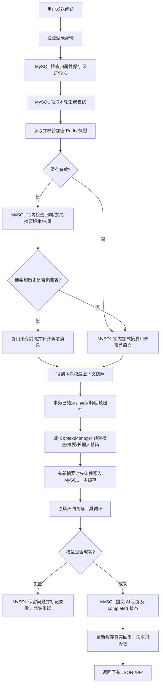

# Redis 聊天上下文缓存：模块、技术栈与完整流程

日期：2026-10-27。项目：`E:\code\LangChian_New`。

## 1. 本阶段完成什么

聊天读取上下文时，优先使用 Redis 中的历史快照；缓存不存在、过期、损坏或不可用时从 MySQL 加载。用户原文、模型回复、摘要、轮次状态仍及时写入 MySQL。Redis 不承担唯一存储职责，不需要等缓存过期才保存聊天。

缓存保存的是“当前摘要 + 尚未被摘要覆盖的真实原文”，不是所有历史永远累积，也不是固定只缓存四轮。何时摘要、保留最近几轮仍由原有 ContextManager 的预算和 keep_recent_turns 控制。48K 输入预算、长输入精简、消息缺口标注、本人 Key、聊天 Tool 和失败重试逻辑均保留。

独立分析 Agent 尚未实现；本阶段缓存与 Agent 事件队列是 Redis 的两种不同用途。

## 2. 为什么命中缓存仍然查询 MySQL

缓存存在不代表当前用户有权访问，也不代表生成租约有效或摘要没有更新。正式聊天仍在 MySQL 短事务里验证归属、当前尝试、摘要版本与边界、真实末尾序号。

命中时不再读取整段摘要正文和历史：

1. 缓存尾部与数据库相同、摘要版本相同：复用缓存正文。
2. 数据库只追加了新消息：只查询 `seq > 缓存 tail_seq` 的增量，然后拼接。
3. 摘要版本或覆盖范围改变，或者数据库尾部变小：重新读取权威快照。

因此本阶段减少的是重复历史传输和正文读取，不是完全取消数据库访问，也不能保证模型生成回复的耗时明显缩短。尚未做生产容量和吞吐量基准测试。

## 3. 完整流程



没有数据库事务跨 Redis 或模型网络请求。缓存写入失败不会回滚已成功提交的聊天，也不会触发再次调用模型。

## 4. 一个多轮例子

第一轮完成后：MySQL 有 seq=1 的 human 和 seq=2 的 ai；Redis 保存到 tail_seq=2。

第二轮：start_turn 先把新问题保存为 seq=3。缓存仍到 2，仓储在锁内确认摘要没有改变后，只读取 seq>2 的一条新问题。模型返回后 complete_turn 保存 seq=4 的 ai，再缓存到 4。

模型超时时：human 已经保存，缓存也可能保存到奇数末尾；重试领取同一个未完成轮次，检查新 attempt，不重复保存“继续”或再创建一条问题。

工具调用过程中临时生成的 tool 消息不直接放入这份聊天缓存。只有 MySQL 已保存的真实 human/ai 和已提交摘要才进入缓存。

## 5. Redis 键和字段

键：`experiment_assistant:chat-context:v1:{user_id}:{session_id}`。类型：Hash。

| Hash 字段 | 含义 |
| --- | --- |
| version | 摘要版本，固定 20 位十进制字符串；无摘要为 0 |
| tail_seq | 快照最后一条消息的真实 seq，同样固定 20 位 |
| payload | Fernet 加密并认证的 JSON 正文 |

这里使用 `(摘要版本, 消息末尾)` 共同判断进度，不新增“每次消息都递增”的数据库列。与上阶段事件 schema_version、report_version、event_id 没有混用。

解密后示例（Redis 中看不到这里的明文）：

```json
{
  "schema_version": 1,
  "user_id": 7,
  "session_id": "b4c4e67554ee4c1981740a1e901ec614",
  "tail_seq": 6,
  "summary": {
    "content": "已确认的任务背景和限制",
    "summarized_until_seq": 4,
    "version": 1,
    "missing_ranges": []
  },
  "messages": [
    {"seq": 5, "role": "human", "content": "当前问题"},
    {"seq": 6, "role": "ai", "content": "已保存的回复"}
  ]
}
```

序列化器校验归属、字段、版本、真实序号、角色、正文、摘要边界、缺口和条目大小。内容不一致时不将其直接发给模型。缺失 seq 可以保留，不伪造 AI 回复。

摘要正文和消息使用已有 MODEL_CREDENTIAL_ENCRYPTION_KEY 派生专用缓存密钥，派生用途与凭据加密隔离；不生成、不替换、不落盘新主密钥。跨用户复制密文也会因正文归属校验失败而退回 MySQL。

## 6. 过期、并发和删除

默认 TTL 为 604800 秒，即 7 天（配置范围 60～604800 秒）。经数据库校验后回填、保存摘要后更新、保存回复后更新都会重新设置 TTL。仅仅读取到 Redis 内容不会绕过数据库检查直接续期。

写缓存使用 Redis Lua 原子比较：摘要版本或末尾任意一个倒退都拒绝。字符串固定 20 位，避免 Lua 浮点数在超过 2^53 的整数上失去精度。

删除本人会话时先完成原 MySQL 删除事务，随后原子删除缓存正文并保留短期 `deleted=1` 墓碑。墓碑阻止仍在进行的旧填充请求把正文重新写回来。墓碑也会过期，不是永久记录。

Redis 恰好不可用时，删除数据库成功仍返回成功，缓存删除失败记脱敏日志；残留加密条目由 TTL 清理。任何后续请求必须检查 MySQL，会话已经删除就无法再调用模型或返回历史。不能声称 Redis 故障期间也能立即物理清除其中的数据。

当前业务消息为追加模式，删除是整个会话删除。直接在数据库执行 SQL 修改旧消息、只删中间消息、恢复旧备份，不属于当前受支持的消息编辑流程；维护后应清理该项目上下文键或更换缓存前缀。如果后续新增消息编辑/局部删除接口，需要引入相应内容版本和失效机制，不能只看末尾序号。

## 7. Redis 故障如何降级

连接和命令各设 0.3 秒超时，关闭自动重试；连接池最多 16 个连接。网络/认证错误暂时熔断本进程缓存操作，默认 10 秒后重新尝试，正常聊天走原 MySQL 路径。超大条目只跳过缓存，不因此拒绝用户提问，也不熔断其他会话。

缓存不是鉴权替代品：MySQL 故障仍按原接口安全报错，不能拿未经校验的旧缓存继续回答。模型失败仍保留待回复问题，不能伪造成功。

Redis 中事件 Stream 与上下文键互不覆盖：

| 用途 | 键 | 可否按 TTL 丢弃 |
| --- | --- | --- |
| 聊天上下文 | `experiment_assistant:chat-context:v1:...` | 可以，MySQL 可恢复 |
| Agent 事件流 | `experiment_assistant:agent-events` | 不按聊天 TTL 清理 |
| 分析消费者组 | `experiment_assistant:analysis-dispatch` | 是 Stream 的组元数据，不是聊天缓存 |
| 事件死信 | `experiment_assistant:agent-events-dead` | 不按聊天 TTL 清理 |

## 8. 每个模块与包负责什么

| 文件 | 责任与调用关系 |
| --- | --- |
| app/models/context_cache.py | dataclass 配置、严格 JSON 编解码、ContextSnapshot/ContextMessage/ContextSummary 转换、大小限制；不访问网络 |
| app/services/redis_context_cache.py | 同步 redis 客户端连接池、专用 Fernet 密钥派生、读写、Lua 单调更新、删除墓碑、超时和熔断；不保存 MySQL 数据、不调用模型 |
| sql/load_context_marker.sql | 在本人会话内只查询摘要 version 和覆盖边界，不重复查询正文 |
| app/repositories/context_repository.py | 原 load_context/save_summary 保留；新增 reconcile_context，在短事务内验证权限与任务，复用缓存前缀并读取增量 |
| app/services/context_service.py | 用 asyncio.to_thread 调用缓存/同步仓储，选择全量或增量；摘要先提交再缓存；记录本次准备快照用于提交回复后的缓存更新 |
| app/services/chat_context_factory.py | 每次生成尝试创建新的 ContextService 和管理器，注入共享缓存协作者，保留每次模型调用前的 attempt 校验 |
| app/services/user_chat_service.py | 为当前用户创建个人网关，将缓存传入本轮工厂，最后关闭网关 |
| app/services/chat_service.py | start/claim/模型/complete 原流程；complete_turn 成功后才缓存真实 AI 回复 |
| app/services/chat_session_service.py | 删除成功后清理缓存并写墓碑；越权删除不会清理别人的缓存 |
| app/api/dependencies.py | lru_cache 复用缓存配置和线程安全连接池，不缓存当前用户、Token 或个人查询结果；构造时不连接 Redis |
| app/config.py | 从部署环境或本地 .env 读取配置，参数严格校验，不从普通用户接口接收 Redis 密码 |
| app/main.py | HTTP 路由保持原样，lifespan 退出时关闭已经创建的缓存连接池 |
| app/serve.py | 可选开发启动入口，隐藏输入 Redis 密码，仅放在本次进程环境中启动 Uvicorn，不写 .env |
| tests/test_redis_context_cache.py | 模拟依赖验证编解码、归属、增量、提交顺序、版本冲突、缓存降级与删除 |
| scripts/verify_context_cache_mysql_redis.py | 真实 HTTP + 随机临时 MySQL + 独立临时 Redis 验收；网关全部为替身 |

| 技术栈/包 | 这里的作用 |
| --- | --- |
| FastAPI / Uvicorn | 保持已有 HTTP 接口与登录依赖，运行 API、管理退出资源 |
| mysql-connector-python | 同步参数化 SQL、事务、会话行锁；持久化仍由它完成 |
| redis 6.4.0 客户端 | 同步 Redis 连接池、Hash、EVAL、TTL；已在 Redis 服务 5.0.14.1 上验证 |
| asyncio | to_thread 将同步 MySQL/Redis 工作放入线程，避免阻塞事件循环；不是在 event loop 内直接做同步网络调用 |
| cryptography | Fernet 对缓存正文加密并认证；主密钥从现有部署配置取得 |
| hashlib / hmac / base64 | 从主密钥派生缓存专用密钥，用途隔离；不是把用户密码当作加密密钥 |
| json / dataclasses | 严格消息格式与配置对象 |
| threading / time | 线程安全连接初始化、熔断时钟；不使用全局列表存用户历史 |
| python-dotenv / os | 部署环境优先的配置加载 |
| logging | 记录命中/未命中、delta/reload/unchanged、降级类型，不记录正文、密码、Token、Key、连接 URL |
| unittest / TestClient | 模拟单元检查和真实 API 联调；真实供应商模型被明确替换 |

本阶段不新增依赖、不新增 MySQL 表、不改变已有 HTTP 请求和响应字段。MySQL 仍为 27 张共享业务表，前端无需传缓存版本或 Redis 连接参数。

## 9. 后续边界

仍需独立分析执行器、建议 Agent、RAG/Skill、生产部署与容量验收。Redis 事件交付不等于模型分析已完成；聊天缓存也不等于有了流式输出。目前 HTTP 仍返回完整 JSON，没有新增 SSE/WebSocket。

启动与 Swagger 验证见 [Redis聊天缓存启动与接口验证说明](Redis聊天缓存启动与接口验证说明.md)；全部文件见 [Redis聊天缓存阶段文件变更清单](Redis聊天缓存阶段文件变更清单.md)。
