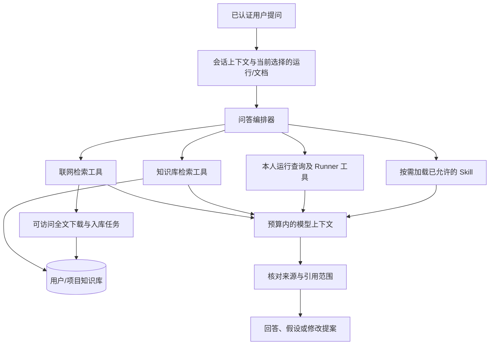

# Skill、论文 RAG 与训练工具接入规划

日期：2026-10-25。本文是后续设计，本阶段没有实现 Skill 加载器、论文下载器或 RAG 服务。

## 1. 你的方向是否合理

合理。用户上传的论文，以及系统实际联网检索后取得的论文，都可以进入同一套知识入库流程；随后在正常问答、论文对比和训练建议中按需检索。两种入口可以共用，不需要二选一。

Skill 可以先理解为“专门任务的说明和步骤”，但完整形态还可以包含元数据、示例、参考材料和脚本。其格式和按需加载思路可参考 [Agent Skills 官方规范](https://github.com/agentskills/agentskills/blob/main/docs/specification.mdx)。脚本资源的存在不等于允许直接执行，执行权限仍由后端工具控制。

以下是适合当前项目的应用设计，并非声称已经安装对应框架。当前无需更换 DeepSeek 聊天网关，也不需要一次引入完整多 Agent 框架。

## 2. 四部分各自解决什么

| 部分 | 负责什么 | 例子 |
| --- | --- | --- |
| 会话上下文 | 理解这次聊天在讨论什么 | “这个学习率”指哪一轮提到的值；保留最近对话与较早摘要 |
| Skill | 指导如何完成一类任务 | 分析训练先看数据和配置、再看指标、最后给出待验证假设与对照方案 |
| RAG | 从外部资料中找可引用事实 | 找到某篇论文某页对学习率预热的描述 |
| Tool/Runner | 实际查询或执行 | 查询最近 run、读取日志、启动已登记脚本和停止运行 |

“你是谁/你好”一般直接聊天；“这篇论文的方法是什么”查知识库；“最近训练为什么异常”先查本人运行与日志，再按需要查论文；“按这个配置再跑一次”才进入有明确执行意图的训练工具。不能让每轮聊天都搜索论文、加载全部 Skill 或自动训练。

## 3. 统一问答入口与按需路由



工具调用由编排器判断，鉴权、参数约束、次数和预算由后端固定执行。先用一个主编排器加几个清晰工具即可；监控、分析、建议可在状态和证据协议成熟后拆成独立 Agent。

“这个/上次/那个方法”先结合最近原文、摘要、选中的论文或 run 改写为明确检索问题。仍有多个可能指代时再澄清；RAG 不能凭空解决未明确的指代。原始问题保留，改写仅作为检索输入，不能悄悄改变用户任务。

## 4. 论文入库：两个入口，同一条处理链

```text
用户上传 PDF ─────────────┐
                         ├→ 校验/去重 → 保存原件和来源 → 提取正文及页码
实际联网搜索 → 选定资料 ──┘   → 分块 → 建索引 → 标记 ready → 可检索
```

联网搜索先返回标题、作者、年份、DOI/论文编号及来源 URL，再按问题相关性挑选少量资料；不批量下载所有搜索命中。只获取实际可访问、允许使用的全文，无法获取就保留元数据/摘要，并明确“未读全文”。不绕过登录、付费或访问限制。PDF 获取后也必须完成解析、索引，不能“下载成功”就声称读完论文。

下载器独立控制目标、重定向、文件类型、单文件/总字节、超时和数量，拒绝指向内网服务及本地文件的任意 URL；不允许网页内容要求执行命令。网络、解析和索引放后台任务，不占住整次聊天请求。可用 MySQL 任务记录起步，将来使用 Redis Streams 时保留相同任务 ID、幂等和重试协议。

文档状态明确为 uploaded/downloading/parsing/indexing/ready/failed 等；相同字节内容使用 SHA256 去重，去重不能跨用户泄露私有文档是否存在。失败保留可重试状态，不把只有文件名的记录当作可回答正文的资料。

## 5. RAG 问答具体怎么做

1. 当前用户、项目、所选文档与版本先确定检索范围；权限条件必须进入检索请求，不能只在最终回答时过滤。
2. 使用明确问题检索相关段落。先建立关键词检索基线，再用召回测试决定是否加入向量检索和重排；RAG 并不要求第一天就安装向量数据库。
3. 每个结果携带 doc_id、版本、chunk_id、页码/章节、原文片段及来源，不只返回一段无出处文字。
4. 取少量相关段落，结合邻近段落、表格说明及当前实验设置，放入有界的证据包。
5. 模型回答使用证据编号，后端核对编号确实属于本次检索结果，再生成可点击来源和页码。编号存在不等于结论被证明，仍需检查片段是否支持该论断。
6. 没有支持材料、仅有摘要、多个来源冲突或解析缺失时如实说明，不补造引用和数值。

例如回答“论文 A 的方法在第 6 页说明了 X；你的 run B 在 epoch 8～10 出现 Y；二者实验设置在 Z 方面不同。因此可先验证假设 H，暂不能认定 H 已成立”。不能从“论文提到 dropout”直接推导“当前训练变差一定是 dropout 导致”。

Embedding 是独立的文本向量编码能力，不能把聊天生成接口直接当作向量接口。后续选择适用的本地或用户自带配置的模型，并保存 embedding_model、维度和索引版本；更换编码模型需要重新建索引，不混用不同向量空间。不自动下载大模型、购买向量服务或产生收费调用。

## 6. Skill 如何动态接入

建议将第一版 Skill 设计为部署者维护的版本化包：

```text
skills/
  training_analysis/
    SKILL.md
    references/metric_checklist.md
    assets/report_template.md
```

先加载名称、简短说明和适用任务；命中训练分析时才读取相应正文，需要具体检查清单时再加载引用文件。用户可以显式选择允许的 Skill，也可以由编排器在允许列表里建议选择。

建议的首批 Skill：training_analysis（事实/假设/验证）、paper_comparison（比较任务设置与证据范围）、experiment_planning（基线和对照）、result_reporting（统一报告格式）。当前先规划，不创建或安装外部包。

每次执行固定 skill_id、version、内容哈希、加载资源和允许工具，记录在调用事件/报告中，以便复现。新版本对新请求生效，正在执行的任务继续使用固定版本；不能在缓存的全局提示词列表中追加某个用户的资料，否则会造成串用户和重复累积。

实际工具权限是部署策略、当前用户权限和 Skill 允许范围的交集。Skill 里的“启动训练”只是流程指令，不能越过 Token、服务器归属、脚本注册和 Runner 幂等校验。上传论文和网页属于资料，不能通过写入类似 SKILL.md 的内容自动获得系统指令权限。

以后如果支持用户自定义 Skill，先限定为有归属、有版本的指令和参考材料；携带可执行脚本的外部包需要另行做隔离和发布管理，不能上传即运行。

## 7. 接入现有上下文管理的位置

现有 ContextService 继续负责聊天摘要和最近对话。新增 ContextAssembler 负责把系统规则、当前问题、少量 Skill、最近历史、工具结果和检索证据统一计入预算，再交给个人模型网关。

历史摘要不能成为论文证据的唯一来源：原文片段和引用保持独立持久化，聊天摘要只保存“讨论过哪个文档/运行”的引用。检索包变大时，优先减少不相关命中或整块裁剪，不能截掉出处后保留结论。Skill 文本和工具描述也消耗 token，必须计入完整请求预算。

不要每个问题都把知识库重新摘要一遍。入库时建立稳定索引，提问时检索相关片段；只有用户明确要求全文综述或跨文档综合，才做有界的分批阅读与聚合。

## 8. 建议的模块和数据结构（尚未创建）

| 模块 | 责任 |
| --- | --- |
| ChatOrchestrator | 选择普通回答、训练工具、资料检索和 Skill，执行次数和预算约束 |
| SkillRegistry / SkillLoader | 归属、版本、元数据、按需加载与固定快照 |
| ResearchSearchService | 真正联网搜索及来源元数据，不上传完整私密训练日志 |
| DocumentIngestionService | 上传/下载、字节预算、解析、分块和索引任务状态 |
| KnowledgeRepository / Retriever | 共享表持久化、本人/项目权限过滤与段落召回 |
| EvidenceService | 文献片段、训练日志位置和指标引用的可追溯记录 |
| ContextAssembler | 在既有上下文基础上加入预算内 Skill 与证据 |
| RecommendationService | 输出观察、来源、适用差异、假设、修改提案和验证方案 |

MySQL 继续使用共享表，例如 knowledge_documents、document_chunks、ingestion_jobs、evidence_records、skill_versions、chat_resource_links；包含 owner/project 关系和引用版本，不为每个用户建表。原始 PDF 放受控文件/对象存储；数据库保存引用和元数据。向量索引只是派生数据，应能从授权文档重新构建，不能成为唯一资料存储。

新会话可以在用户权限范围内选择以前上传的文档，也可以查最近训练。跨会话可用来自持久化知识库和 run，不依赖旧聊天文本碰巧还在上下文中。

## 9. 实施顺序与验收

1. Runner 与基础状态/日志（本阶段完成本地验证，真实 Linux 待验收）。
2. 结构化训练指标和事实报告基础已于 2026-10-26 完成本地验证，见 [训练指标采集与事实报告说明](训练指标采集与事实报告说明.md)；接着接入只读模型工具，打通最近训练的结果问答。
3. 一个最小 Skill 注册/加载器，先接训练分析流程；无外部脚本自动执行。
4. 用户上传一篇 PDF 的解析、分块、权限检索及带页码回答。
5. 实际联网检索和有限全文入库，复用同一条 RAG 管道。
6. 混合召回/重排、跨论文分析、有证据的修改提案与验证运行；按实际吞吐需求接 Redis 和独立 Agent。

验收关注：跨用户资料绝不命中；引用能回到原文页码；无证据时不编造；删除/撤销文档权限后缓存与索引同步失效；相同文档重复提交不重复建有效版本；Skill 越权指令不能绕过 Runner；引用错误和解析失败可定位；测试使用微型本地数据与假模型，不产生收费调用。
