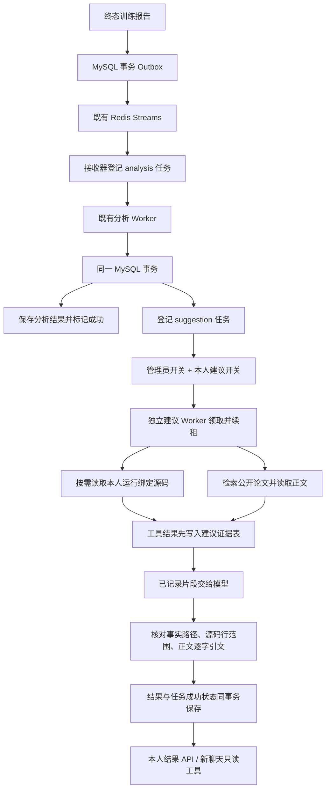

# 修改建议 Agent：模块、技术栈与证据流程

日期：2026-10-28。项目根目录：`E:\code\LangChian_New`。本阶段完成独立建议任务的登记、执行、证据保存、结果查询、显式恢复和聊天读取。

当前共 32 张共享业务表、50 条接口路径、62 个 HTTP 操作。新增三张建议表；没有新增 Python 依赖、Redis Stream 或通用 Agent 框架。源码修改、重新训练、PDF/向量 RAG 和动态 Skill 不在本阶段。

## 1. 完整流程

分析到建议的第二段交接直接复用 MySQL `agent_tasks`：分析结果、分析成功状态和建议任务在同一事务提交。交接失败则上游结果和成功状态一起回滚，原任务可恢复。没有额外发布 `analysis.completed` Redis 事件，也没有声称 Redis 正文在 Agent 间传输完整上下文。

Redis 仍承担报告事件投递和已有聊天缓存；它不是建议结果的唯一存储。建议 Worker 读取持久任务，因此重启不依赖某个 Python 列表仍在内存。

## 2. 两个 Agent 分别负责什么

| 阶段 | 输入 | 工作 | 输出 |
| --- | --- | --- | --- |
| analysis | 固定版本的事实报告 | 区分事实、待验证推断、实验验证方向和信息缺口 | 原有 analysis_results |
| suggestion | 已保存分析及同一报告版本 | 按需检查源码、检索资料、逐字引用正文，形成具体修改方案 | suggestion_results 和 suggestion_evidence |

建议 Agent 不把上游推断当作已经证实的原因。每条建议的 problem 对应观察事实，hypothesis 明确作为待验证解释，validation 描述对照实验和判断条件。

迁移会为已有成功分析补登记 queued 建议任务，不生成建议，也不开启调用。唯一键 `(agent_name, event_id)` 防止重复登记同一报告版本。启用本人建议开关后，Worker 可以处理这些历史任务。

## 3. 每个 Python 模块与使用的包

| 模块 | 职责 | 主要技术/包 |
| --- | --- | --- |
| app/models/suggestion.py | 配置、输出 Schema、三类证据契约、引用及保存内容校验 | Pydantic、dataclasses、hashlib（经既有内容摘要函数）、re、uuid |
| app/services/suggestion_service.py | 单个任务的模型工具循环；绑定运行、控制次数/预算、先审计后提供片段 | asyncio、既有 ModelGateway、源码服务和公开资料客户端 |
| app/repositories/suggestion_repository.py | 建议阶段 SQL、工具证据、证据不足重试；复用分析仓储租约生命周期 | mysql-connector、参数化 SQL、事务 |
| app/workers/suggestion_worker.py | 独立常驻或单次执行入口，组装个人网关和只读协作者 | argparse、asyncio、functools.partial；复用现有 Worker 轮询 |
| app/api/suggestion_routes.py | 本人开关、任务、结果、工具证据和恢复接口 | FastAPI、Depends、Query、UUID |
| app/models/suggestion_tools.py | 聊天 get_run_suggestions 参数和有界结果展示 | Pydantic、既有工具契约 |
| app/repositories/analysis_repository.py | 分析成功时事务登记下一阶段；提供可复用的内容校验/重试衔接点 | 既有仓储事务 |
| app/services/analysis_service.py | 复用领取、心跳、超时、取消、失败分类和提交生命周期 | asyncio.create_task / wait / timeout |
| app/config.py | 加载建议执行配置，默认关闭 | os、python-dotenv |
| app/database.py | 增量迁移，扩展任务类型、建三张表并补登记旧任务 | MySQL DDL、information_schema |
| app/api/dependencies.py | 查询服务的依赖组装；聊天仅配置结果读取工厂 | lru_cache、依赖注入 |
| app/services/read_only_chat_service.py | 聊天读取保存的建议，并保存聊天工具调用审计 | 既有只读工具循环 |
| app/main.py | 将新 router 挂到 FastAPI 应用 | FastAPI.include_router |

FastAPI 负责 HTTP 请求，Pydantic 校验结构，MySQL 保留任务与证据，AsyncSSH 通过既有源码服务读取服务器文件，httpx 通过既有 PublicResearchClient 读取允许的公开 HTML，LangChain/DeepSeek 通过既有 ModelGateway 调用个人模型。

## 4. HTTP 身份校验如何流转

以 `GET /runs/{run_id}/suggestions` 为例：

1. `main.py` 中的 `app.include_router(suggestion_router)` 挂载接口。
2. `Depends(require_current_user)` 提取 Bearer Token，验证登录会话是否有效，取得当前用户。请求不能自行指定 user_id。
3. `Depends(get_suggestion_service)` 组装查询服务与仓储；此工厂不构造模型、SSH 或论文客户端。
4. 路由将当前用户 ID、规范化 run_id 交给 `service.results`。
5. Service 用 `await asyncio.to_thread(...)` 将同步 MySQL 操作移到线程，避免阻塞事件循环。
6. 仓储先检查运行归属，再联查对应阶段的成功任务和结果；核对内容摘要、上游分析、事实路径与证据引用。
7. 响应模型过滤公开字段，成功响应设置 `Cache-Control: no-store`。

任务详情和 evidence 接口同时限定 user_id、run_id、task_id 与 agent_name。不能拿 analysis 的 task_id 当作 suggestion 任务查询，其他用户访问返回 404。

## 5. 模型能调用哪些工具

建议 Agent 只提供四个工具：

| 工具 | 功能 |
| --- | --- |
| list_project_files | 列出当前任务所绑定项目的一个目录 |
| read_project_file | 按完整行读取当前任务项目的源码 |
| search_references | 使用公开研究关键词检索 arXiv 候选论文 |
| read_reference | 读取本次候选来源或允许的公开 HTML URL |

根目录、服务器身份和运行来自任务的不可变绑定，不接受模型指定另一个运行或远程命令。源码继续使用上一阶段的路径、符号链接、凭据模式、文件大小和 SSH 主机指纹校验。

一次尝试最多 8 次工具调用。最多允许 48 KiB 的 UTF-8 预算刻度作为输入；这是沿用当前项目的保守字节估算，并非 DeepSeek 精确 tokenizer。输出上限 4,096，单次模型默认超时 60 秒，总任务默认 600 秒，工具调用另有 40 秒上限。

每个网络结果返回后，先在短事务中核对租约和本人开关，再写工具审计；提交成功后才进入下一次模型上下文。网络等待期间不占数据库事务。

同一尝试中同一文件后续分页自动使用已读版本，并在返回后核对实际路径对应的 SHA-256，避免默认入口别名导致混合版本。不同文件的读取不是完整项目原子快照。

## 6. 每条建议必须有三类依据

| 依据 | 保存与校验 |
| --- | --- |
| 分析事实 | evidence_paths 必须属于已保存分析实际 facts；保留报告版本、摘要和上游分析 task_id |
| 源码 | code_N 必须来自本次成功提供的片段；引用起止行必须落在实际返回范围内 |
| 论文/官方正文 | paper_N 必须来自本次已读正文；quote 必须逐字存在于提供给模型的片段中 |

每条建议包含 problem、hypothesis、change、conditions、validation、evidence_paths、code、papers。代码证据保存路径、实际完整行、文件版本、读取时间和登记入口匹配信息。论文证据保存 URL、类型、正文片段、字符起点、来源内容摘要和读取时间。

搜索摘要只能发现候选来源，不能作为修改实现的正文依据。读取不到源码或正文时，由程序返回零建议和明确局限，`evidence_status=insufficient`；不能靠模型文字补造成功。已有两类片段但模型引用了不存在的事实、行号或引文时，任务进入 attention，不保存伪造建议。

`supported` 只表示建议通过当前结构和引用存在性检查，不表示引用相关性、假设因果或改动效果已被证明。当前源码不保证与训练时所有依赖一致；`training_entry_match` 只比较登记的单个入口。

## 7. 三张新增表分别存什么

| 表 | 内容 | 为什么需要 |
| --- | --- | --- |
| suggestion_preferences | 每个用户的独立建议开关，缺失视为关闭 | 分析授权与读代码/检索/生成建议授权分开 |
| suggestion_results | 每个建议任务的结构化结果、证据快照、模型标识和内容摘要 | 跨聊天、重启后查询；不依赖原聊天仍存在 |
| suggestion_evidence | 每次尝试的工具名、合法参数、实际返回结果、时间 | 失败可排查，模型使用材料可追溯 |

任务继续使用 `agent_tasks`，agent_name 新增 suggestion。事件仍引用原 `training.report_ready` 快照，因此没有重复复制一套报告事件表。

SQL 文件按职责分为：建表/约束与历史补登记、领取与续租、上游分析/结果联查、证据写入/读取、证据不足的显式恢复。所有业务参数通过 SQL 占位符传入。完整逐文件清单见 [文件变更清单](修改建议Agent阶段文件变更清单.md)。

## 8. 状态、恢复和日志

| 状态 | 含义 |
| --- | --- |
| queued | 已登记，可能尚未启用开关或 Worker 未运行 |
| running | 正在读取资料或调用模型，持有有时限的租约 |
| succeeded + supported | 已保存具体建议，但尚未执行代码修改 |
| succeeded + insufficient | 已完成证据检查，保存了信息缺口，零条建议 |
| failed / attention | 超时、凭据不可用、模型格式/引用错误或执行中断，具体看安全错误码 |

默认需要管理员进程开关与本人开关同时开启。开关关闭后不领取新任务，续租和最终提交继续检查本人授权。旧租约不能保存结果；Worker 退出或取消会尝试记录可恢复状态并关闭模型客户端。

显式 retry 可以恢复失败、attention 或证据不足的结果。证据不足重试会在同一事务中清除旧的零建议诊断并重新排队；原始工具审计保留。已保存具体建议的成功结果不允许覆盖，也不自动重复调用模型。

evidence 接口返回最近 24 条工具记录，按时间展示，并给这批记录内的尝试分组编号；编号不是跨所有历史尝试的永久 ID。不会返回租约令牌。底层记录继续保留，接口不是全部历史导出。

业务日志沿用现有 request_id、模块/行号、task_id/run_id、异常链和安全错误码。生命周期复用 analysis_service.py，事件名称区分 suggestion_started / suggestion_succeeded / suggestion_attention。工具正文保存在证据表，不写入通用日志。

## 9. 新聊天如何读取

聊天新增可选工具 `get_run_suggestions`，复用当前登录用户和运行归属检查。overview 返回数量、证据状态、局限和旧报告标记；suggestions 每次返回一条预览及实际引用位置。完整结果通过建议 API 查看。

查询已保存建议不触发后台生成、不连接 SSH、不重新检索，不需要后台 Worker 开着。新聊天仍使用本人 Key 生成自然语言回复；直接 GET 已存结果不需要个人模型 Key。

报告版本或运行状态变化时 `is_stale=true`；已存片段仍是当次材料。该标记不是实时检查远端代码或网页是否改变，当前代码需要再次通过源码工具读取。

## 10. 验证和边界

专项测试覆盖三类引用、摘要拒绝、伪造行号/引文、文件版本、审计失败、关闭开关、取消、只读工具和查询不触发生成。HTTP/MySQL 验证使用随机临时库、模拟模型、源码和论文，不启动训练或调用付费模型；验证事务交接、重复迁移、旧约束升级、跨用户/阶段隔离、两领取者、恢复、聊天读取和日志脱敏。

既有真实 PRNet SSH/Linux 源码读取验证仍适用于复用的源码服务。本阶段没有用真实供应商评估建议质量，也没有声称已经完成真实论文相关性评测、自动修改、GPU 对照训练或 Kubernetes 部署验收。

测试结果数量与逐文件清单见 [阶段文件变更清单](修改建议Agent阶段文件变更清单.md)。接口操作见 [Swagger 验证说明](修改建议Agent接口与Swagger验证说明.md)。
