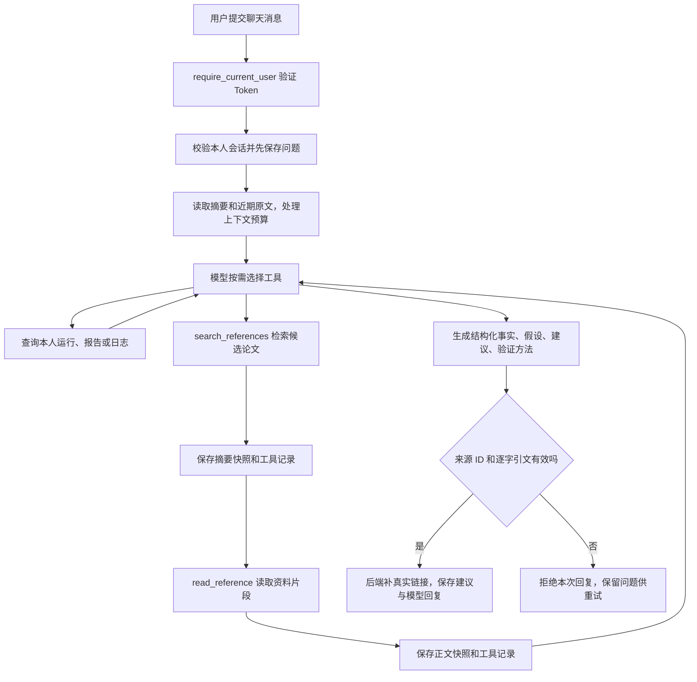

# 公开论文检索与有依据训练建议

日期：2026-10-26。项目：`E:\code\LangChian_New`。

本阶段接通的是：**聊天按需查训练 → 检索公开论文 → 读取有限资料片段 → 校验来源和引文 → 保存建议**。

完整新增/修改文件记录见 [本阶段文件变更清单](公开研究建议阶段文件变更清单.md)。总体分层见 [系统架构](系统总体架构图与模块分层说明.md)。

## 1. 现在能做什么

普通聊天可以直接回答。需要了解训练时，模型仍通过既有三个只读工具读取本人最近运行、已有报告、有限日志；需要文献依据时，再调用两个新工具：

| 工具 | 做什么 | 不代表什么 |
| --- | --- | --- |
| `search_references` | 用公开关键词检索 arXiv，返回最多三篇候选论文及少量摘要预览 | 不是全网搜索；找到标题/摘要不代表已读论文 |
| `read_reference` | 读取本会话已保存资料，或允许的公开 HTTPS HTML；返回有限文本片段及来源 ID | 不会下载任意网址、执行网页脚本、读取 PDF 或自动导入整篇论文 |

模型可以先搜索，然后读取搜索结果的 `reference_id`。arXiv 有 HTML 时会尝试读取 HTML 正文；没有时明确退回已保存摘要。

**只有实际返回给本轮模型的正文片段，才可作为本轮修改建议的引文。** 单有检索结果、摘要、一个看起来正确的网址，都不能通过修改建议的引用校验。

系统会保存网址、标题、抓取时间、资料种类、正文快照、内容哈希、关联运行、工具记录和建议。建议不自动修改代码，也不开始训练。

## 2. 完整调用顺序



图里的回路有上限：启用研究时，每轮总共最多六次工具调用，包括原来的训练查询工具；并非每类工具都能各用六次。最多七次工具问答网关调用，最后一次禁用工具；摘要/精简调用另受既有上下文预算约束。

## 3. 从接口入口逐层理解

### 3.1 路由先确定你是谁

既有 `POST /sessions/{session_id}/messages` 继续承担问答入口，无须新增一个单独“论文聊天接口”。

路由中的 `Depends(require_current_user)` 会读取 Bearer Token，查询有效登录记录并得到当前用户。这里验证的是登录凭证，不是重新比较用户名和明文密码。

`user_id` 来自服务器确认的身份，模型工具不能传入另一个 `user_id`。仓储还会校验 `(session_id, user_id)` 的归属。会话是其他人的时返回 404，不告诉请求者那个会话是否真实存在。

### 3.2 dependencies.py 组装对象

`get_user_chat_service()` 组装聊天业务；其中 `ReadOnlyChatService` 增加可选 `research_factory`，需要研究协作者时调用 `get_research_service()`。

`get_research_service()` 组装：

```text
ResearchService
├─ ResearchRepository：保存/查询资料和建议，分配公网请求频率
└─ PublicResearchClient：受限公开网络读取和解析
```

`@lru_cache(maxsize=1)` 复用这些固定协作者。用户消息、当前用户、当轮已读片段、模型响应均在方法局部变量里，不放入这个共享缓存。多人使用时，不会通过该对象共享上一位用户的引用列表。

两个新增查询接口使用独立的研究依赖，不需要读取个人模型 Key，也不会为了查看历史建议而再次联网或调用模型。

### 3.3 UserChatService 与 ChatService

`UserChatService` 为当前用户创建模型网关，读取本人加密 Key 并在服务端解密。研究功能不更改 Key 的存储或加密流程。

`ChatService` 先保存用户问题与轮次，再领取 `attempt_id`，随后处理上下文并调用工具聊天业务。模型返回普通字符串时，沿用原有保存逻辑；返回 `ResearchReply` 时，取出显示正文，连同结构化建议一起交给 `complete_turn()` 保存。

`attempt_id` 是这一轮的某一次生成尝试。过期任务即使迟到，也不能写入来源、审计或回复，避免覆盖后来重试的结果。

### 3.4 ReadOnlyChatService 决定本轮如何往下走

这层负责有界工具循环，不是模型直接访问数据库或 SSH。

1. 读取服务端保存的会话运行关联。
2. 组装允许的工具说明和研究输出要求。
3. 附上本会话最近两条资料元信息，便于后续问题找到来源 ID；元信息不算本轮已读正文。
4. 调用网关，检查模型返回的工具名、参数、调用 ID 和预算。
5. 用服务器确认的用户和会话执行工具。
6. 校验当前生成尝试，将工具审计和新资料同时提交。
7. 只把实际交付给模型的片段加入本轮 `delivered` 字典。
8. 模型完成时校验结构化输出，生成可显示的建议。

普通闲聊没有使用研究工具时仍可直接返回文本。研究工具执行过但没有成功读取资料时，后端返回明确的“未取得可核验资料”说明，不展示模型在失败之后自行编造的建议。

注意：这套硬校验发生在使用研究工具后的建议链路。它不是对所有普通聊天内容的自动学术事实审查，也不能保证模型每次都正确选择工具。

## 4. 两个工具具体怎样工作

### 4.1 检索

模型传入公开关键词，例如：

```json
{"query":"camouflaged object detection boundary refinement","limit":2}
```

后端用这些词构造 arXiv Atom API 请求。最多使用十四个词、最多三条结果，不接收模型直接提供的查询 API 地址。

参数校验会拒绝常见凭据模式、URL、UUID 和额外身份字段。提示词也要求不发送私人日志、内部参数和凭据。这是有限的格式拦截与模型约束，不能声称自动识别所有敏感自然语言；部署者仍应把公开检索当作外部数据边界。

Atom 用 `xml.etree.ElementTree` 解析，拒绝 DTD/实体声明，核对 feed 类型和 arXiv ID，保存作者、发表时间和摘要，并标记为 `search_abstract`。

检索范围是 arXiv，支持的读取范围比检索稍宽；目前没有接入收费搜索 API，没有承诺覆盖所有 CVPR 论文、所有网页或最新全部成果。英文专业词通常更适合这个检索源。

### 4.2 读取

可以二选一：

```json
{"reference_id":"本会话返回的真实来源ID","offset":0,"max_bytes":1000}
```

```json
{"url":"https://docs.pytorch.org/docs/stable/optim.html","offset":0,"max_bytes":1000}
```

二者同时给或都不给都会被拒绝。来源 ID 可以是带连字符的 UUID，后端统一为 32 位字符串。

已有正文快照优先从 MySQL 读取，不重复下载。搜索摘要在第一次读取时会尝试 arXiv HTML；成功后产生一个**新的正文来源 ID**，模型后续翻页应使用读取结果返回的正文 ID。

`offset` 是规范化文本中的字符位置，`max_bytes` 是这次片段的 UTF-8 字节上限，二者不是同一单位。响应给出 `next_offset`，模型照着它继续读取即可，不要自行用字节数推算中文字符位置。

网页去掉脚本、样式、导航等，优先提取 main/article 中的文字，然后规范化空白。当前只保存最多 60000 字节的文本前缀；`snapshot_truncated=true` 表示快照不完整。每次工具读取最多 1400 字节，且还受本轮总结果预算约束。**读取了一个片段不等于已读全文。**

## 5. 为什么不允许任意 URL

服务端去读取 URL 时，必须防止模型或恶意资料诱导它访问本机、内网及云元数据地址。

当前仅允许以下固定 HTTPS 域名和特定路径：

| 域名 | 用途 |
| --- | --- |
| `export.arxiv.org/api/query` | 仅后端生成的检索请求 |
| `arxiv.org/abs/...`、`arxiv.org/html/...` | 论文摘要或 HTML 正文 |
| `info.arxiv.org/help/...html` | 官方帮助资料 |
| `docs.pytorch.org/docs/...html`、`pytorch.org/docs/...html` | 官方文档 |
| `openaccess.thecvf.com/content/.../html/...html` | 论文详情页，保守标记为摘要 |

网络层还会：

- 校验所有 DNS 地址均为公网 IP，再直接连接选定 IP；Host 和 TLS SNI 保留原域名。
- 每次重定向重新检查 URL 和 DNS，不跟随到任意站点。
- 不携带模型 Key、用户 Token、Cookie 或 SSH 凭据，不使用进程代理配置。
- 最多三次 HTTP 尝试；有连接、读取和整体超时。
- 下载上限 512 KiB；拒绝 PDF、压缩响应、异常编码和部分常见访问验证页，不绕过反爬或登录限制。

所有公开资料请求共用 MySQL 中的限速记录，正常情况下起始间隔至少三秒。各进程先用短事务争取许可，释放锁后才等待或联网，不用数据库行锁等待网页下载。这个实现适合当前体量；高并发时需要后台任务和更明确的排队/失败策略。

官方接入规则应以 [arXiv API 帮助](https://info.arxiv.org/help/api/user-manual.html) 和 [使用条款](https://info.arxiv.org/help/api/tou.html) 为准。本次已真实读取官方使用条款，并验证公开检索和一篇论文的 HTML 读取；成功一次不代表这些站点始终可用。

## 6. 建议怎么校验，不只是让模型写一个链接

使用研究工具并读到资料后，模型必须返回纯 JSON，字段包括：

```text
facts：观察事实
hypotheses：待验证的可能原因
recommendations：修改内容、理由、适用条件、验证方法、引用
limitations：证据局限
```

每条修改建议至少一条引用。后端逐项核对：

1. `reference_id` 是否来自本轮真正读到且交付的资料。
2. 引文是否是实际返回片段的逐字子串。
3. 来源种类是否为 `paper_html` 或 `official_documentation`；摘要不能支持实施建议。
4. 引文、来源数量、文本长度和 JSON 结构是否符合限制。
5. 写入时该资料是否仍属于本人会话，网址、种类、标题前缀、内容哈希是否匹配。

链接由后端按已保存资料生成，模型最终 JSON 不能自行塞入网址。引文保存规范化文本的字符范围，不能编造 PDF 页码。

没有足够依据时，模型应返回空 `recommendations`，说明局限。引文不匹配时返回受控 502，保留用户问题，轮次标为失败，允许通过原来的 `/retry` 重新生成。

**校验通过只代表“这个出处和这段引文确实存在”。** 它不能证明论文正确、论点相关、因果成立或新方案一定提升指标。模型写的事实和假设仍可能出错，必须结合已有报告版本、指标质量标记、适用条件和对照实验判断。

## 7. 三张新表分别存什么

| 表 | 保存内容 | 作用 |
| --- | --- | --- |
| `research_references` | 所属用户/会话/轮次/尝试、可空运行 ID、URL、标题、资料种类、正文快照、SHA256、元信息、抓取时间 | 追溯模型究竟读过什么；之后可以不联网重读快照 |
| `research_advice` | 所属用户/会话/轮次/尝试、运行 ID、结构化建议、渲染正文、SHA256、保存时间 | 保存最终给用户的研究结果和引用位置 |
| `research_rate_limits` | 固定 provider 名、下次允许请求时间 | 多个 API 进程共用公开请求频率 |

表仍然按业务共享，用 `user_id` 和 `session_id` 隔离，不按用户名动态建表。加上本阶段三张表，当前共 21 张业务表。

会话删除时会级联删除它的资料和建议，训练运行不会因此删除。关联运行使用外键限制，不能把来源写成其他用户的运行。

来源与工具记录一笔事务提交；回复与最终建议另一笔事务提交。两笔事务分别有自己的任务有效性检查，网络调用不在事务里。

因此，“回复没生成，但来源和工具记录已经保存”是有意保留的可追溯中间结果；“建议已保存但对应回复没有保存”则不允许。

如果数据库写回失败，当前已有策略是不再次自动调用模型，以免重复生成；轮次可能保持 running，需待租约失效后重试。这里只读保存失败不会删除原问题。

## 8. 每个 Python 模块及引用的技术

| 文件 | 职责 | 关键包/概念 |
| --- | --- | --- |
| `app/api/research_routes.py` | 两个查询接口、登录依赖、错误转换、禁止响应缓存 | FastAPI `APIRouter`、`Depends`、`Query`；`UUID`；类型注解 `Annotated` |
| `app/models/research.py` | 工具参数、URL 规则、结构化建议模型、引文校验和渲染 | Pydantic `BaseModel/Field/field_validator/model_validator`；`dataclass`；`urllib.parse`；`re`；`json`；`hashlib`；`uuid` |
| `app/services/public_research_client.py` | 受限 HTTP、DNS/IP 检查、HTML 与 Atom 解析 | `httpx.AsyncClient`；`asyncio`；`socket`；`ipaddress`；`html.parser.HTMLParser`；`xml.etree.ElementTree` |
| `app/services/research_service.py` | 组织检索/读取/降级，收集已交付片段，完成建议 | `asyncio.to_thread`；现有安全日志；研究模型契约 |
| `app/repositories/research_repository.py` | 校验会话归属，查资料/建议，核对哈希，分配全局请求许可 | MySQL Connector；参数化 SQL；事务；`asyncio.sleep/to_thread`；`pathlib`；`json` |
| `app/services/read_only_chat_service.py` | 扩展工具循环，把研究结果交回模型，持久化工具审计 | 网关工具调用、Pydantic 参数校验、超时、输入/结果预算 |
| `app/repositories/chat_tool_repository.py` | 在有效 attempt 下原子保存新来源和工具审计 | 短事务、会话行锁、复合外键 |
| `app/repositories/message_repository.py` | 完成轮次时原子保存建议、AI 消息和 completed 状态 | MySQL 事务、内容哈希、有效生成尝试 |
| `app/services/chat_service.py` | 识别 `ResearchReply`，接上原有问题保存/生成/失败流程 | `isinstance`、协程、`asyncio.to_thread` |
| `app/services/user_chat_service.py` | 按用户创建网关，预留研究工具上下文预算并关闭网关 | `asynccontextmanager`、工厂、资源释放 |
| `app/models/chat_tools.py` | 原三种工具与可选研究工具的定义，结果裁剪和分页位置更新 | Pydantic schema、JSON、UTF-8 字节裁剪 |
| `app/api/dependencies.py` | 组装协作者；只缓存固定服务对象 | `lru_cache`、依赖注入 |
| `app/config.py` | 读取部署级研究开关 | `python-dotenv`、环境变量，不写真实 `.env` |
| `app/database.py` | 新增表和工具次数约束的可重复迁移 | MySQL DDL、`information_schema`、命令行参数 |
| `app/main.py` | 注册新增路由 | `app.include_router(research_router)` |
| `app/repositories/capacity_repository.py` | 将三张新表纳入原只读容量检查 | 表元数据、固定表名集合 |

`async def` 允许在网络等待时让出执行权；`await` 等结果后继续当前流程。MySQL Connector 是同步库，所以用 `await asyncio.to_thread(仓储方法, 参数)` 放到线程，避免阻塞 FastAPI 事件循环。不是看到函数就都加 await：普通参数校验、JSON 组装仍为同步调用。

新增显式依赖 `httpx==0.28.1`，其余继续使用现有 Python、FastAPI、Pydantic、MySQL、LangChain DeepSeek、密码/凭据和日志栈。没有新增 Redis、向量库或付费检索 SDK。

所有新增 SQL 的逐文件用途见变更清单。

## 9. 如何启动和在 /docs 查看

在项目根目录、已有 langchain 环境中：

```powershell
cd E:\code\LangChian_New
python -m pip install -r requirements.txt
python -m app.database --research-schema
python -m uvicorn app.main:app --reload
```

本次已经为当前项目库执行了该增量迁移：18 → 21 张表，原有各表记录数未变，重复执行通过；你不用为了本阶段再手动建表。`--research-schema` 适用于已具有上一阶段表结构的数据库。全新库仍先执行 `python -m app.database`。迁移不清空原有数据、不发模型请求、不开始训练。

`RESEARCH_ENABLED` 默认 true；管理员可以参考 `config/research.env.example` 设置为 false 并重启，此时聊天只暴露原三个训练查询工具，已保存来源/建议仍能查询。示例文件不会被自动作为 `.env` 加载。

访问 `/docs` 后，先按既有流程登录并 Authorize，然后：

1. 查看“研究资料与建议”标签，有两个 GET 接口。
2. 使用本人的会话 ID，查询 `/sessions/{session_id}/references`。
3. 查询 `/sessions/{session_id}/research-advice`，查看 `advice`、`rendered_text` 和关联运行。
4. 没有研究记录时返回 `items: []`，不是错误。
5. 普通问答仍走原 messages 接口；只有模型选择调用工具时才执行检索。

可用的问法：“读取我最近一次训练的已有结果，检索相关公开论文，区分事实与猜测，给出附原文依据、适用条件和对照验证方法的建议；没有全文依据就明确说证据不足。”

`request_id` 仍是新问题的幂等标识，新问题换 UUID，重试同一请求复用原 UUID。`reference_id` 是资料标识，两者不是一个东西。

真实聊天仍使用用户配置的模型服务。下面的验收脚本全部替换模型和公网响应，不使用真实 Key、不发送付费请求。

## 10. 验收方式和本次结果

```powershell
python -m unittest discover -s tests -q
python -m scripts.verify_research_mysql
python -m scripts.verify_chat_tools_mysql
python -m scripts.verify_context_chat_mysql
python -m scripts.verify_experiment_runs_mysql
python -m scripts.verify_database_capacity_mysql
```

各 MySQL 验收脚本创建带随机名称的临时库，退出时只删除它自己创建的临时库，正式业务记录不进入测试清理路径。

本次 978 项单元测试、11 组研究 HTTP/MySQL、12 组原聊天工具/回环 SSH、16 组上下文、15 组运行管理和 8 组容量验收全部通过。详细结果在变更清单中记录。已覆盖普通聊天不联网、真实 Token/归属、跨会话资料隔离、正文引文核验、错误引文拒绝及重试、来源与审计回滚、建议与回复回滚、过期 attempt、数据库归属约束、重复迁移、限速和会话级联删除。

自动化业务测试采用模拟 Atom/HTML 和假模型，另回归本机回环 SSH。最初在受限执行环境内的公网探测失败；允许网络的独立探测随后通过，真实 arXiv 检索返回《Exploring Depth Contribution for Camouflaged Object Detection》（https://arxiv.org/abs/2106.13217v3），并成功读取对应 HTML、生成最多 60000 字节的规范化文本快照。还读取了官方 API 使用条款并确认三秒间隔提示。这个公网探测没有使用模型、没有写入用户资料/建议表，也没有运行训练。真实 DeepSeek 研究工具选择与建议输出、真实 Linux/GPU 作业仍待实际环境验收。

## 11. 与 RAG、Skill 和多 Agent 的关系

这里完成的是“按需查资料并保留证据”的工具层基础，**尚不是完整论文 RAG**。没有 PDF 上传/解析、向量 embedding、相似度检索、跨会话知识库或论文自动下载库。

后续 RAG 可以复用：来源 ID、权限、快照、哈希和最终引用校验，新增文档解析、分块、索引与检索即可。Skill 则在工具调用前提供领域步骤和约束，例如伪装目标检测的评测规范，不负责代替资料证据或放宽执行权限。

研究建议目前由聊天编排按需完成，还没有独立建议 Agent 的后台队列。后台状态/指标采集、Redis Streams、多 Agent 任务恢复与可审计代码修改属于后续阶段，当前聊天没有自动训练或自动改文件工具。
