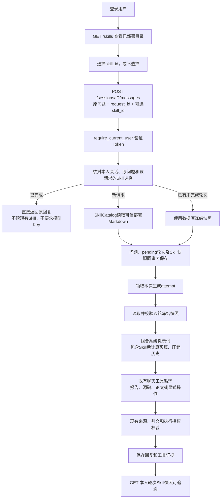

# 动态 Skill：模块、技术栈与完整调用流程

日期：2026-10-28。项目：`E:\code\LangChian_New`。当前 **67条路径、83个HTTP操作、39张共享业务表**。

本阶段支持服务器部署纯文本Skill、登录后查看、每轮手动选择、计入上下文预算、保存不可变轮次快照，以及使用原快照重试。附带 `cod-experiment-analysis`（伪装目标检测实验分析）1.0.0。

## 1. Skill、RAG、Tool分别负责什么

| 能力 | 职责 | 本项目示例 |
| --- | --- | --- |
| Skill | 分析步骤、检查重点与输出要求 | 先核对评测，再读实际损失代码，再找论文方法，最后设计消融 |
| RAG | 查找相关知识并提供实际出处 | 关键词检索本人PDF、读完整片段及前后页、核验页码和引文 |
| Tool | 取得真实数据或执行受控动作 | 读报告/源码/日志，或在当前人类明确授权后启动已登记任务 |

本阶段Skill是带元信息的Markdown流程，不是新的Agent、数据库或工具执行引擎。它能指导模型如何组合现有工具，但不会新增工具权限。当前只接入聊天，每轮手动选择；没有自动推荐、上传Skill、联网安装第三方Skill，或把聊天选择自动传播到独立分析/建议Worker。

这里的目录属于**你开发的实验助手应用**，不是Codex的个人Skill安装目录。通用Skill包还可能包含references/scripts等，本阶段只读取SKILL.md文字，不递归加载这些资源或执行其中脚本。

## 2. 总体流程



选Skill不会自动启动训练、读取所有论文或完成所有步骤。普通问候无需查库；缺少报告、源码或资料时，流程要求说明不足，不能为了“走完Skill”编造结果。

## 3. 模块和使用的包

以下路径相对于项目根目录。

| 文件 | 职责 | 技术 / 包 |
| --- | --- | --- |
| `skills/cod-experiment-analysis/SKILL.md` | 首个可部署流程，规定事实/代码/论文/消融分析重点 | YAML元信息、Markdown正文 |
| `app/models/skill.py` | 元信息、目录摘要、冻结快照、SHA校验、公开响应及业务异常 | Pydantic、dataclasses、hashlib、json |
| `app/services/skill_catalog.py` | 只从固定部署目录读Skill；解析格式、校验ID与长度；每次读取当前文件 | pathlib、re、**PyYAML 6.0.3 safe_load** |
| `app/api/skill_routes.py` | 目录、详情和本人轮次快照3个只读操作 | FastAPI Depends、asyncio.to_thread |
| `app/api/schemas.py` | 聊天请求增加可选skill_id，拒绝客户端直接提交instructions等字段 | Pydantic Field/正则约束 |
| `app/api/chat_routes.py` | 把skill_id交给聊天业务；把缺失、选择冲突、配置故障转换为安全错误 | FastAPI、已有错误映射和安全日志 |
| `app/api/dependencies.py` | 构造共享目录对象；聊天注入；快照查询独立于模型Key | lru_cache、既有数据库配置 |
| `app/services/user_chat_service.py` | 先查请求重放和冻结选择，新请求才加载文件；资源管理沿用原网关流程 | asyncio.to_thread、asynccontextmanager |
| `app/repositories/message_repository.py` | 原问题/选择一致性、快照和问题原子保存、归属及当前attempt核对 | mysql-connector-python、SQL事务/行锁 |
| `app/services/chat_service.py` | 领取生成后读取该轮快照，失败记录和重试不新增问题 | 原消息/轮次生命周期 |
| `app/services/chat_context_factory.py` | 将Skill放入本次系统提示词，再交上下文管理器预算计算 | ContextManager、Utf8BudgetCounter |
| `app/database.py`、`sql/*skill*.sql` | 新安装定义与已有库的可重复增量字段迁移 | MySQL 8 TEXT、JSON CHECK |
| `app/main.py` | include_router挂接新的Skill路由 | FastAPI |

PyYAML此前已在指定Python环境中安装，本阶段将6.0.3明确列入requirements，避免部署只依赖偶然存在的间接包；没有新增常驻服务或Worker。

`lru_cache`只缓存目录/服务对象，**不缓存每个用户的选择或Skill正文**。新文件和编辑在下一次查询或新问题加载时可见，不要求为更新文字重启；初次升级程序仍需重启API。文件I/O和同步MySQL操作通过to_thread执行，模型请求继续使用现有异步网关。

## 4. Skill文件格式与添加方法

固定目录为项目根目录下 `skills/<skill_id>/SKILL.md`。例如：

```text
E:\code\LangChian_New\skills\
└─ cod-experiment-analysis\
   └─ SKILL.md
```

文件使用UTF-8，开头YAML元信息与正文之间用独占一行的`---`分隔：

```markdown
---
name: point-cloud-analysis
title: 点云实验分析
version: "1.0.0"
description: 结合真实报告、源码和论文，分析点云实验。
---

# 分析步骤

先确认具体任务是分类、分割还是配准，再按当前问题读取相关证据。
缺少资料时说明缺口，具体操作仍遵守后端授权。
```

name必须和文件夹名一致，使用小写字母开头，后续只能有小写字母、数字或连字符，最多64字符。title最多80字符，description最多300字符；version必须是字符串，建议修改流程时递增，例如1.0.1。

当前每个文件最多8 KiB、正文最多6 KiB UTF-8，目录最多50份。超过范围或格式错误返回固定配置错误，不把原始YAML内容回传。只读取这一个文件，不允许请求传入路径、脚本、URL或自定义正文。safe_load与严格模型拒绝Python对象标签及未知配置字段；加载文件不执行Markdown代码块。

由部署者维护的目录是所有登录用户共享的可信流程目录，**不是个人私有知识库**，不要放入密码、Key或私有训练材料。个人论文继续通过已有用户隔离的/papers接口管理。后续多实例部署应分发相同Skill目录；本轮实际选择则保存在共享MySQL中。

## 5. 数据库保存什么，为什么不另建表

复用 `chat_turns`，仅新增可空字段 `skill_snapshot_json`，不增加第40张表。

| 内容 | 含义 |
| --- | --- |
| NULL | 本轮未选Skill，或是引入该功能前的旧轮次 |
| skill_id、title、description、version | 当时选中的流程元信息 |
| instructions | 当时实际加载的正文，不依赖之后的磁盘文件 |
| sha256 | 以上元信息和正文规范化JSON的SHA-256，不是原Markdown文件字节的SHA |

CHECK保证NULL或合法JSON对象，最大12 KiB。应用读取时重新核对SHA和结构；损坏时明确503，不静默换成新版本继续生成。

创建轮次时，问题、pending状态和Skill快照在**同一个事务**提交。快照写入失败会一起回滚，不出现问题保存了却丢失选择的情况。原有会话锁序列化同一会话写入；遇到并发重复请求，使用当前锁定读核对已提交选择，避免MySQL旧一致性快照误读。

Skill快照是已批准流程文字，不是凭证，本字段没有应用层Fernet加密。历史删除沿用聊天级联规则：删除会话会删除该会话的轮次快照，但不删除服务器共享Skill文件。

## 6. 同一请求和重试如何判断

HTTP中的request_id就是turn_id。一条新问题生成一个UUID，重试保留原问题和选择。

| 情况 | 行为 |
| --- | --- |
| 新request_id + skill_id | 读取当前部署版本并随问题保存 |
| 新request_id，不填或null | 普通聊天，不自动继承上一轮Skill |
| 同request_id、同问题、同skill_id且已完成 | 返回已保存回复；即使文件删除/升级、个人Key删除也不重复调用模型 |
| 同request_id，换问题 | 409，沿用原问题冲突规则 |
| 同request_id，换skill_id或改为不选 | 409，不允许更改这一轮身份 |
| 同request_id、同skill_id但目录已经更新 | 沿用第一次提交时的快照，不以新版本覆盖 |
| POST /sessions/ID/retry | 读取未完成轮次已有快照，不要求再次提交skill_id，不新增“继续”消息 |

快照冻结的是Skill资料，不冻结整个后端程序、个人模型Key或全局权限。升级后的安全规则和工具检查仍然生效。

## 7. Token、用户归属与模型调用顺序

路由先依赖require_current_user，验证登录Token并确定user_id。客户端不能自填user_id。目录是登录可见的共享部署资料；本人轮次快照查询则按用户、会话、轮次三者一起检查。

发送时先只读核对请求/归属/选择，完成重放可直接返回。新问题选中的目录不存在时，在保存问题和创建模型网关前拒绝；需要生成时才按原流程取得本人Key。快照查询使用独立消息仓储工厂，不需要解密模型凭据。

领取生成attempt之后，读取快照还核对该attempt和有效期；过期生成不能拿新轮次上下文继续写回。原有模型失败记录、取消、网关关闭和消息保存顺序保持不变。

## 8. 上下文、Redis和工具边界

Skill在ContextManager准备上下文前放入系统提示词，计入当前UTF-8预算。不能先把历史填满后再无限追加Skill。旧历史摘要和长问题精简沿用原流程；Skill不会单独增加供应商上下文上限。

Redis仍缓存摘要和原始消息，不缓存某个全局“当前用户Skill”，也不把Skill临时提示词写成普通聊天消息。每次生成都从该轮数据库快照重建系统提示词，因此不会把A用户的选择混给B用户，也不会无条件传给后续问题。

训练、改代码等工具是否提供，继续根据当前落库的人类原文和原权限检查决定；Skill正文里的“启动PRNet”不能当作用户授权。正文没有shell、Python或任意文件执行能力。

与论文RAG同用时，仍按原规则读取实际正文、验证逐字引文和程序页码。Skill的输出偏好不能覆盖工具阶段要求的JSON格式，也不能让未读资料成为证据。读取私有PDF后的公开网络工具隔离保持不变。

操作日志复用request_id、模块位置、耗时和安全异常类型，不写Skill正文、用户Key或原始YAML错误片段。实际选用的版本、摘要值和正文通过本人轮次快照接口检查。

## 9. 验证范围

通过1,298项单元测试，包含新增15项Skill专项；14组真实临时MySQL/HTTP Skill联调；17组既有论文联调及原聊天HTTP回归。覆盖旧库升级、版本变化/文件删除后的重试、无Key重放、同请求选择冲突、并发锁、事务回滚、归属、Skill不能启动训练、Skill与真实PDF引用组合及删除。

所有模型为替身，PDF使用真实Windows解析子进程，数据库使用真实MySQL。未调用付费API、未进行SSH或训练；这些验证不等于真实模型一定严格遵循分析步骤。自动Skill推荐、用户上传/安装、额外资源加载、后台Agent选择和前端都不在本阶段范围。

接口步骤：[动态Skill接口与Swagger验证说明](动态Skill接口与Swagger验证说明.md)。全部新增/修改：[文件清单](动态Skill阶段文件变更清单.md)。
