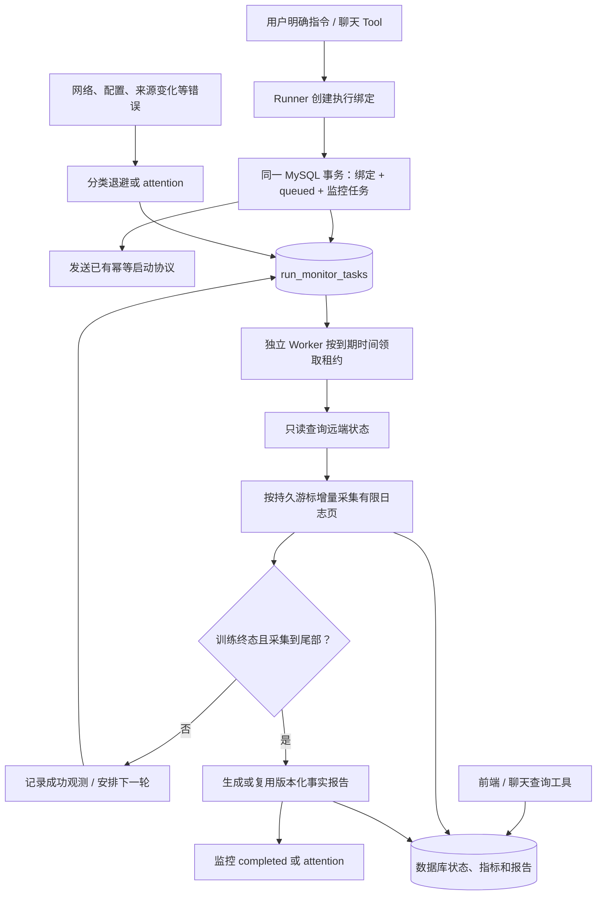

# 后台训练监控 Worker 与恢复机制

日期：2026-10-26。项目：`E:\code\LangChian_New`。

## 1. 本阶段完成什么

已有训练接口能够启动作业，但过去需要手动刷新状态、同步指标和生成报告。本阶段增加独立 Worker：运行创建执行绑定时，自动登记持久监控任务；Worker 查询状态、增量采集日志指标，训练结束且采集完成后自动生成报告。

无论从聊天 Tool 还是启动 API 创建执行，都会登记监控。Worker 不调用模型，不调用 Runner.start 或 stop，不会因为连接失败而重新训练。

本阶段先用 MySQL 队列实现可靠执行，**尚未安装或接入 Redis Streams**。下一阶段可将任务交付改为 Redis Streams，持久状态、租约和去重仍保留在 MySQL；不要求为了开始本阶段先购买或部署新服务。



## 2. 怎么运行

需要两个独立进程。API 进程不在内存中偷偷启动循环，避免 Uvicorn 多进程 / reload 时重复创建后台任务。

先执行一次可重复的增量迁移：

```powershell
cd E:\code\LangChian_New
python -m app.database --monitor-schema
```

终端一启动 API：

```powershell
python -m uvicorn app.main:app --host 127.0.0.1 --port 8000
```

终端二运行 Worker：

```powershell
conda activate langchain
cd E:\code\LangChian_New
python -m app.workers.monitor_worker
```

只做一次到期检查，可使用 `python -m app.workers.monitor_worker --once`。它最多领取一个到期任务，没有任务也正常退出；processed=true 仅表示处理了一步，不等于整场训练完成。

没有运行 Worker 时，任务保留为 scheduled，手动刷新 / 同步接口仍然可用。保存代码或启动 API 本身不代表 Worker 已在后台常驻。Windows 可在当前终端运行，后续部署时再用独立服务或容器管理进程，不靠本次对话常驻。

## 3. 两种状态必须分开

| 对象 | 状态 | 含义 |
| --- | --- | --- |
| 训练运行 | created / queued / running / succeeded / failed / cancelled | 原运行和远端监督进程的事实状态 |
| 监控任务 | scheduled | 已安排到期检查，等待 Worker |
| 监控任务 | running | 某个 Worker 正在持有有效或待回收租约，不等于训练正在运行 |
| 监控任务 | completed | 已采集到可信终端日志尾部，并生成完整报告 |
| 监控任务 | attention | 来源、配置或重试上限等需要处理，不能冒充采集完整 |

训练失败也可以得到 monitor.completed：表示失败日志收集完毕并生成了如实的失败报告，不表示模型训练成功。日志截断时会生成带不完整告警的报告，并标记 attention。

## 4. 新表 run_monitor_tasks 存什么

本次增加一张共享表，业务表总数为 25。

- run_id / user_id：唯一运行及所属用户，外键关联实际执行和用户归属运行。
- status / next_poll_at：当前监控状态和下一次到期时间。
- lease_token / lease_until：本次领取的随机令牌和有效期；不通过公开接口返回令牌。
- attempts：总领取次数；failure_count：连续处理错误次数。
- last_attempt_at / last_success_at：最近领取和最近成功观测时间。
- last_error_code：固定安全分类，不保存原始异常文字或凭据。
- report_version / completed_at：最近关联报告版本及完整监控完成时间。

每个 run 只有一行任务。启动绑定、queued 状态和监控入队同事务提交；入队失败会回滚绑定，SSH 不会先发出去。迁移只为已存在的 queued / running 执行补入缺失监控；Worker 启动及每 60 秒也会有界补偿，每次最多 1000 行，覆盖旧版本或部署间隙。已有 attention / completed 不会被补偿重置。不自动监控所有历史终态，历史终态可显式调用监控 retry 接口登记。

## 5. 如何领取、恢复和防止旧 Worker 覆盖

领取使用 MySQL 的 `FOR UPDATE SKIP LOCKED`，要求支持该语法的 MySQL 版本，本机真实 MySQL 已验证。领取后更新随机 lease_token 并立即提交，不持有数据库行锁等待 SSH。

只有 scheduled 且到期，或 running 但租约已经过期的行可以被领取。多个 Worker 可以领取不同运行；同一运行的有效租约不会被其他消费者领取。

每次状态 / 日志 RPC 前续租，报告生成前再次确认租约。写回任务结果需要同时满足运行、用户、令牌、running 状态和租约有效条件。进程崩溃后任务会在租约过期后由新 Worker 领取；旧令牌不能续租或覆盖新任务结果。

这里不是跨网络的“严格只执行一次”。进程暂停到租约过期时，已发出的只读请求仍可能完成；指标原有 CAS、事件唯一键及报告事务保证重复采集不重复计数，报告版本在事实未变化时复用。监控完全不拥有训练启动能力。

Ctrl+C 取消当前 Worker 时，会尽量把持有任务重新安排；如果数据库不可用或进程被强制结束，则依赖租约过期恢复。停止 Worker 不等于停止训练，训练仍由远端独立监督进程运行。

## 6. 每个新 Python 模块的职责

### app/models/monitor.py

MonitorSettings 定义运行间隔、空闲间隔、单步预算、租约、页数和重试限制，并检查超时必须比租约短。MonitorResponse 声明前端公开响应，区分两种状态，不暴露租约令牌。

dataclasses 保存不可变配置，Pydantic 负责公开响应模型和 OpenAPI，datetime 表示 UTC 时间，Literal 限定监控状态。

### app/repositories/monitor_repository.py

负责参数化 SQL 和短事务：claim 领取任务、renew 续租、settle 条件写回、get 归属查询、retry 重新排队。使用 mysql-connector-python，SQL 放在单独文件；使用 uuid4 生成令牌，Path 读取 SQL。

retry 只能处理本人已有执行。仍有有效 running 租约时返回冲突，不抢占活跃 Worker。重复排队仍是原 run 的原任务，不创建新训练。

### app/services/monitor_service.py

tick 是“一次有界工作”：领取一行，创建 LeaseRunner，读取状态，复用 MetricService 采集有限页数，按真实执行和流状态决定完成、延后还是需要处理。

LeaseRunner 只允许该租约绑定用户和 run 的 status / logs 操作；不暴露 start / stop。每步构造自己的采集器，不修改缓存服务中的共享用户状态。

asyncio 管理异步等待、取消和单步超时；to_thread 调用同步仓储。MySQL 处理完成后才做网络请求。log_failure 复用安全日志记录源码位置、异常类型和原因，不把 SSH Key 或原始请求写日志。

### app/workers/monitor_worker.py

独立入口，持续调用 tick。没有任务时异步等待；数据库等全局故障时退避；--once 用于单步运行和运维检查。argparse 解析命令，logging_context 为每步生成独立日志关联上下文，JSON 只输出一次执行结果摘要。

API 路由导入和进程启动时不会自动运行这个循环。多实例共享数据库领取机制，本轮验证了真实 MySQL 的八消费者并发领取；尚未进行 Kubernetes 多副本压力或故障演练。

### app/api/monitor_routes.py

提供本人监控状态读取和重新排队。Depends(require_current_user) 验证 Token 并取得当前用户；Depends(get_monitor_service) 组装协作者。两个接口都声明 MonitorResponse，读取不连 SSH，retry 也只登记任务，由 Worker 后续执行。

## 7. 现有模块改了什么

- RunnerRepository.claim：执行首次绑定和 queued 更新后，同事务执行 enqueue_run_monitor.sql。
- dependencies：懒组装 MonitorService。读取监控元数据不创建 Runner 或解密凭据；Worker 实际处理才组装 Runner。
- config：读取 MONITOR_ 前缀部署参数，不改原 `.env`。
- database：新增 --monitor-schema，全量初始化也包含监控表和已有活跃运行登记。
- main：挂载两个监控接口，没有给 API 加常驻循环。
- 容量诊断：表和索引白名单覆盖 25 张业务表。
- 日志：新增监控不存在、活跃任务冲突及租约失效的固定中文原因。

## 8. 配置和退避规则

部署参数可由环境变量设置，下面是默认值；环境中的显式值优先于本地配置文件，未设置时使用默认。

| 环境变量 | 默认 | 含义 |
| --- | --- | --- |
| MONITOR_POLL_SECONDS | 15 | 已追到日志尾部、训练未结束时的下一轮间隔 |
| MONITOR_IDLE_SECONDS | 2 | 没有到期任务时等待 |
| MONITOR_LEASE_SECONDS | 120 | 领取租约长度 |
| MONITOR_STEP_TIMEOUT_SECONDS | 90 | 单步处理超时 |
| MONITOR_MAX_PAGES | 4 | 每次最多采集日志页，每页最多 16384 字节 |
| MONITOR_MAX_FAILURES | 8 | 连续错误达到此值后 attention |
| MONITOR_BACKOFF_SECONDS | 5 | 退避起点 |
| MONITOR_MAX_BACKOFF_SECONDS | 300 | 退避上限 |

有未读页时下一轮安排为 1 秒后，避免一轮读完巨量日志。轮询是尽力按到期时间调度，不保证精确每 15 秒一次；负载和网络耗时会影响延迟。

暂时断网、超时、采集并发、来源暂不可确认等进行退避，默认 5、10、20、40、80、160、300 秒，达到连续错误上限后转 attention。正常一次处理会清零连续错误次数。

认证失败、主机指纹不匹配、禁止地址、密文解密失败、配置绑定变化、协议异常或日志来源变化，直接 attention，不持续重试错误凭据或清空游标。数据库在任务领取前不可用时，Worker 做全局退避，不会因此丢掉已有任务。

## 9. 验证结果及范围

本阶段 1055 项单元测试通过，新增监控测试 20 项。真实 HTTP / MySQL / 回环 SSH / Worker 验收 12 组通过，覆盖聊天启动后自动更新、训练失败、部署间隙补偿、用户停止、网络恢复、启动未确认、八消费者领取、租约恢复和旧令牌拒绝、日志变化/截断、原子入队回滚、重复迁移和安全日志。

验收仅使用 CPU 微型作业和模拟聊天模型，没有新启动真实服务器 GPU 训练，没有付费模型调用。Worker / 采集 / 报告使用实际实现，不是用模拟结果冒充后台运行。

下一步可以接 Redis Streams 任务交付，再按已记录路线开发第一版前端。Redis 接入时应保留持久事实与恢复机制，并单独验证丢消息、重复消息及消费确认。

接口字段、请求/响应及错误示例见 [后台监控接口与前端联调说明](后台监控接口与前端联调说明.md)，完整文件列表见 [本阶段变更清单](后台监控阶段文件变更清单.md)。
