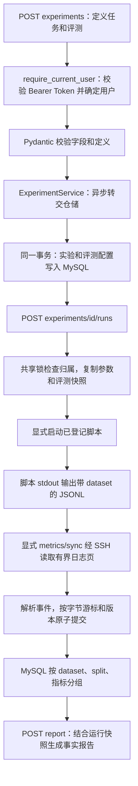

# 多方向评测配置与数据集隔离

本阶段日期：2026-10-26。代码位于 `E:\code\LangChian_New`。

## 1. 这次解决什么问题

同一套系统支持点云分类、点云分割、点云补全、点云检测、目标跟踪、目标检测、伪装目标检测，以及 custom 自定义任务。任务方向只描述实验，不替你安装算法、启动未登记脚本或选择评测实现。

`kind=training/script` 表示执行类别；`evaluation.task_type` 表示研究任务，两者各有用途。伪装目标检测可以是训练，也可以是只运行评测的 script。

以前报告按照 split＋指标名分组，无法区分同一次运行在 COD10K 和 CAMO 上的 MAE。现在按照 **dataset＋split＋metric_name** 分组；它们各有首末值、范围、点数和步数检查，绝不平均到一起。

本阶段没有增加图像、视频、点云文件、分割掩码、检测框、模型权重等产物接口。这些应放独立产物存储，数据库保存归属、路径和摘要，不能塞进数值指标字段。

## 2. 从请求到报告的完整路径



这里没有新增登录逻辑。`require_current_user` 从请求 Authorization 头取 Token，经现有登录记录校验有效期和撤销状态，得到当前用户。业务层和 SQL 都使用这个用户 ID，客户端不能通过请求体随意指定另一个用户。

`Depends(get_experiment_service)` 是 FastAPI 依赖注入：提供服务对象；服务通过自己的 repository 操作数据库。它不是继承，也不会让服务自动拥有其他类的全部方法。

同步 MySQL 驱动通过 `await asyncio.to_thread(...)` 执行，避免数据库等待阻塞事件循环；`await` 等待工作完成并取得结果，不表示数据库操作本身变成了异步驱动。

## 3. 评测配置的字段

| 字段 | 意义 |
| --- | --- |
| task_type | 上述任务方向之一；扩展方向可先选 custom |
| protocol_id | 评测协议标识，例如组内某一套评测流程 |
| protocol_version | 协议版本；评测选项变化时使用新版本 |
| implementation | 记录实际评测仓库、commit、选项等说明；只是文本，不会执行或联网获取 |
| datasets | 数据集 ID、显示名、版本；最多 16 项，ID 不重复 |
| metrics | 指标名、显示名、单位、优化方向、可选范围、定义；最多 64 项 |
| primary_metric | 可选主指标，必须出现在 metrics 中 |

数据集 ID 是 1～64 位小写字母、数字、点、下划线、短横线，第一位为字母或数字。`unspecified` 为未标注/旧日志保留，不能注册为正式数据集。

指标名使用小写字母开头，后续可用数字、下划线，最多 64 位。`type/step/epoch/split/dataset` 是日志元数据保留字，不能用作新的指标名。

`unit` 是声明，不自动换算。脚本输出 0.85 时，应该声明与实际实现一致的单位；不能声明 percent 后期待系统把 0.85 自动变成 85。

方向是 `maximize/minimize/none`。不能根据名字猜方向：同名指标可能使用不同定义、归一化方式或评测实现。范围是可选的有限数值，下界不能高于上界；整个配置规范化后最多 32768 字节。

数据集版本、协议和实现必须如实填写。系统保存并展示声明，不会自动证明你填的版本与远端脚本一致；需要后续代码快照、数据指纹等证据来加强可复现性。

## 4. 在 /docs 中怎么测试

先启动项目已有 API，注册/登录，在 Authorize 中使用登录返回的 Token。

1. 打开 `POST /experiments`，复制 `examples/evaluation_examples.json` 中 `camouflaged_object_detection` 对应的整个对象作为请求体。外层文件是四个示例的集合，不能整个集合提交。
2. 示例覆盖伪装目标检测、跟踪、检测和点云分割；它们是填写格式演示，协议版本、数据集版本和指标尺度需要替换成自己脚本的实际值，不是官方基准默认配置。
3. 返回 201，检查 `evaluation` 和 `experiment_id`。实验列表保持精简，完整配置在详情中读取。
4. 使用该实验 ID 创建 run；`request_id` 使用新的 UUID，`parameters` 填已登记脚本支持的参数。返回的 `run.evaluation` 是快照。
5. 原来的启动、refresh、sync 操作保持不变；系统不会因为普通聊天或创建实验就自动训练。

训练/评测脚本可以这样输出：

```python
import json

print(json.dumps({
    "type": "metric",
    "dataset": "cod10k",
    "split": "test",
    "step": 1,
    "sm": 0.86,
    "mae": 0.03,
}), flush=True)

print(json.dumps({
    "type": "metric",
    "dataset": "camo",
    "split": "test",
    "step": 1,
    "sm": 0.80,
    "mae": 0.05,
}), flush=True)
```

这些只是格式示例，不代表实际训练结果。`dataset`、`split`、`step`、`epoch` 是元数据，其余字段是实际数值。每条最多 16 个指标，每次运行最多 64 条不同的“数据集/分组/指标”序列，保留原有 8192 字节行预算和 16384 字节采集页预算。

`GET /runs/{run_id}/metrics?dataset=cod10k&split=test&metric_name=mae` 只查看对应数据集的已采集事件。分页游标仍然使用源日志字节位置，筛选不会重新编号。

`GET /runs/{run_id}/metrics/latest` 返回所有分组的数值统计。`POST /runs/{run_id}/report` 生成报告，`GET` 读取已有报告；读取和生成报告均不需要连接 SSH 或调用模型。

## 5. 为什么要保存运行快照

实验声明存于 `experiment_evaluation_specs`，每次运行的独立副本存于 `run_evaluation_specs`。两张是共享业务表，按用户和实验/运行隔离，不是每个用户创建一张表。项目共 16 张业务表。

创建实验时，实验行和评测声明在同一事务内提交；创建运行时，run 行与评测快照在同一事务内提交。任何一部分失败，都会回滚，不留下不完整对象。

读取时会检查规范化 JSON 和 SHA-256 摘要。摘要用于一致性检测，并不是抵御能同时改正文和摘要的数据库管理员。涉及归属的复合外键进一步阻止错误用户写入。

创建 run 时用共享锁读取归属和配置，在复制完成前避免其他事务改动源声明。同一请求编号的并发创建由已有唯一键保护；重复请求返回原来的 run 和快照，而不是重新复制新配置。

当前没有开放编辑评测配置接口，日常变更请创建新实验。即使将来支持编辑，旧 run 仍读取自己的副本；本次临时库验收已模拟编辑并确认这一点。

## 6. 报告如何解释指标

新版报告 `data.schema_version=2`，顶层 `evaluation` 保存实际运行时的声明。每一项 series 带 dataset、split、metric_name，以及声明引用 ID；定义正文只存一份，避免长说明被重复 64 次撑爆报告。

| 字段/标记 | 意义 |
| --- | --- |
| dataset_definition_id | 引用顶层 evaluation.datasets 中的 ID；找不到时为 null |
| metric_definition_name | 引用顶层 evaluation.metrics 中的 name；找不到时为 null |
| is_primary_metric | 是否为声明的主指标；不会把不同数据集的主指标合成一个数 |
| DATASET_UNSPECIFIED | 日志没有注明数据集，不能自动认领为某个基准 |
| DATASET_UNDECLARED | 日志数据集未在运行声明中登记 |
| METRIC_UNDECLARED | 指标没有定义，不能猜单位、范围、方向 |
| VALUE_OUT_OF_RANGE | 某个已观察值超出声明范围；原数值仍保留 |
| observed_best_value | 同一数据集和 split 内、按声明方向取得的已观察极值 |

只有数据集和指标均已声明、数值没有越界且方向不是 none 时，才填写 observed_best_value。它不等于最佳模型，不推断最佳 checkpoint，也不证明收敛、泛化提升或论文结论。

首值/末值按源日志顺序取得；step 倒退仍记录质量计数，不擅自排序成新历史。日志缺失、截断、未采集完等原有质量提示仍然保留。

没有新加跨运行排行榜。比较不同运行时至少应核对任务、数据集版本、评测协议/实现、单位和相同 split；这些条件未对齐前，不能因为名字都叫 mAP 就直接比较。

## 7. 旧数据与迁移

已有项目库在激活这版代码前执行一次：

```powershell
conda activate langchain
cd E:\code\LangChian_New
python -m app.database --evaluation-schema
```

该选择性迁移以此前实验、运行、Runner 和指标表已安装为前提；新部署使用完整 `python -m app.database` 按依赖顺序初始化。

迁移新增两张评测表，给指标事件表补 dataset 默认字段和复合索引；可重复执行。旧事件的逻辑数据集为 unspecified，不猜它属于 COD10K 或 CAMO。已有用户、会话、消息、运行和游标不被改写。

旧游标中 `train/loss` 在继续解析时转换为 `unspecified/train/loss`；字节位置、半行缓冲和计数不会重置。旧报告仍能读到，但缺少新版分组语义时标注 is_stale，只有显式 POST 才重建版本。

本次已在现有项目库执行迁移并重复验证；后续更换部署库时仍需执行迁移。大库上线要根据事件表规模安排新增索引的时间，不能把本地小库迁移耗时当作生产耗时。

## 8. 技术栈与模块分工

沿用 Python 3.12、FastAPI、Pydantic v2、mysql-connector-python、MySQL 8、asyncio；没有增加依赖、Redis 或付费服务。SSH 采集沿用现有 AsyncSSH Runner。

| 模块 | 职责及主要包 |
| --- | --- |
| app/models/evaluation.py | Pydantic 声明、字段/跨字段校验；json 规范化；hashlib 摘要；报告注释 |
| app/models/experiment.py、experiment_run.py | dataclasses 的不可变记录；json 每次解码新对象，调用者改返回字典不会改原始快照 |
| app/api/experiment_schemas.py、experiment_run_schemas.py | 请求/响应类型和 OpenAPI；拒绝额外字段，详情携带评测配置 |
| app/api/experiment_routes.py | 复用身份依赖，把请求中的声明交给服务，统一 HTTP 异常 |
| app/services/experiment_service.py | asyncio.to_thread 转交同步仓储；不在这里拼 SQL |
| app/repositories/experiment_repository.py | 参数化 SQL、实验＋配置原子创建、读取校验 |
| app/repositories/experiment_run_repository.py | 归属锁、参数/评测快照、幂等创建与事务回滚 |
| app/models/training_metrics.py | JSONL 严格解析、dataset 维度、旧游标命名兼容、事实报告 |
| app/repositories/metric_repository.py | 归属、游标版本 CAS、事件/游标同事务、筛选和分组查询、报告版本 |
| app/api/metric_routes.py | 增加 dataset 查询参数；沿用登录及安全错误响应 |
| app/database.py | 独立增量迁移与全新安装顺序；校验已有字段和索引结构 |
| app/repositories/capacity_repository.py | 将两张新共享表纳入只读容量检查 |
| sql/ 下本阶段文件 | 建表、增量迁移、参数化读写、复合分组；完整逐文件用途见变更清单 |
| scripts/verify_evaluation_mysql.py | 真实 HTTP/MySQL 正常、失败、归属、快照和旧结构迁移验收 |
| scripts/verify_metrics_mysql.py | 真实回环 SSH 与微型脚本，验证多数据集从 stdout 到报告的整条链 |
| tests/test_evaluation.py | 声明边界、兼容解析、报告方向/质量、预算及迁移单元测试 |

`Path` 定位固定的项目 SQL/示例文件；`re` 校验标识符；`json` 处理结构化数据；`hashlib` 校验快照；`uuid4` 为实验/运行生成标识；`mysql.connector` 执行参数化语句、事务和外键约束。这里没有使用 eval、shell 拼接或把用户说明当作可执行代码。

## 9. 验证方法与结果

```powershell
python -m unittest discover -s tests -q
python -m scripts.verify_evaluation_mysql
python -m scripts.verify_metrics_mysql
python -m scripts.verify_experiment_runs_mysql
python -m scripts.verify_database_capacity_mysql
```

完整单元测试 916 项通过；评测配置新联调 8 组、扩展后指标/报告 SSH 联调 10 组、运行回归 15 组、容量回归 8 组通过。联调使用随机独立临时库并清理，只运行本机微型脚本；没有调用付费模型或占用真实训练服务器/GPU。

真实 Linux 服务器上的 flock/进程组、真实数据集评测、后台自动采集、聊天模型工具、联网论文证据、Skill/RAG 和产物系统仍需后续阶段实现/验收。本阶段不会让聊天自动开始训练。

下一步建议接入只读运行工具：用户问“最近训练怎么样”，模型按需查询本人最新 run、报告和有界日志，引用准确的数据集/协议和质量提示；之后再接论文检索证据。先把读工具接稳，再扩展需要明确授权的训练启动工具。
