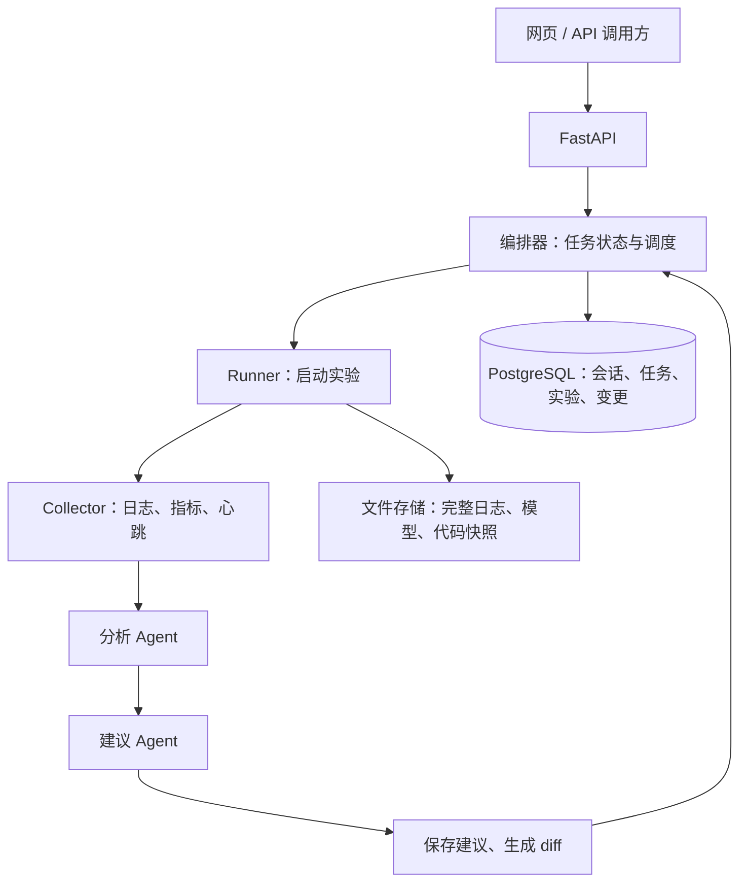

# 实验自动运行与多 Agent 监控系统设计方案

日期：2026-10-17  
适用场景：模型训练、Python 脚本实验及其日志、指标和代码修改管理。

## 1. 建设目标与推荐方案

系统需要支持自动启动实验、持续采集日志和指标、分析实验表现、提出修改建议，并记录每次实际变更及其效果。用户通过网页或 API 使用系统，无需直接操作编码助手。

建议第一版采用：

**FastAPI + PostgreSQL + Redis Streams + 两个 Agent + 一个独立实验执行器。**

已有的 `ChatDeepSeek` 调用可以作为模型调用层继续使用。需要补齐的是任务调度、实验管理、会话持久化、上下文管理和变更追踪。

把以下两个配置分开：

- `auto_run`：是否自动启动符合策略的实验或下一轮实验。
- `auto_apply_changes`：是否允许系统自动应用修改建议。

自动运行、生成建议、应用修改是不同步骤。无论修改来自用户还是 Agent，都应记录实际差异，并关联后续实验结果。

## 2. 系统职责与整体流程

| 模块 | 职责 | 是否需要大模型 |
| --- | --- | --- |
| API 服务 | 接收聊天、提交实验、查询结果、推送进度 | 部分需要 |
| 编排器 Orchestrator | 管理步骤和状态，触发下一任务，控制重试与停止 | 第一版用普通代码 |
| 执行器 Runner | 启动训练、查询状态、停止任务、记录退出码 | 不需要 |
| 采集器 Collector | 采集日志、指标、心跳，识别触发条件 | 不需要 |
| 分析 Agent | 判断实验现象、分析可能原因、引用证据 | 需要 |
| 建议 Agent | 提出参数或代码修改、预期效果及验证方案 | 需要 |
| 上下文管理器 | 检索历史、组装输入、计算 token、必要时总结 | 总结时需要 |
| 变更服务 | 保存提案，验证和应用补丁，计算实际 diff | 通常不需要 |

逻辑流程如下。耗时步骤通过 Redis Streams 调度，数据库保存业务状态。



如果 Markdown 阅读器不支持 Mermaid，可按以下顺序理解：

```text
提交实验 → 创建运行记录 → 启动脚本 → 采集日志和指标
                                      ↓
保存结果 ← 生成建议 ← 分析现象与原因 ← 触发分析
   ↓
依据策略结束本轮，或应用修改并创建下一轮运行
```

第一版使用固定的“分析 → 建议”工作流。两个 Agent 可以使用同一个模型，分别设置角色提示词、输入结构和输出结构。

## 3. Agent 通信与 Redis 设计

### 3.1 使用 Redis Streams 传递任务

建议按任务类型拆分 Stream：

```text
run.jobs       → Runner Worker
analysis.jobs  → 分析 Agent Worker
proposal.jobs  → 建议 Agent Worker
```

Worker 是持续运行的 Python 服务，负责阻塞等待任务。收到任务后，它读取数据、组装上下文，再调用模型。持续监听 Redis 的是 Worker，不需要让大模型持续运行。

基本处理过程：

1. 使用 `XADD` 写入任务。
2. 使用 `XREADGROUP ... BLOCK` 等待并读取新任务。
3. 加载数据库中的任务和输入快照。
4. 执行对应步骤，校验并持久化结果。
5. 登记后续事件。
6. 使用 `XACK` 确认当前消息。

未确认消息由恢复逻辑使用 `XAUTOCLAIM` 等机制重新领取。只有读取新消息的循环不足以覆盖 Worker 崩溃后的恢复。

普通 Redis Pub/Sub 的订阅者断线时，错过的消息无法补收，因此任务链路优先使用 Streams。[Redis Pub/Sub 文档](https://redis.io/docs/latest/develop/pubsub/)

### 3.2 消息使用结构化格式

```json
{
  "schema_version": 1,
  "event_id": "evt_001",
  "event_type": "analysis.requested",
  "experiment_id": "exp_001",
  "run_id": "run_008",
  "task_id": "task_042",
  "snapshot_id": "snapshot_019",
  "reason": "validation_loss_not_improving"
}
```

ID 由后端生成。完整日志、代码和指标快照放数据库或文件存储，通过引用读取，避免在消息中反复复制大段内容。

同一个 consumer group 中的 Worker 分担消息。如果两个不同角色都需要收到同一事件，应使用独立消费组。对于前后依赖的分析与建议任务，直接使用两个阶段队列更清楚。[XREADGROUP 文档](https://redis.io/docs/latest/commands/xreadgroup/)

### 3.3 可靠性与重复执行

- **幂等：**用 `task_id + step` 的唯一约束识别重复步骤，任务状态更新采用事务或条件更新。
- **避免重复启动：**执行器用 `run_id` 作为稳定任务标识。重新消费时查询执行器中的对应任务，恢复关联，不能直接再启动一次。
- **失败恢复：**设置执行超时、重试退避、最大次数、未确认任务回收和失败队列。
- **防止误回收：**任务租约和心跳要覆盖正常执行耗时，不能因为模型响应较慢就让两个 Worker 同时执行同一步。
- **长时间训练：**启动任务在执行器成功接管并持久化任务标识后确认；训练后续状态由心跳和状态查询跟踪。
- **状态一致性：**结果与待发送事件在同一个数据库事务内保存，发送器再投递 Redis，即 outbox 模式。发送可能重复，消费者仍需幂等。
- **恢复与保留：**配置 Redis 持久化和保留策略，避免清理尚未完成处理的消息；数据库保留任务记录，用于发现和恢复遗漏任务。

Redis Streams 的确认机制不等于整个业务绝对只执行一次。[Redis Streams 文档](https://redis.io/docs/latest/develop/use-cases/streaming/)

## 4. 实验运行与监控

### 4.1 采集内容

```text
进程状态、退出码、心跳时间
step / epoch
train_loss / val_loss
学习率、显存占用、训练耗时
异常日志位置
checkpoint 和其他产物路径
```

优先让训练脚本输出结构化指标，例如 JSONL。已有脚本可以增加适配器，解析日志中的指标。完整 stdout/stderr 持续写文件，数据库保存路径和必要的索引。

指标的均值、变化率、最优值、窗口趋势等先由 Python 计算，Agent 读取计算结果及相关日志片段。

### 4.2 模型分析的触发条件

- 进程异常退出、OOM、出现 NaN。
- 指标连续多个窗口没有改善。
- 一个 epoch 或实验阶段结束。
- 用户主动发起分析。
- 达到可配置的定期检查时间。

这些触发条件属于可配置规则。对相同异常去重并设置冷却时间；某次运行正在分析时，合并新增事件，避免每行日志都触发一次模型调用。

### 4.3 角色输出约定

分析 Agent 输出：

```text
observations：观察到的事实
evidence_refs：指标窗口、日志行或文件引用
hypotheses：可能原因及其依据
missing_information：尚缺的信息
```

建议 Agent 输出：

```text
target_hypothesis：针对哪个原因
changes：建议修改的参数或文件
rationale：修改原因
expected_effect：预期效果
validation_plan：如何判断有效
rollback_condition：何时回退
```

观察、推测和已验证结论分别保存。证据不足时应明确记录缺失信息。

## 5. 会话、实验与运行管理

### 5.1 分开使用不同 ID

| 标识 | 含义 | 示例 |
| --- | --- | --- |
| `session_id` | 用户与系统的一段聊天 | 讨论模型 A 的优化 |
| `experiment_id` | 一个实验目标或实验系列 | 比较不同学习率 |
| `run_id` | 一次具体执行 | 第 8 次训练 |
| `task_id` | 一次后台任务 | 分析第 8 次训练异常 |
| `change_id` | 一份修改提案及其应用记录 | 调整学习率或修改代码 |

一个实验可以有多次运行，也可以关联多个聊天会话。关闭页面不应停止实验。新一轮训练使用新的 `run_id`，并记录 `parent_run_id` 和来源 `change_id`。

### 5.2 建议的数据表

| 表 | 核心内容 |
| --- | --- |
| `experiments` | 目标、评估指标、资源限制、自动运行策略 |
| `runs` | 实验 ID、父运行 ID、状态、配置快照、代码版本、执行器任务 ID |
| `sessions` | 用户、关联实验、摘要版本、上下文版本 |
| `messages` | 会话 ID、递增序号、角色、内容、时间及元数据 |
| `agent_runs` | 角色、任务和步骤、输入引用、输出、模型及提示词版本、token、耗时、错误 |
| `changes` | 修改原因、diff、应用状态、前后版本、关联运行 |
| `events` / `outbox` | 事件历史、待投递消息、投递状态 |

训练指标规模较小时可先存 PostgreSQL。完整日志、模型权重和 checkpoint 放文件存储，数据库保存引用。

### 5.3 并发与权限

同一个聊天会话的回复任务第一版串行处理，消息使用递增 `seq`。后台分析可以并发，但应读取固定版本的输入快照，并记录输入版本。过期结果可以保留为历史，不能无条件覆盖最新结论。

多用户场景按用户或项目检查读写与执行权限，不能仅凭传入的 `session_id` 或 `run_id` 就访问数据。

## 6. 上下文存储与压缩

### 6.1 数据保存与模型输入分开

当前调用 `ChatDeepSeek.invoke(messages)` 时，模型看到的是本次传入的消息。Chat Completions 多轮对话需要应用把相关历史重新传入。[DeepSeek 多轮对话文档](https://api-docs.deepseek.com/guides/multi_round_chat/)

建议分为两层：

```text
长期保存：
完整聊天、实验状态、每轮分析、实际修改、日志与代码引用

一次模型调用输入：
角色指令
+ 当前任务
+ 当前实验的结构化状态
+ 相关历史摘要
+ 最近若干轮完整消息
+ 本次需要的日志、指标和代码片段
```

分析 Agent 重点读取指标、日志、上一次分析；建议 Agent 重点读取分析结果、配置、代码及此前尝试过的修改。两个角色分别构建上下文，共享实验事实和工作产物。

实验日志、代码注释和其他外部内容作为待分析数据传入，不应获得覆盖系统指令或执行权限的能力。

### 6.2 每次调用前检查 token 预算

字符数不等于 token 数。每次模型调用前都检查输入预算，包括工具调用返回后的下一次请求。

```text
输入 token + 为输出预留的 token + 安全余量 ≤ 模型上下文上限
```

如果服务商另有输入或输出上限，也需要分别满足。应用可以设置更小的输入预算，以控制成本和响应时间。

工具定义、工具返回、日志、代码和摘要都要计入输入。`max_tokens` 控制生成上限，不会自动裁剪历史。[DeepSeek API 文档](https://api-docs.deepseek.com/api/create-chat-completion/)

推荐过程：

1. 根据任务筛选上下文，限制日志和工具返回的大小。
2. 优先使用匹配模型的 tokenizer；只能估算时保留足够余量，并用实际 usage 校准。
3. 达到应用输入预算阈值时，总结较早的对话。
4. 保留最近完整交互、当前任务和必要证据。
5. 重新计数，超限时继续缩小范围或分批处理。

可以把“达到输入预算的 80% 时压缩，压缩到约 50%～60%”作为初始参数，再根据实际效果调整。摘要调用本身也需要预算控制；历史过大时分批总结。

### 6.3 摘要结构与增量更新

```json
{
  "goal": "当前实验目标",
  "constraints": ["用户明确给出的限制"],
  "confirmed_facts": ["已确认事实及来源"],
  "attempted_changes": ["做过什么、结果如何"],
  "open_questions": ["尚未确定的问题"],
  "next_steps": ["后续计划"],
  "summary_until_seq": 120
}
```

`summary_until_seq` 表示已总结到哪条消息。下一次总结读取已有摘要和新增的旧消息，生成新版本。原始消息仍保留，以便重新生成或核对摘要。

配置数值、代码版本、实验结果以数据库和版本快照为准，摘要只帮助模型理解历史。摘要可能遗漏信息，不能成为实验事实的唯一来源。

裁剪涉及工具调用的历史时，要保留完整的调用和对应结果，不能留下孤立的工具消息。

LangChain 的 `SummarizationMiddleware` 提供基于 token 阈值的总结能力，checkpointer 可用于会话状态持久化。它们需要接入 Agent 运行流程，单独调用 `ChatDeepSeek.invoke()` 不会自动得到这些功能。[LangChain 短期记忆文档](https://docs.langchain.com/oss/python/langchain/short-term-memory)

第一版通常不需要向量数据库。先实现按实验、运行、任务类型和时间范围查询；跨大量历史实验检索时再评估语义检索。

## 7. 修改记录与可复现性

“修改了哪里”应由程序通过版本差异计算，不能仅保存 Agent 的文字说明。

每次变更至少包含：

```text
change_id
来源分析任务及建议
base_run_id、修改前代码版本
代码 unified diff、配置 before / after
修改原因及证据引用
应用者、时间、应用结果
验证结果、后续 run_id、指标变化
```

示例：

```json
{
  "change_id": "chg_009",
  "base_run_id": "run_008",
  "status": "applied",
  "config_changes": [
    {
      "path": "optimizer.lr",
      "before": 0.001,
      "after": 0.0003
    }
  ],
  "patch_ref": "changes/chg_009.patch",
  "next_run_id": "run_009"
}
```

变更状态区分 `proposed`、`applied`、`failed`、`reverted`。只有确认实际落盘成功，才能记录为已应用。

每次运行保存不可变的代码和配置快照。若代码有未提交修改，除 Git commit 外还需保存实际 diff 或完整快照。记录数据集版本、随机种子和依赖环境，以便比较前后结果。

运行中的实验使用独立目录；修改应用到下一轮的工作目录。应用补丁前验证基线版本，完成后运行必要检查，再生成实际 diff。每轮启动前比较快照，因此人工修改同样可以进入记录。

自动修改可以先限制为学习率、batch size 等配置项，并设置允许范围、最大轮数、GPU 时间、单轮超时和停止条件，再扩展到代码补丁。

Runner 接收注册脚本及结构化参数。模型输出的文本不能直接作为 shell 命令执行。

## 8. API 设计

前端围绕会话、实验、运行和变更操作，不需要了解内部有几个 Agent。

| 接口 | 用途 |
| --- | --- |
| `POST /sessions` | 创建会话 |
| `POST /sessions/{id}/messages` | 发送消息 |
| `GET /sessions/{id}/messages` | 获取历史 |
| `POST /experiments` | 创建实验和策略 |
| `POST /experiments/{id}/runs` | 提交一次运行 |
| `GET /runs/{id}` | 查询运行状态、指标和结果 |
| `POST /runs/{id}/stop` | 停止运行 |
| `POST /runs/{id}/analyses` | 主动触发分析 |
| `GET /experiments/{id}/changes` | 查询建议和实际变更 |
| `POST /changes/{id}/apply` | 应用指定变更 |
| `GET /tasks/{id}` | 查询后台任务 |
| `GET /experiments/{id}/events` | SSE 推送进度 |

提交训练后，返回 HTTP `202 Accepted`：

```json
{
  "run_id": "run_009",
  "task_id": "task_043",
  "status": "queued"
}
```

实际工作由独立 Worker 和 Runner 执行。API 服务重启后，仍可依据数据库记录和执行器状态恢复查询。创建运行接口可支持幂等键，避免客户端重复提交导致两次训练。

运行状态可使用：

```text
queued → starting → running → succeeded / failed / cancelled
```

后台分析任务、变更提案和实验进程各自维护状态，不把“模型分析完成”等同于“训练已结束”。

SSE 事件携带序号，断线后可补读事件或重新查询当前状态。

FastAPI 的 `BackgroundTasks` 适合较小的后台工作。长时间训练应使用进程外任务机制。[FastAPI 文档](https://fastapi.tiangolo.com/tutorial/background-tasks/)

## 9. 在现有代码上如何拆分

### 9.1 模型调用层

以下代码是模型调用层示意，未包含数据库、队列、Agent 工具循环和上下文管理，也未进行真实 API 调用验证。

```python
from dotenv import load_dotenv
from langchain_deepseek import ChatDeepSeek

load_dotenv("../config/.env")


class ModelGateway:
    def __init__(self):
        self.model = ChatDeepSeek(
            model="deepseek-flash",
            temperature=0,
            max_tokens=4096,  # 示例值，按任务及推理需求调整
            timeout=120,     # 示例值，按实际响应耗时调整
            max_retries=2,
        )

    async def invoke(self, messages):
        response = await self.model.ainvoke(messages)
        return {
            "content": response.content,
            "usage": response.usage_metadata,
            "metadata": response.response_metadata,
        }
```

服务启动时加载配置，部署时使用明确的配置文件路径或环境变量，避免相对路径随工作目录变化。密钥保留在服务端配置中。

分析和建议使用不同提示词及输出 schema，复用模型 Gateway。`ChatDeepSeek` 支持异步调用。[LangChain 集成文档](https://docs.langchain.com/oss/python/integrations/chat/deepseek)

### 9.2 一次业务调用

以下是业务流程伪代码，其中各服务需要自行实现：

```python
task = await task_store.load(task_id)
context = await context_builder.build(task)
messages = await context_manager.fit_budget(context)

result = await model_gateway.invoke(messages)
validated = output_validator.validate(result)

# 同一个事务保存结果，并登记下一步待发送事件
await workflow_store.complete_step_and_enqueue_next(
    task=task,
    result=validated,
)
```

使用 Pydantic 校验 Agent 输出。JSON 不合法、字段缺失、输出截断、模型超时等都进入明确的失败或有限重试流程。记录每次调用的模型、提示词版本、输入引用、输出、token、耗时和错误。

仅导入 `@tool` 不会让模型自动执行工具。工具能力还需要绑定、调用参数校验，以及“模型提出调用 → 程序执行 → 返回结果 → 模型继续”的循环。第一版可以由程序准备好输入，再逐步加入只读日志和代码查询工具。

### 9.3 目录建议

```text
app/
  api/                 # HTTP 接口
  agents/              # 分析、建议及输出 schema
  services/
    model_gateway.py
    context_manager.py
    orchestrator.py
    change_service.py
  workers/             # Redis 消费、重试、恢复
  runner/              # 进程管理、日志与指标采集
  repositories/        # 数据库访问
  models/              # 数据表和请求模型
```

第一版可以使用普通 Python 状态机。出现较多分支、暂停恢复和工具循环时，再引入 LangGraph 的工作流与持久化能力。[LangGraph 文档](https://docs.langchain.com/oss/python/langgraph/workflows-agents)

## 10. 实施顺序与验收

### 阶段一：会话持久化和自动运行

- 封装模型 Gateway，保存聊天记录。
- API 创建实验和运行，Runner 启动注册脚本。
- 记录状态、日志、退出码及代码和配置快照。
- 能查询、停止任务，服务重启后能够恢复状态查询。

### 阶段二：分析与建议

- 配置监控触发规则，处理重复异常。
- 通过 Redis Streams 调度分析和建议任务。
- 保存结构化输出、证据、模型调用记录。
- 支持任务重试、幂等和崩溃恢复。

### 阶段三：版本和变更追踪

- 保存建议 diff、实际 diff、配置前后值。
- 区分建议、应用成功、应用失败和回退。
- 关联父运行、后续运行及指标变化。
- 将人工修改纳入快照比较。

### 阶段四：有限的自动迭代

- 先支持允许范围内的配置修改，再扩展代码补丁。
- 设置轮数、耗时、资源预算和停止条件。
- 每轮先验证修改，再启动下一轮。

建议使用以下场景验收首个完整版本：

1. 提交实验后自动运行，日志和状态可查询。
2. 实验异常时产生带证据的分析和建议。
3. 重启 API 或 Worker 后仍能找回运行与任务状态。
4. 重复投递任务不会启动两份训练。
5. 下一轮能准确展示修改内容和前后指标。
6. 聊天变长后仍保留目标、约束和关键事实，原始记录可追溯。

本方案是实现规划。代码片段为接口和模块示意，尚不构成完整可运行系统。
