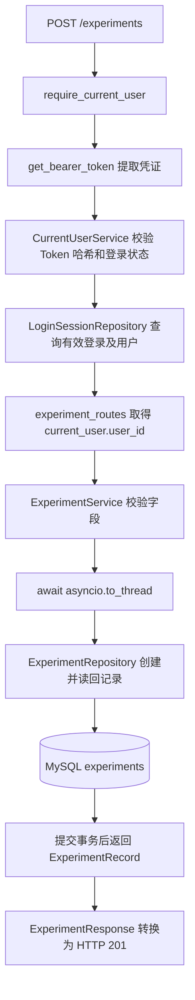

# 实验记录管理接口与模块说明

日期：2026-10-25。项目：E:\code\LangChian_New。

后续运行记录阶段已完成：定义与参数快照、幂等创建、分页、详情及本人最近训练查询，完整回归 777 项。详见 [实验运行记录与最近训练查询说明](实验运行记录与最近训练查询说明.md)。本篇保留实验定义阶段的说明与验收记录；远程训练、日志和 Agent 工具仍未实现。

## 1. 本阶段做了什么

新增 experiments 实验定义表，接入创建、分页列表、详情三个 HTTP 接口。每次操作都依赖已有登录校验，用户身份来自 Token，不由请求正文指定。

本阶段的实验是“要研究什么”的记录：标题、类型和说明。例如“对比两种学习率”，说明中写目的、预期、材料和约束。它不代表训练已经启动。

| 概念 | 保存什么 | 当前是否实现 |
| --- | --- | --- |
| 实验定义 experiments | 谁的实验、标题、类型、说明、时间 | 本阶段已实现 |
| 每次运行 experiment_runs | 定义/参数快照、状态元数据和引用预留 | 后续阶段已完成记录基础，尚未真实执行 |
| 执行器 Runner | 启动受控脚本、停止、查询运行、恢复 | 后续实现 |
| 监控与分析 Agent | 根据日志和指标生成分析、修改建议 | 后续实现 |

一个实验将来可以运行多次，不能把所有运行结果反复覆盖到同一条实验定义中。本阶段未新增执行命令、脚本路径、自动运行、模型调用或 Redis 队列。

## 2. 启动与在 /docs 中验证

在已有 langchain 环境、项目根目录执行。MySQL 服务应已启动，服务器应已有 MYSQL_PASSWORD。实验接口不需要个人模型 Key 或模型加密主密钥。

```powershell
Set-Location E:\code\LangChian_New

# 已有项目库，仅补实验表。可重复执行，不运行聊天回填。
python -m app.database --experiment-schema

# 启动或重启服务，加载新增路由。
python -m uvicorn app.main:app --reload
```

打开 http://127.0.0.1:8000/docs，按下面顺序操作：

1. 使用已有注册接口创建测试账号，或直接使用已有账号登录。
2. 调用 POST /auth/login，复制返回的 access_token。
3. 点击页面 Authorize，在 BearerAuth 中粘贴 Token，确认授权。
4. 在“实验管理”分组中找到 POST /experiments，点击 Try it out，输入下面的 JSON 并执行。

```json
{
  "title": "第一次学习率对比实验",
  "kind": "training",
  "description": "目的：比较两组学习率的验证集表现。先登记实验，后续再接入训练脚本。"
}
```

预期返回 201，包括自动生成的 experiment_id、规范化标题、类型、原始说明和带 UTC 时区的时间。响应 Location 指向详情地址。UUID 由后端生成，创建请求里不要填写 user_id 或 experiment_id。

5. 调用 GET /experiments，limit 保持 20，before_id 不填写。预期返回自己的实验列表。
6. 调用 GET /experiments/{experiment_id}，粘贴创建结果中的 ID。预期返回 200 和完整说明。
7. 如果列表的 next_cursor 不为 null，把它填入下一次 GET /experiments 的 before_id，继续查看更早的实验。

列表最小示例：

```json
{
  "items": [
    {
      "experiment_id": "430390d71ece4e63ae202043b057e9c2",
      "title": "第一次学习率对比实验",
      "kind": "training",
      "created_at": "2026-10-25T02:00:00Z",
      "updated_at": "2026-10-25T02:00:00Z"
    }
  ],
  "next_cursor": null
}
```

示例 UUID 和时间只是格式演示；测试时必须使用实际返回的值。列表不带完整 description，点击详情再加载，避免每页重复传输长说明。

如果想用隔离临时库练习、退出后清理本次测试账号和数据：

```powershell
python -m scripts.run_chat_api_demo --port 8001
```

打开 http://127.0.0.1:8001/docs，实验接口也已挂载。这个应用使用临时库及假模型，Ctrl+C 正常退出后清理本次库；需要在其中重新注册登录，不能拿正式库 Token 使用。

## 3. 表结构与约束

| 字段 | 类型 | 含义和限制 |
| --- | --- | --- |
| id | CHAR(32)，主键 | 服务端 uuid4().hex，ASCII 二进制排序规则 |
| user_id | BIGINT UNSIGNED，非空外键 | 引用 users.id，禁止引用不存在的用户 |
| title | VARCHAR(200) | 必填，服务端去除首尾空白后 1～200 字符 |
| kind | VARCHAR(16) | script 或 training，大小写精确匹配，仅表示分类 |
| description | TEXT | 可省略，默认空字符串，最多一万字符；原样保存缩进和换行 |
| created_at | DATETIME(6) | INSERT 使用 UTC_TIMESTAMP(6) 显式写入 UTC |
| updated_at | DATETIME(6) | 当前创建时等于创建时间，之后编辑功能再负责更新 |

数据库还包含类型、标题、说明长度和时间顺序的 CHECK 约束，以及 `(user_id, created_at DESC, id DESC)` 索引。外键防止孤立实验，不能替代读取时的用户归属条件。

DATETIME 本身没有时区，读取时仓储按本表“始终写 UTC”的约定补上 timezone.utc，HTTP 返回 Z。没有将数据库的本地时间误认为 UTC，也没有修改服务器时区。

建表使用 CREATE TABLE IF NOT EXISTS。它适合重复补建新表；如果将来字段变更，仍需独立迁移，不能认为重复运行会自动升级任意旧表结构。MySQL DDL 存在隐式提交，不能依赖 Python rollback 撤销已经创建的表；本次选择性迁移只有这一张新表。

## 4. 创建请求的完整调用顺序



require_current_user 不是再次验证用户名和密码。登录时账号密码验证已经完成；后续每次请求验证 Token 是否有效、过期、撤销，以及用户是否仍存在。

get_bearer_token 只提取 Authorization 中的原始凭证。CurrentUserService 通过 TokenService 计算哈希，由 LoginSessionRepository 查询有效登录记录，成功后返回公开的 UserResponse。未通过时，实验路由不会继续执行。

实验路由只把 current_user.user_id 传给业务层。即使 URL 加上 user_id=别人编号，也不会改变身份；JSON 中额外的 user_id、command、experiment_id 等字段直接被拒绝。

创建仓储生成 UUID，执行 INSERT ... SELECT ... FROM users WHERE id=%s：只有用户仍存在才插入。如果校验身份后用户已删除，影响行数为 0 或外键失败，转换为 401。随后在同一事务里读回完整记录，成功 commit 才返回；读回失败则 rollback，不留下半完成的创建。

## 5. 列表和详情如何校验归属

详情 SQL 同时包含 WHERE user_id=%s AND id=%s。ID 正确也不代表有权限，不能只按实验 UUID 查询后直接返回。不存在和属于别人都返回同一个 404。

列表只查询当前用户的记录，每页默认 20，最大 100。按照 created_at DESC、id DESC 排序，时间相同时用 ID 排出确定顺序。

第一页读取 limit+1 条：前 limit 条返回给用户，多出来的一条只用来判断还有没有下一页。只有确实还有记录时，next_cursor 才是最后一条已返回实验的 ID；否则为 null。

下一页把 next_cursor 作为 before_id。仓储先在同一个只读快照里核对该游标属于当前用户，并读取它的创建时间，再查“时间更早，或时间相同但 ID 更小”的记录。这个过程不使用 OFFSET 扫过越来越多的旧页。

新插入且时间更晚的实验不会挤入已经开始向旧记录翻页的后续页。多次 HTTP 翻页不是同一个永久快照；期间若有删除、修改或外部导入，仍应按实际记录处理。目前没有实验编辑/删除接口，若游标被外部删除则返回 404，前端从第一页刷新。

联合索引用于支持用户过滤和排序；具体是否使用、使用范围仍由优化器和数据分布决定，不能仅凭索引定义承诺大规模性能。[MySQL 联合索引说明](https://dev.mysql.com/doc/refman/8.0/en/multiple-column-indexes.html)

## 6. Python 模块与导入包分别负责什么

| 模块 | 职责 |
| --- | --- |
| app/models/experiment.py | 数据对象、类型枚举和共享校验，不连接数据库、不依赖 FastAPI |
| app/repositories/experiment_repository.py | 加载 SQL，创建、归属查询、分页、事务和 UTC 数据转换 |
| app/services/experiment_service.py | HTTP 可等待的业务入口，校验后通过 to_thread 调用同步仓储 |
| app/api/experiment_schemas.py | Pydantic 请求与响应结构，额外字段限制、严格字符串、长度及类型约束 |
| app/api/experiment_routes.py | 三个 HTTP 入口、身份依赖、异常映射和禁止缓存的成功响应 |
| app/api/dependencies.py | 新增 get_experiment_service，组装并缓存固定协作者 |
| app/main.py | 导入 experiment_router，并用 app.include_router 注册 |
| app/database.py | 新增 _ensure_experiments 与 --experiment-schema，完整初始化也包含新表 |
| app/errors.py | 新增 ExperimentNotFoundError 与 ExperimentStorageError |
| app/logging_config.py | 新增两类实验异常的固定、安全原因说明 |

### models：数据对象与校验

- dataclasses.dataclass：生成不可变数据对象。ExperimentOverview 是列表项；ExperimentRecord 继承 Overview 并增加 description；ExperimentPage 保存 items 元组和 next_cursor。这是普通 Python 继承，与 Depends 注入不同。
- typing.Literal：声明 kind 只能为 training 或 script；HTTP 由 Pydantic 运行时检查，直接 Python 调用由共享校验函数检查。
- uuid.UUID：核验和规范化实验 ID，不负责生成新实验。
- normalize_required_text：复用标题去空白和长度检查；另验证 UTF-8 编码，拒绝非法代理字符。

### repository：数据库边界

- pathlib.Path：加载项目 sql 文件，构造仓储时不连接数据库。
- uuid.uuid4：仅创建实验时生成 UUID。
- datetime.timezone：读取数据库时间时附加 UTC。
- mysql.connector.IntegrityError / errorcode：识别外键失败；其他数据库错误继续交给接口安全处理。
- get_connection：每次操作建立自己的同步连接，连接不在 lru_cache 中共享。
- logged_operation：记录模块、函数、源码位置、请求关联、耗时与安全异常类型。

### service：异步业务入口

- asyncio.to_thread：将同步 MySQL 操作交给线程执行；await 等待结果时，让出事件循环供其他请求运行。没有把同步数据库函数错误地直接 await，也没有在 async 路由里直接阻塞执行 SQL。
- 同一套校验在 service 与 repository 使用：业务入口提前拒绝非法输入，仓储也保护脱离 HTTP 的直接调用。它们不重复查询用户表；创建时的 SQL 与外键负责最终关联约束。

### schemas 与 routes：HTTP 边界

- pydantic.BaseModel / Field / ConfigDict：输入拒绝额外字段，字符串严格校验；输出通过 from_attributes=True 从数据对象取值，不是直接返回数据库连接或随意字典。
- typing.Annotated：给字段或 Query 参数附加长度、范围等说明。
- FastAPI APIRouter：定义 /experiments 分组，最终由 main 挂载后才出现在正式 /docs。
- Depends(require_current_user)：返回本次身份；Depends(get_experiment_service)：提供业务对象。这不是把两个类的方法继承给一个对象。
- Query：声明分页数量 1～100；uuid.UUID 声明路径和游标格式。
- HTTPException：将业务含义转换为 HTTP 状态与安全提示，不把原始 MySQL 错误传给用户。
- Response：设置 Location、Cache-Control: no-store 和 Pragma: no-cache。
- logging / log_failure：持久记录错误，固定字段脱敏；不记录标题、说明、密码、Token 或 Key。

get_experiment_service 使用 lru_cache(maxsize=1) 缓存仓储和业务协作者，避免每次重新读取 SQL。不会缓存用户、实验列表、Token 或数据库连接。配置/SQL 文件缺失在这个依赖工厂转换为通用 503。

路由挂载机制沿用 FastAPI 官方推荐的 APIRouter + include_router 分文件结构。[FastAPI 多文件应用说明](https://fastapi.tiangolo.com/tutorial/bigger-applications/)

## 7. SQL 文件职责

| 文件 | 作用 |
| --- | --- |
| create_experiments.sql | 新表、外键、CHECK、列表索引；选择性迁移只执行这一份 |
| create_experiment.sql | 为仍存在的用户原子插入实验和 UTC 时间 |
| get_experiment.sql | 按 user_id + id 查询完整详情，也用于创建后读回 |
| get_experiment_cursor.sql | 在当前用户范围内查询游标的 created_at |
| list_experiments.sql | 当前用户第一页，读取 limit+1 条概览 |
| list_experiments_before.sql | 当前用户创建时间/ID 边界之前的下一页 |

所有数据值用 execute(sql, parameters) 传入，说明中的引号或 SQL 文字只是文本。接口不接收 SQL，不用用户名拼表名，也不执行说明中的命令。

## 8. HTTP 状态、日志和手动失败测试

| 情况 | 状态 | 结果 |
| --- | --- | --- |
| 创建成功 | 201 | 返回持久化记录和 Location |
| 列表/详情成功 | 200 | 列表为空仍是成功 |
| 标题只有空白，或业务参数不合要求 | 400 | 请求参数不符合要求 |
| 缺少/无效/过期/撤销 Token，或创建时用户已不存在 | 401 | 登录已失效，并带 WWW-Authenticate: Bearer |
| 实验/分页游标不存在或属于他人 | 404 | 实验不存在或不属于当前用户 |
| 缺少字段、类型错误、额外字段、UUID 错误、分页范围错误 | 422 | 全局校验处理器生成安全字段错误，不回显原始输入 |
| 数据库或实验存储异常 | 503 | 请稍后重试 |

手动验收建议依次测试：未授权访问；正常创建；空白标题；JSON 添加 user_id；kind 改成 shell；limit=101；错误 UUID；第二个账号查询第一个账号的实验。最后一种应得到与随机不存在 UUID 相同的 404。

logs 中可按 request_id 找到 request_logging → experiment_routes → experiment_service → experiment_repository 的记录和根因。底层已经记录的异常不会逐层重复打印完整调用栈。普通用户响应不会出现数据库连接、SQL、密码或内部异常文本。

## 9. 测试入口与本次结果

常规测试：

```powershell
python -m unittest tests.test_experiment_repository tests.test_experiment_service tests.test_experiment_api tests.test_experiment_migration -v
python -m unittest discover -s tests
```

真实登录、HTTP、MySQL 与隔离临时库验收：

```powershell
python -m scripts.verify_experiment_api_mysql
```

脚本复用 _chat_api_test_app 的独立随机库与真实登录服务，实验仓储全部 SQL 重写到该临时库；验证结束由上下文管理器清理本次库。模型构造器被禁止，实验接口不需要模型 Key。

本次结果：36 项新增专项、729 项完整常规回归通过；12 组实验 HTTP/MySQL 验收通过。额外核对创建失败回滚、相同时间排序、翻页期间新增记录、最大四字节 UTF-8 说明、SQL 文本作为正文、数据库失败安全响应、注销 Token 和持久日志脱敏。

已有聊天上下文的 16 组 HTTP/MySQL 回归和容量检查的 8 组临时库验收也通过；临时库均已清理。未联网安装新依赖，未调用收费模型。

## 10. 对其他模块的衔接与边界

容量检查的固定业务表范围同步由七张增加为八张，包含 experiments；其临时库验收也创建实验表。历史报告仍代表生成时的范围，不是实时数据。

本阶段没有实验编辑/删除、请求幂等键、运行状态、日志采集或调度。每次成功 POST 都表示新建一条实验；同名允许，网络结果不确定时先查看列表，不能假定重复提交会复用旧实验。将来自动运行的提交入口需要单独补齐幂等与任务状态校验。

本阶段技术栈：Python 3.12、FastAPI、Pydantic、已有 mysql-connector-python、MySQL 8.0 InnoDB、已有 python-dotenv 和项目日志，标准库 asyncio/dataclasses/uuid/datetime/pathlib/typing，以及 unittest 和 TestClient。没有新增 Redis、ORM 或收费服务。

experiment_runs 记录基础现已完成，接下来接执行目标和 Runner，真实运行结果归到对应 run，避免覆盖实验定义。

已确认用户要求：运行结束后的结果必须能接入聊天，供用户持续追问并获得有证据的建议。后续增加持久化的运行与会话关联，按当前用户权限加载结果报告和相关日志，再进入已有模型上下文管线。具体流程及验收见 [训练结果对话与建议设计](训练结果对话与建议设计.md)；当前实验登记和聊天接口尚未具备该关联。
