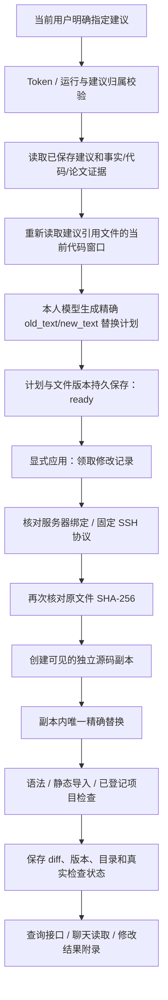

# 应用建议与代码修改：模块、技术栈和完整流程

日期：2026-10-28。项目：`E:\code\LangChian_New`。本阶段完成“指定已有建议 → 准备修改计划 → 显式应用到独立副本 → 保存差异和检查结果 → API/聊天查询”。当前 34 张共享业务表、53 条接口路径、66 个 HTTP 操作。

## 1. 当前行为



准备计划会读取当前源码并调用个人模型，不写远端代码。应用计划会写服务器独立目录，不再调用模型，不通过 Runner 启动训练。已有报告、分析和建议均保留。

服务器目录结构：

```text
原项目/
  原训练脚本、models 等             ← 编辑器不覆盖这些文件
  code_changes/
    <change_id>/
      request.json                  ← 固定计划摘要
      before/                       ← 本次修改文件的原始字节
      project/                      ← 筛选后的源码副本及修改
      check_1.log ...                ← 仅登记检查实际运行时产生
      result.json                   ← 本次完成结果，最后原子写入
      lock
```

这是源码候选副本，不是包含数据、权重、环境的完整训练部署。修改副本接入新训练、与原运行对比、合并回原项目，是下一阶段。

## 2. 为什么分计划与应用

计划和应用是两个可查询状态。模型先给出具体旧文本、新文本和原因，后端检查路径与原文是否来自本次实际读取窗口。用户可以先查看计划，也可以通过明确聊天指令让 Agent 连续准备并应用。

模型不能提供任意命令、远端根目录、SSH 凭据或项目检查命令。计划只允许改已读且被该条建议引用的已有文件，最多 3 个文件、6 次替换。不能用此阶段创建或删除项目源码文件。

old_text 必须非空、确实出现在提供给模型的连续窗口内；不同窗口不能拼成虚假的连续代码。远端再确认它在文件中唯一出现，重名多处会报告 REPLACEMENT_CONFLICT。替换后保留 UTF-8 BOM 和原有 LF/CRLF；混合换行格式明确拒绝，避免无意重写整文件格式。

## 3. 每个模块和引用技术

| 模块 | 职责 | 技术/包 |
| --- | --- | --- |
| app/models/code_change.py | 请求/计划/结果 Schema、配置、模型计划验证、当前原文指令判断 | Pydantic、dataclasses、re、uuid、既有严格 JSON/摘要函数 |
| app/repositories/code_change_repository.py | 本人建议读取、幂等记录、租约、聊天领取、计划/结果事务保存 | mysql-connector、参数化 SQL；复用 ContextRepository 的会话/尝试校验 |
| app/services/code_change_service.py | 当前源码读取、个人模型规划、绑定核对、准备/应用生命周期、取消及凭据释放 | asyncio.to_thread / timeout / shield、既有个人网关工厂 |
| app/services/code_change_transport.py | 固定 bootstrap，计划经 stdin，结果绑定校验 | AsyncSSH、json、shlex、Pydantic |
| app/runner/code_editor.py | Linux 内执行固定副本编辑器、diff 与检查 | os/dir_fd/O_NOFOLLOW、fcntl、hashlib、difflib、ast、importlib.machinery、subprocess、resource |
| app/api/code_change_routes.py | 四个鉴权 HTTP 操作及安全错误映射 | FastAPI、Depends、Query、UUID、HTTPException |
| app/models/code_change_tools.py | 聊天工具 Schema、有界预览、程序生成修改结果附录 | Pydantic、dataclasses；复用 ResearchReply |
| app/services/chat_code_change_service.py | 聊天适配，生成固定请求编号，把当前会话/尝试带给仓储 | asyncio、既有内容摘要函数 |
| app/api/dependencies.py | 查询与执行协作者的延迟组装 | lru_cache、functools.partial、依赖注入 |
| app/services/read_only_chat_service.py | 明确修改模式、工具选择、预算/超时、聊天审计与结果展示 | 既有有界工具循环 |
| app/runner/source_reader.py | 公共有界字节读取与版本验证；普通源码查询排除 code_changes | Linux 文件描述符、stat、hashlib |
| app/config.py / app/database.py / app/main.py | 配置、增量建表、路由挂载 | python-dotenv、MySQL DDL、FastAPI.include_router |

没有新增 Python 依赖、Redis Stream、后台 Worker 或通用沙箱框架。Redis 继续负责既有聊天缓存和报告事件通信；本阶段修改是一次有超时、可重放的 HTTP/聊天操作。

## 4. 四个接口如何鉴权与调用数据库

以准备接口为例：

1. main.py 使用 include_router 挂载 code_change_routes。
2. `Depends(require_current_user)` 提取并验证当前 Token，取得用户 ID；不接收请求体里的 user_id。
3. `Depends(get_code_change_service)` 只组装对象，不立即读取个人 Key、连接 SSH 或调用模型。
4. 路由将 run_id、suggestion_task_id、第几条建议和 request_id 交给 Service。
5. 仓储先检查运行、建议任务和用户归属，核对已保存建议摘要及上游事实；证据不足、建议编号不存在、旧报告均不能直接应用。
6. 查相同请求记录：已有计划或正在处理时复用，不再次生成。否则登记 planning 与 300 秒租约。
7. Service 在事务之外读取当前源码、调用个人模型，生成计划；按租约令牌保存 ready。

GET 修改记录仅访问 MySQL，不需要个人模型 Key，也不连接 SSH。已准备计划的重放不要求 Key。POST apply 使用当前用户的持久记录和固定目标，凭据只在实际 SSH 阶段解密，finally 清除字典引用；不会写进计划、结果或日志。

数据库等待用 to_thread，不把同步驱动直接阻塞在 asyncio 事件循环。规划整体上限 150 秒、应用整体上限 120 秒；租约 300 秒，处理超时或取消后记录可恢复状态。旧令牌不能覆盖新尝试。

## 5. 聊天授权与工具

| 工具 | 普通查询可用 | 行为 |
| --- | --- | --- |
| list_code_changes | 是 | 查看当前/指定本人运行的修改记录 |
| get_code_change | 是 | 查看已有计划、实际差异和检查预览 |
| prepare_code_change | 仅明确修改模式 | 为已保存建议准备精确替换计划 |
| apply_code_change | 仅明确修改模式 | 将同一计划应用到独立副本 |

聊天模式判断使用数据库中当前人类原文，不能由历史摘要、论文、日志或模型的 authorized=true 获得授权。讨论、引用、条件句、否定不提供写工具；仓储执行时仍核对当前会话归属、生成尝试和原文指令。

明确示例：`应用运行 <本人run_id> 的第1条建议，不要启动训练`。否定“启动训练”不会误伤前面明确的代码应用指令。也可明确指定修改 ID；“应用这个修改”只指本会话最近登记的修改，不能由模型任选一条旧记录。

修改模式不同时提供训练启动和公开论文读取工具。一次用户提问最多应用一个 change_id，code_change_claims 的会话/轮次主键负责限制；模型不能通过同一轮多次工具调用批量应用。准备请求编号由会话/当前轮次稳定生成，不接受模型随意更换。仅说建议编号时，只能应用本轮新准备的计划；应用旧计划需要明确修改 ID，或使用本会话最近修改的明确指代，不能由模型选一份同编号旧计划代替。

准备成功而未应用时，程序明确返回“计划已准备，尚未应用”；应用未取得已保存结果时不接受模型声称已经完成。应用成功时由程序附实际修改 ID、目录、文件及检查状态。聊天只展示有界 diff 预览，完整内容见 API。

## 6. 文件版本变化如何处理

建议中记录的是当时读过的文件。准备计划时重新读取当前代码，保留 suggestion_sha256 和 before_sha256：两者不同则 `source_changed_since_suggestion=true`，模型只能基于本次当前窗口重新定位。窗口不足或无法可靠生成替换时明确拒绝，不编造旧位置。

同一文件的多个窗口使用相同文件版本，缺口不拼接成连续文本。应用前在远端再次核对 before_sha256；模型规划之后文件又变化则记录 conflict/SOURCE_CHANGED，原项目不会被覆盖。需要基于新代码重新准备时使用新的 request_id，旧计划不会被悄悄改写。

服务器配置、运行绑定和根目录也必须与准备时一致，变化后记录 TARGET_CHANGED，不向另一个目标写入。

## 7. 副本范围与项目配置

源码副本复用源文件路径与凭据模式策略：不跟随符号链接，排除隐藏/凭据文件、已知权重/输出目录、非允许文本扩展名和当前输出目录。每个文件最多 1 MiB，最多 512 个源码文件、20 MiB 总源码、4096 个扫描条目。

不能只凭名称识别任意项目的数据目录。因此部署者可在 code_change_checks.json 按登记脚本 ID 配置实际数据目录排除项，避免扫描大型数据集。配置会冻结进计划，模型无法提供或更改。超限会明确失败，不声称拿到了完整项目。

```json
{
  "实际登记的script_id": {
    "checks": [],
    "exclude_directories": ["tiny_COD", "其他实际数据目录"]
  }
}
```

上面只是 PRNet 目录填写示例，代码没有硬编码 PRNet。排除项是项目内相对路径，不能使用绝对路径或 `..`。已经排除的文件不能被模型重新添加进修改计划。数据加载器若位于 data/loaders.py，不应把整个 data 目录排除；应填写实际存放样本的子目录。

不同源文件不是完整项目原子快照，也不保证与训练时全部依赖一致。这个阶段不自动复制数据/权重或创建指向原项目的数据链接；完整训练环境的接入留到候选副本训练阶段。

## 8. 三类检查分别证明什么

| 检查 | 实现 | 能证明的范围 |
| --- | --- | --- |
| syntax | 对修改的 Python 文件 ast.parse | 在远端辅助 Python 版本下语法可解析；不执行文件 |
| imports | AST 提取导入，静态检查当前辅助 Python 的顶层模块可发现性及相对路径 | 不执行 import，不证明导入符号、版本、运行环境或训练兼容 |
| project | 仅运行部署者登记的 pytest/unittest | 显示该检查真实退出码、失败或超时；未登记显示 not_configured |

缺少模块、未修改 Python、未登记项目测试等情况标记 incomplete/not_configured，不能说全部检查通过。语法或登记检查失败时主状态为 checks_failed，副本和 diff 仍保留供查看；不会回滚或覆盖原项目。

登记项目检查最多三项，每项 30 秒以内，固定 Python 的 pytest/unittest 模块与参数列表，不走 shell。默认不执行项目测试。执行时设置 CUDA_VISIBLE_DEVICES 为空、限制线程和日志输出，超时结束进程组；不转发后端个人 Key/SSH 凭据。

登记测试会执行项目代码，属于部署者选择的可信 CPU 检查，不是操作系统沙箱；其行为不等同于纯静态检查。选择检查时应确认不会启动训练或修改原项目。编辑器本身只写候选目录，不调用训练 Runner。检查使用的 python_executable 会保存，不能把辅助环境的检查当作其他 Conda 环境已验证。

## 9. 幂等、故障与重试

| 情况 | 行为 |
| --- | --- |
| 同一 request_id、同一建议重发 | 返回原计划或处理中状态，不重复调用模型 |
| 同一 request_id 换建议/运行/编号 | 409，不创建另一份修改 |
| 两个应用请求同时进入 | 只有一个租约；另一个收到冲突或已完成结果 |
| 远端已保存 result.json，但响应丢失 | 使用同一 change_id 重试，从远端完成记录恢复，不重新修改 |
| MySQL 提交成功但响应不确定 | 查询或重试同一记录，终态不被旧令牌改回失败 |
| WORKSPACE_BUSY | 原远端操作可能仍在结束，稍后查询/重试同一记录 |
| WORKSPACE_INCOMPLETE | 远端存在未完成副本；不自动覆盖或删除，检查该目录后用新请求准备新记录 |
| SNAPSHOT_TOO_LARGE | 配置实际数据目录排除项后，用新请求准备新计划 |
| checks_failed | 保留实际失败结果；修正方案需要新的修改记录，不假装通过 |

已完成记录是完成时的历史结果，不实时核对候选目录后来是否被手改或删除。重复应用不会覆盖用户后来手改的候选目录；后续训练前需要另行检查当前副本版本。

## 10. 两张表与持久内容

| 表 | 内容 |
| --- | --- |
| code_changes | 用户、运行、建议任务/编号、请求编号、来源快照及摘要、计划、租约、状态、实际 diff/检查、目录和时间 |
| code_change_claims | 当前聊天轮次实际应用的 change_id，限制同轮批量应用 |

code_changes 是实验修改记录，独立于聊天保留；删除聊天会清除对应领取记录和聊天内容，不删除实验修改档案及服务器候选目录。来源快照只复制所选建议和相关证据，不保存聊天密码、Key 或 SSH 明文。

原建议中的“尚未应用”是生成时的说明，也不代表已合并回原项目；当前是否已有候选副本及检查结果以 code_changes 为准，不改写原建议的证据快照。

通用日志继续使用 request_id、模块/行号和安全异常链；具体代码、模型计划和检查摘录存于专用记录，不写通用日志。远端 check_N.log 属于所登记测试的本地输出，API 返回内容经过脱敏和限长。

## 11. 验证

完整单元测试、HTTP/MySQL 验收及 Linux 真实标准库编辑器检查的最终数量见 [文件清单与验证结果](代码修改阶段文件变更清单.md)。Linux 检查只使用随机临时目录及 CPU 微型 unittest，未改真实 PRNet 项目、权重或启动训练；模型规划和 HTTP 远端使用替身，未调用付费模型。

接口字段、配置例子和操作顺序见 [接口与 Swagger 文档](代码修改接口与Swagger验证说明.md)。
