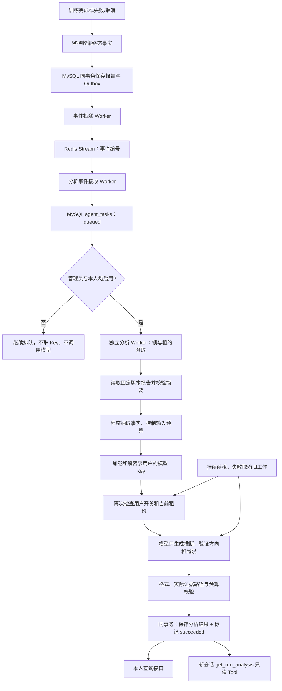

# 独立分析 Agent：执行、租约与证据结果

日期：2026-10-27。项目：`E:\code\LangChian_New`。

## 1. 本阶段能力与边界

上一阶段只把完整终态训练报告交付为 `agent_tasks.status=queued`。本阶段新增独立 `analysis_worker`：领取任务、读取该版本不可变报告、构造有界证据、调用本人的模型、校验输出、原子保存结果和任务成功状态。新会话可通过只读 Tool 查询已存分析。

这是一名只读报告分析 Agent。它没有 SSH、训练启动、代码修改或论文检索工具。输出里的 recommendations 是需要对照验证的实验方向，不是已经具备论文依据的修改方案；联网有据建议 Agent、分析完成事件到下游的自动编排、Skill、论文 RAG 和代码修改闭环仍是后续阶段。

后台模型调用采用双开关：管理员默认关闭；用户偏好也默认关闭。查询接口和聊天读取已存结果不会开启后台分析。验证使用模拟网关，无付费调用、真实 SSH/GPU 作业。

## 2. 当前完整流程



Redis 仍负责事件交付；分析任务接收后已持久化 MySQL，执行器轮询 MySQL 的 queued/过期 running 任务。不需要为同一任务再维护另一套 Redis 执行状态，也不会把 Redis ACK 当成分析完成。

API、监控、投递、接收和分析执行是不同进程。仅启动 FastAPI 不会自动启动常驻 Worker。

## 3. 状态和恢复

| 状态 | 说明 |
| --- | --- |
| queued | 等待处理；可能本人或管理员未启用 |
| running | 某个执行器持有有效租约；不等于模型已回复 |
| succeeded | 分析结果和该状态已在同一事务中提交 |
| failed | 模型超时/不可用等；需要本人显式重试 |
| attention | Key 缺失、格式/证据不合格、取消、租约中断、存储问题或多次进程中断，需要检查 |

领取使用 `FOR UPDATE SKIP LOCKED`，默认租约 90 秒、每 15 秒续租。领取令牌为随机 UUID，续租/写回都要求令牌一致、状态 running 且租约仍有效。结果写回还要求用户当前仍启用。

进程被强制杀死后，running 租约过期可由其他 Worker 领取；同一恢复周期最多领取三次，超过后进入 attention。`attempts` 保留总领取次数；`attempts_in_cycle` 在本人明确重试后清零。优雅取消进入 attention，不自动马上重新调用模型。

关闭本人开关会阻止后续领取和模型调用前检查；正在运行的工作在续租检查失败后取消，不再发布结果。已经发送给供应商的请求不能保证撤销其上游处理或计费。

模型请求、Key 获取、模型关闭都不持有 MySQL 事务。提交时先锁 run，再锁 task，与报告/事件接收保持一致的锁顺序。结果 INSERT 与任务 succeeded 更新同事务：失败一起回滚；提交成功但调用方丢失确认时，旧令牌的 fail 不会把成功任务改回失败，后续领取也不会再次处理成功任务。

不能承诺供应商调用严格一次：进程可能在供应商已生成但结果尚未落库的窗口崩溃，租约恢复后可能再次调用。执行器关闭 SDK 自动重试（普通聊天仍保留原默认重试），格式错误不自动再问一遍，恢复次数有上限。默认开关与本阶段全部模拟验收避免未经启用的后台费用。

## 4. 事实、推断和建议如何分开

程序从冻结报告抽取 `facts=[{path,value}]`，路径采用 JSON Pointer，例如：

```json
{
  "path": "/series/0/last_value",
  "value": 0.03
}
```

模型请求使用 JSON 输出模式并关闭思考输出；后端仍严格校验结果。模型不能提交自己的 facts，只返回：

```json
{
  "inferences": [
    {"text": "只有一次观测，暂不能判断趋势。", "evidence_paths": ["/series/0/points"]}
  ],
  "recommendations": [
    {
      "text": "补齐相同评测协议下的多轮验证观测。",
      "evidence_paths": ["/parameters/epochs"],
      "verification": "固定数据划分和其余参数，对比验证指标曲线。"
    }
  ],
  "limitations": ["没有核实论文依据，不能认定某项改动一定有效。"]
}
```

后端拒绝未实际提供的证据路径、重复引用、额外 facts、错误 JSON、空白文字、超长内容和未核实链接。来源 UUID、报告版本、报告 SHA-256、事实和固定能力提示由程序补充。

存储/读取时还逐项比较每个 fact.value 与该路径上的原报告值。数值没有经过模型改写，也不允许修改后仅重新计算结果摘要就冒充原事实。路径有效只证明引用存在，不能证明模型因果推断或建议本身正确。

单次指标、观测极值或一轮训练不能证明收敛、过拟合、泛化改善或异常根因。缺少基线、评测声明或验证曲线时，模型必须说明局限；输出需要用户审阅与实际对照验证。

## 5. 输入预算和隔离

分析上下文独立于聊天历史，只含本任务的报告证据，不复用另一个用户的会话列表。默认输入预算 49152，仍是项目原有 UTF-8 保守估算，不是供应商精确 tokenizer；输出上限 2048。

最多 256 个事实，指标组整体保留或整体省略，避免保留数值却丢掉 dataset/split/metric_name。记录 `omitted_fact_count` 并补局限说明。敏感参数名、明显凭据片段、过长字段等不送入分析上下文；这不是对任意用户文本的完美敏感信息识别保证。

不执行报告、参数或日志里的命令。后台网关只调用 invoke，没有绑定训练/网页 Tool。结果即便给出了实验方向，也不会自动应用到项目。

## 6. 数据设计

MySQL 共 29 张共享业务表，不按用户建表。

`agent_tasks` 保留来源、用户、run、报告版本与原状态，新增：

| 字段 | 作用 |
| --- | --- |
| attempts | 总领取次数 |
| attempts_in_cycle | 本次显式重试周期内的领取次数 |
| lease_token / lease_until | 当前执行凭证与有效期；只内部使用 |
| next_attempt_at | 可领取时间，空表示立即；本阶段模型错误不自动排队重试 |
| last_error_code | 固定安全分类，不存供应商错误正文 |
| started_at / finished_at | UTC 执行时间 |

`analysis_preferences`：user_id 主键及外键、enabled、updated_at；缺行即关闭。启用会允许处理本人已有未处理队列，包括启用之前已排队的报告，接口和文档明确说明。

`analysis_results`：task_id 主键/外键、content_json、content_digest、model_name、created_at。每个任务最多一份不可变结果；用户归属和 run/event/report_version 从关联任务和 Outbox 查询，不重复引入可能不一致的用户列。

已成功结果不允许显式重跑覆盖。新版报告生成新 event/task；旧分析保留，读取时 `is_stale=true`。训练状态不因分析失败而变成失败。

迁移命令：`python -m app.database --analysis-schema`。新安装走完整初始化也包含该迁移。旧版字段一次 ALTER 增量加入，已有队列和报告保留；发现部分迁移/类型不符时停止，不擅自重写旧数据。DDL 不具备整段业务事务回滚语义，建表命令可重复执行。本阶段不会开启本人偏好或后台开关。

## 7. 模块与技术栈

| 模块 | 责任 |
| --- | --- |
| app/models/analysis.py | dataclass 设置、Pydantic API/模型输出契约、预算内事实包、输出与持久结果证据校验 |
| app/repositories/analysis_repository.py | 参数化 SQL、本人开关、领取/续租/失败/重试、原子结果提交、来源校验与本人查询 |
| app/services/analysis_service.py | 双开关、按用户网关、心跳任务与模型任务协作、取消、超时和固定错误分类 |
| app/workers/analysis_worker.py | 独立进程入口，默认退出不开模型；显式开启后循环领取，异常有界退避 |
| app/api/analysis_routes.py | Token 确定本人身份，UUID/分页校验，安全错误与 no-store；不组装模型网关 |
| app/models/analysis_tools.py | get_run_analysis 参数和有界分页投影，标明旧报告/推断/局限 |
| app/services/read_only_chat_service.py | 按需分发查询已保存分析，与原 Tool 循环和审计整合，不启动后台分析 |
| app/repositories/chat_tool_repository.py | 将新只读工具纳入同一会话/attempt 校验与审计 |
| app/api/dependencies.py | 查询服务只组装仓储，聊天注入只读查询工厂，不缓存用户或 Key |
| app/services/model_gateway.py | 允许后台传 max_retries=0；普通聊天默认值仍为 2 |
| app/database.py / sql | 增量字段、两张新表和所有固定 SQL，原数据保持 |
| app/logging_config.py | 增加安全 task/run/event 编号、版本、次数、固定错误分类及中文原因；不记录原文/Key/租约令牌 |
| app/repositories/capacity_repository.py | 将两张新表纳入只读容量检查 |
| tests/test_analysis.py | 契约、权限、默认禁用、取消/续租、迁移和安全日志单元检查 |
| scripts/verify_analysis_mysql_redis.py | 完整 HTTP/MySQL/Redis/假模型联调，随机临时资源退出清理 |

技术栈没有新增依赖：FastAPI/Pydantic 负责接口和结构；mysql-connector-python 负责同步事务/行锁；asyncio.to_thread 隔离同步数据库调用；asyncio Task/timeout 实现续租与取消；现有 LangChain/ChatDeepSeek 负责个人模型调用；Redis Streams 保持既有交付链；hashlib/json 校验报告与结果；统一 logging 记录脱敏执行位置。

实例不会跨用户保存可变模型上下文。生产多副本仍需独立压力、故障演练和模型质量验收，模拟模型联调不等于真实供应商回答已经验收。

## 8. 下一阶段

接“已保存分析 → 分析完成事件/独立研究建议 → 实际论文正文引用 → 用户审阅”，再实现可审计改动和对照实验；此前不将当前建议称为已核实论文支持的自动修改。

接口与启动见 [独立分析Agent接口与Swagger验证说明](独立分析Agent接口与Swagger验证说明.md)；全部新增/修改见 [独立分析Agent阶段文件变更清单](独立分析Agent阶段文件变更清单.md)。
