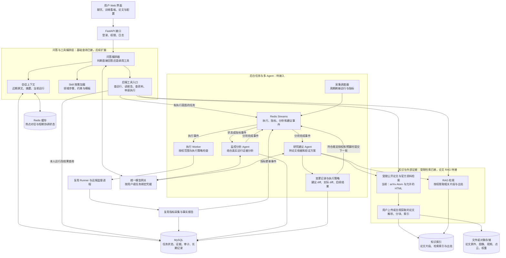
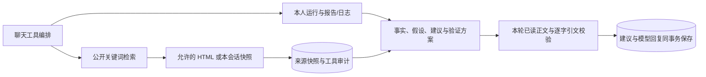
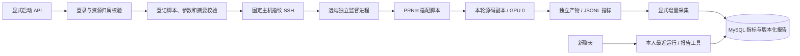
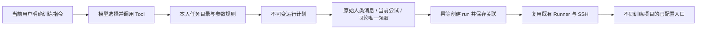

# 实验助手：总体架构图与模块分层

日期：2026-10-28。依据当前项目 `E:\code\LangChian_New` 的路由、服务、仓储和 Runner 实现整理。当前共 67 条接口路径、83 个 HTTP 操作、39 张业务表；历史章节保留各阶段的数量。

## 1. 目前是什么架构

目前是 **模块化单体后端＋独立监控与消息 Worker＋Redis Streams / 上下文缓存＋远端独立执行器**。

“模块化单体”表示登录、聊天、实验管理、指标和报告都在同一个 FastAPI 应用里，代码按职责分模块，并没有部署成多个独立微服务。“远端独立执行器”表示训练由训练服务器上的监督进程启动和管理，不要求发起操作的 HTTP 连接一直保持。

当前已有聊天 Agent、独立后台分析/建议执行器和普通监控/消息 Worker。聊天可查询本人运行、报告、日志、已保存分析/建议和源码，也可按当前明确指令应用指定建议到独立源码副本。报告通过事务 Outbox、Redis Streams、Inbox 交付；分析完成与建议任务登记同事务提交。建议 Worker 生成带代码/论文依据的方案，修改服务负责计划、版本核对、独立副本和检查记录。修改后训练服务已接通候选源码预检、原运行/修改/新运行关联、显式启动及同协议报告对比。本人 PDF 知识库已接通分页分块、关键词检索及实际引文校验；动态Skill已支持每轮手动选择部署Markdown、快照审计与原版本重试。Skill自动推荐、向量语义检索和正式前端仍待后续完成。

下面第一张图只画已经接通的代码。第二张图表示后续目标，两张不能混当成当前部署现状。

## 2. 当前已实现架构

```mermaid
flowchart TB
    U["用户入口<br/>Swagger /docs 或接口客户端"]

    subgraph APP["应用服务层：一个 FastAPI 后端"]
        ENTRY["API 路由与公共处理<br/>请求校验、请求日志<br/>受保护接口校验 Token 与用户归属"]
        CHAT["聊天与会话业务<br/>消息保存、幂等、失败重试"]
        CONTEXT["上下文管理<br/>预算检查、保留近期对话<br/>历史摘要与长问题精简"]
        SKILLCATALOG["动态Skill目录与冻结选择<br/>可信部署SKILL.md、手动选择<br/>每轮正文/版本/SHA随问题保存"]
        CHATTOOLS["聊天工具循环<br/>查本人事实、公开资料<br/>选择本人训练任务并显式启动"]
        RESEARCH["研究证据工具<br/>公开论文检索、有限 HTML 读取<br/>来源快照、引文校验与建议保存"]
        PAPERS["本人 PDF 知识库与 RAG 工具<br/>有界上传、独立解析、分页分块<br/>ngram 关键词检索、实际页码与引文"]
        SOURCE["源码只读工具与接口<br/>本人运行绑定、列目录与按行读取<br/>代码片段、行号与文件版本证据"]
        CHANGE["应用建议与代码修改服务<br/>明确指令、精确计划与版本检查<br/>独立副本、diff 与检查记录"]
        REVISION["修改后训练与对比<br/>副本指纹、原运行关联、显式启动<br/>复用监控报告、按评测声明对齐"]
        GATEWAY["个人模型网关<br/>读取本人密文 Key、解密后调用"]
        EXP["实验与运行管理<br/>参数、任务方向、评测配置快照"]
        RUNNER["Runner 服务与 SSH 传输<br/>显式启动、刷新、停止、读取日志"]
        METRIC["指标与事实报告<br/>有界采集、数据集隔离、质量标记"]
        REPO["Repository 仓储层<br/>参数化 SQL、事务、归属校验"]
    end

    subgraph REMOTE["训练服务器：远端执行层"]
        SUP["独立监督进程<br/>管理已登记脚本、状态与停止"]
        JOB["训练或评测脚本<br/>点云、跟踪、检测、伪装目标检测等"]
        CODE[("项目当前源码<br/>只读，不导入或执行用户源码")]
        CANDIDATE[("可见 code_changes 目录<br/>before / project / result / 检查日志<br/>固定编辑器写副本，不启动 Runner")]
        REMOTEFILES[("远端任务文件<br/>配置、状态、stdout/stderr 日志<br/>日志中的结构化 JSONL 指标")]
        SUP --> JOB
        SUP --> REMOTEFILES
        JOB --> REMOTEFILES
    end

    subgraph STORE["数据存储层"]
        DB[("MySQL：39 张共享业务表<br/>用户、聊天、摘要、凭据密文<br/>实验、运行、评测快照、指标、报告<br/>聊天关联、工具审计、资料、建议<br/>训练目录、计划、启动领取与监控任务<br/>事件 Outbox、Agent 任务、分析/建议开关与结果<br/>建议工具证据、修改记录与聊天领取<br/>修改后运行绑定与启动领取<br/>papers / paper_files / paper_chunks 全文索引")]
        REDIS[("Redis<br/>Streams：事件引用、消费组与死信<br/>Hash：加密上下文缓存、TTL、版本与末尾")]
        LOG[("应用日志文件<br/>request_id、调用位置、异常链")]
    end

    WORKER["独立监控 Worker<br/>MySQL 到期队列、租约、重试与恢复"]
    WORKER -->|"领取 / 条件写回"| REPO
    WORKER -->|"状态、终态产物发布与日志"| RUNNER
    WORKER -->|"增量采集 / 终态报告"| METRIC
    RELAY["独立 Outbox 投递 Worker"]
    RECEIVER["独立分析事件接收 Worker<br/>保存 queued 任务，不调用模型"]
    RELAY -->|"领取 / 条件写回"| REPO
    RELAY -->|"XADD 事件引用"| REDIS
    REDIS -->|"消费组读取 / pending 重领"| RECEIVER
    RECEIVER -->|"事务保存任务"| REPO
    RECEIVER -->|"提交后 XACK"| REDIS
    ANALYSIS["独立分析 Worker<br/>双开关、租约与心跳、证据校验"]
    ANALYSIS -->|"领取 / 续租 / 结果与状态同事务保存"| REPO
    ANALYSIS -->|"本人 Key、独立证据上下文、无 Tool"| GATEWAY
    SUGGEST["独立建议 Worker<br/>复用任务租约与心跳<br/>三类证据校验、尚未修改代码"]
    ANALYSIS -->|"结果与下一阶段任务同事务提交"| REPO
    SUGGEST -->|"领取 suggestion / 保存工具证据与结果"| REPO
    SUGGEST -->|"按需读取实际源码"| SOURCE
    SUGGEST -->|"公开关键词检索与正文读取"| PUBLIC
    SUGGEST -->|"按需检索和读取本人 PDF"| PAPERS
    SUGGEST -->|"本人 Key、有界只读工具循环"| GATEWAY
    CHATTOOLS -->|"按需读取已存分析/建议，不重跑"| REPO

    MODEL["外部 DeepSeek API<br/>用户自备 Key"]
    PUBLIC["受限公开资料<br/>arXiv Atom、论文 HTML、官方文档"]

    U --> ENTRY
    ENTRY --> CHAT
    ENTRY -->|"登录后查询目录或本人快照"| SKILLCATALOG
    CHAT -->|"新请求加载；重试读原快照"| SKILLCATALOG
    SKILLCATALOG --> REPO
    SKILLCATALOG -->|"先加入系统提示词再计算预算"| CONTEXT
    ENTRY --> EXP
    ENTRY --> RUNNER
    ENTRY --> METRIC
    CHAT --> CHATTOOLS
    CHATTOOLS --> GATEWAY
    CHATTOOLS --> REPO
    CHATTOOLS --> RESEARCH
    CHATTOOLS --> PAPERS
    ENTRY -->|"本人上传 / 查询 / 删除"| PAPERS
    PAPERS --> REPO
    CHATTOOLS --> SOURCE
    CHATTOOLS -->|"查询 / 当前人类明确应用指令"| CHANGE
    ENTRY --> CHANGE
    ENTRY --> REVISION
    CHATTOOLS --> REVISION
    REVISION --> REPO
    REVISION -->|"只读预检"| CANDIDATE
    REVISION -->|"用户显式启动"| RUNNER
    REVISION -->|"只读现存报告并比较"| METRIC
    CHANGE --> REPO
    CHANGE -->|"本人 Key 生成精确计划"| GATEWAY
    CHANGE -->|"重读当前代码"| SOURCE
    CHANGE <-->|"固定 SSH 编辑器 / 幂等结果"| CANDIDATE
    ENTRY --> SOURCE
    SOURCE --> REPO
    SOURCE <-->|"复用 SSH：固定辅助程序、参数走 stdin"| CODE
    CHATTOOLS -->|"按需查已有报告"| METRIC
    CHATTOOLS -->|"按需读有限日志"| RUNNER
    RESEARCH --> REPO
    RESEARCH <-->|"限域名 HTTPS，有限片段"| PUBLIC
    CHAT --> CONTEXT
    CONTEXT --> GATEWAY
    GATEWAY <--> MODEL
    CHAT --> REPO
    CONTEXT --> REPO
    CONTEXT <-->|"缓存快照 / MySQL 校验后补齐增量"| REDIS
    GATEWAY --> REPO
    EXP --> REPO
    RUNNER --> REPO
    METRIC --> REPO
    REPO <--> DB
    METRIC -->|"同步时调用日志读取"| RUNNER
    RUNNER <-->|"SSH：固定协议与已登记脚本"| SUP
    ENTRY --> LOG
```



日志节点表示统一日志能力，服务和仓储的操作也会记录，不只是入口记录。图中为减少连线只从公共处理连出一次。模型调用、数据库访问和 SSH 是三个不同边界。

SSH、Runner 和指标链路已通过本机回环 SSH、微型进程以及真实 Linux / GPU PRNet 一轮训练验收；真实指标已入库并生成报告，新会话工具已读取该结果（文字生成使用模拟模型）。图表示代码职责，不代表这些服务已经部署进 Kubernetes。

## 3. 各层分别做什么

| 层 | 当前模块 | 负责的事情 |
| --- | --- | --- |
| 用户入口 | Swagger /docs、接口客户端 | 调用已有 API；正式聊天和实验看板前端尚未实现 |
| HTTP 接口 | app/api、app/main.py | 注册路由、校验输入、提取登录身份、统一错误响应 |
| 业务服务 | app/services | 组织聊天、摘要、实验、运行、SSH、指标与报告流程 |
| 模型能力 | ModelGateway、ChatContextFactory | 本人 Key、上下文和按需工具；查询/研究及用户显式训练指令 |
| 数据访问 | app/repositories、sql | 查询/保存本人数据、事务、唯一键、归属约束 |
| 远端执行 | app/runner、RunnerTransport | 已登记脚本的启动、监督、日志和停止 |
| 存储与日志 | MySQL、Redis、应用日志、远端文件 | 持久数据、可恢复上下文缓存、事件传递、问题排查、任务状态与原始日志 |

一次请求通常走 `客户端 → 路由 → Service → Repository → MySQL`。只有需要模型时才经过模型网关，需要远端执行、日志或源码时才经过 SSH。

不是每个 Service 都需要调用模型。例如读取实验列表、查询指标、生成当前事实报告，都是普通后端逻辑。

## 4. 当前三条主要业务链

### 4.1 普通聊天

用户提交消息 → 校验 Token/会话归属 → 保存问题与生成任务状态 → 读取有效历史和摘要 → 检查输入预算 → 必要时摘要较早对话或精简长问题 → 使用本人 Key 调用模型 → 按需执行受控查询并返回证据 → 保存回复；工具审计单独保存。

摘要按需要触发，不是每条消息都重新总结全部历史。当前使用 UTF-8 预算计数器，是保守预算刻度，不是声称已接入 DeepSeek 官方精确 tokenizer。

### 4.2 提交和运行实验

用户登记实验及评测配置 → 创建 run 并保存独立参数/评测快照 → 显式请求启动 → Runner 校验本人服务器、脚本登记和允许参数 → SSH 发送固定协议 → 远端监督进程启动脚本。

启动接口不负责等待整个训练完成。用户可以继续查询执行状态、刷新、读取日志或停止任务。创建实验、创建 run、普通闲聊不直接开始训练；明确训练指令可由聊天 Tool 选择本人任务、保存计划并复用 Runner 启动。

### 4.3 指标与报告

显式调用 metrics/sync → 读取本人远端日志的有限字节页 → 解析 JSONL 指标 → 事件和游标同事务保存 → 按 dataset＋split＋metric_name 独立聚合 → 显式生成版本化事实报告。

查询已存指标或生成报告不连接 SSH，也不调用模型。现已支持独立 Worker 到期自动采集，部署时须单独启动；聊天模型已可按需读取已有报告和有限日志进行回答，已增加受限公开研究和引用校验；自动修改闭环仍待开发。

## 5. MySQL 的 39 张表怎样分工

| 领域 | 表 |
| --- | --- |
| 用户与登录 | users、login_sessions |
| 聊天原文与任务、Skill快照 | chat_sessions、chat_messages、chat_turns（可空skill_snapshot_json） |
| 聊天摘要 | chat_context_summaries |
| 聊天工具与运行关联 | chat_tool_calls、chat_run_bindings |
| 训练目录、计划与启动领取 | training_tasks、chat_training_plans、training_launch_claims |
| 资料快照、研究建议与请求许可 | research_references、research_advice、research_rate_limits |
| 个人模型凭据 | model_credentials |
| 实验与运行 | experiments、experiment_runs |
| 评测声明与运行副本 | experiment_evaluation_specs、run_evaluation_specs |
| 服务器与执行绑定 | server_connections、run_executions |
| 指标游标、事件、报告 | run_metric_streams、run_metric_events、run_reports |
| 后台监控到期队列与租约 | run_monitor_tasks |
| 事务事件与 Agent 任务 | event_outbox、agent_tasks |
| 独立分析 | analysis_preferences、analysis_results |
| 独立建议 | suggestion_preferences、suggestion_results、suggestion_evidence |
| 修改记录与领取 | code_changes、code_change_claims |
| 修改后运行与启动领取 | revision_runs、revision_launch_claims |
| 本人论文知识库 | papers、paper_files、paper_chunks |

所有用户共用这些表，通过 user_id 和关联约束隔离；不会给每个用户建立一套表。服务器密码/私钥等敏感内容按现有加密机制保存，应用主密钥属于后端部署配置。

MySQL 保存长期记录及可靠任务状态，论文原件二进制与可检索片段分开保存。原始训练日志和权重等仍在远端可见产物目录，数据库保存解析后的指标和相应元数据；统一图像、视频、点云等产物管理尚未实现。

## 6. 后续目标：多 Agent、工具、任务通信与知识库

以下是首次规划时的目标设计，保留用于理解演进，不表示当前连接方式。已有部分目标现已实现，当前能力以第2节和第24节为准；例如建议阶段交接使用MySQL事务任务，PDF检索使用MySQL全文索引，Skill目前由用户手动选择，没有新增向量服务。



这个图按职责分层，不意味着每个方框必须独立部署，也不意味着应立即安装所有中间件。已有后端可以先在同一项目内增加模块，耗时任务再放到独立 Worker。

### 多 Agent 各自做什么

- 问答编排器：理解用户意图，决定调用哪些工具。普通问候不触发训练；查询训练先查本人记录。
- 监控分析 Agent：读取真实状态、指标及相关日志，提出有证据的异常分析；常规定时采集由普通程序完成，不必每次都调用模型。
- 研究建议 Agent：结合运行证据、检索到的论文/官方资料给出修改建议，并注明适用条件和验证方法。
- 执行 Worker：按照后端允许的脚本、参数、授权和资源预算执行。它可以是普通程序，不要求本身就是大模型 Agent。

### Agent 之间怎样交流

目标采用 Redis Streams 投递事件，MySQL 保存可靠状态和可追溯结果。事件主要传 user_id、experiment_id、run_id、task_id、event_id 和结果引用，不投递私钥、完整训练日志或整篇论文。

事件必须按类型路由给对应消费者：执行 Worker 不消费指标更新事件，建议 Agent 不消费训练启动事件。“有消息就读取”还必须配合幂等键、消费确认、重试、租约和恢复；这些是后续队列阶段的工作。共享可靠任务状态避免只依赖某个 Agent 内存中的聊天列表。

Redis 缓存和 Redis Streams 是同一技术的两种用途：前者加速热点读取，后者传递任务事件。两者都不能把聊天永久原文、运行证据和审计记录变成只存于进程内存的临时内容。

### Skill 和 RAG 放在哪里

Skill 放在编排器/Agent 执行任务之前，提供某类任务的步骤、约束、模板和参考资源。它不是数据存储，也不能跳过工具权限直接执行上传脚本。

RAG 放在知识工具层，为问答和建议按需提供论文片段、页码或章节及来源。论文上传和联网取得资料共用入库链；聊天上下文解决本次交流中的指代，RAG 解决外部知识检索，两者不能互相替代。

## 7. 与实习项目架构图的对应关系

| 实习项目中的职责 | 本项目对应位置 | 当前状态 |
| --- | --- | --- |
| Python/Java 业务服务 | FastAPI 中的聊天、实验、Runner、指标模块 | 已实现，当前在一个后端内 |
| AI 模型服务 | 个人模型网关调用 DeepSeek | 已实现 |
| RocketMQ 各类 Topic | Redis Streams 报告事件引用与消费组 | 已实现；建议交接复用 MySQL 任务 |
| 定时任务 | 后台状态/指标采集调度器 | 已实现，独立监控 Worker |
| 入库和数据处理 | 指标、报告、公开资料快照、本人 PDF 解析分块 | 已实现；扫描 PDF OCR 尚未实现 |
| ES/检索系统 | MySQL ngram 论文知识检索与 RAG | 关键词检索已实现，向量语义检索尚未实现 |
| MySQL/Redis 等存储 | MySQL 长期记录、Redis 缓存/事件流 | 已实现；聊天缓存 TTL 默认7天 |
| 数据展示服务 | 当前 /docs，后续聊天和实验看板前端 | 正式前端未实现 |
| Kubernetes 集群边界 | 后续容器化和部署层 | 未实现 |

Kubernetes 是部署和运行这些组件的基础设施层，不是业务流程模块。以后可以把 API 与 Worker 分开部署，训练仍通过 Runner 去指定服务器执行；不必因为使用 Kubernetes 就先把每个 Service 类拆成微服务。

## 8. 当前部署形态

```text
开发电脑/应用主机
├─ Uvicorn + FastAPI：对外提供 HTTP API
├─ 后端配置：MySQL 连接、加密主密钥、脚本注册表等
├─ 应用日志文件
├─ 独立监控 / Outbox / 事件接收 / 分析 / 建议 Worker（按需单独启动）
├─ Redis：事件流与7天加密聊天缓存
├─ 按需短时 PDF 解析子进程（不需要额外常驻 Worker）
└─ 本地 MySQL（当前连接固定为 127.0.0.1:3306）

训练服务器（经过允许配置和实际连接后）
├─ SSH 服务
├─ 独立监督进程
├─ 已登记训练/评测脚本
└─ 每次任务的配置、状态与日志目录

外部模型服务
└─ DeepSeek API（用户自备 Key）
```

生产环境的 K8s 清单、独立数据库地址配置及完整运维验收尚未补齐。应用后台 Worker 已有可单独启动的程序，远端监督进程负责训练作业生命周期，二者职责不同。

## 9. 接下来的实施主线

后端已接通查询/显式执行、监控、事件通信、独立分析与建议、源码证据、授权修改、候选训练比较、本人PDF RAG和手动动态Skill。接下来应围绕真实用户场景完成后端联调、正式前端和部署验收；不是每轮问答都调用全部模块。

完整闭环是：**用户意图 → 查询或执行 → 真实训练证据 → 有来源的分析建议 → 授权范围内的修改 → 新运行与结果比较。** 代码链路已接通，各阶段自动化验证和真实运行验证范围仍需分别看模块文档，不能据此宣称科研效果或生产部署已完整验收。

以下第10～23节保留各阶段的历史记录；当时的“尚未完成”和数量不代表最新状态。

## 10. 首次架构整理的文件记录

- 新增：`docs/系统总体架构图与模块分层说明.md`，包含当前架构、目标架构、存储分工和与实习项目的对应关系。
- 修改：无。本次没有修改业务代码、数据库或部署配置。
- 核对依据：app/main.py、app/api/dependencies.py、聊天上下文工厂、Runner 远端监督实现、容量表清单和当前评测/Skill/RAG 文档。
- 本次是架构文档整理，没有重新运行业务测试；之前阶段的通过结果不能等同于真实服务器或生产部署已经验收。


## 11. 聊天只读工具阶段更新

本文件已随聊天工具阶段更新当前能力。新增 ReadOnlyChatService、chat_run_bindings、chat_tool_calls，按需查询本人训练、报告和日志；目标架构中更完整的编排、执行工具、Redis Streams、Skill/RAG、研究建议仍未完成。当前工具接线与状态以 [聊天只读训练工具与会话运行关联说明](聊天只读训练工具与会话运行关联说明.md) 为准。


## 12. 公开研究建议阶段更新

新增研究工具、来源快照、结构化建议与引文校验。新表为 `research_references`、`research_advice`、`research_rate_limits`，共 21 张业务表；使用共享表和用户/会话归属隔离，不按用户建表。

新增查询接口为 `GET /sessions/{session_id}/references` 与 `GET /sessions/{session_id}/research-advice`。聊天仍用原消息接口；启用研究时允许五种工具，每轮总共最多六次调用。



正文快照和工具审计一笔事务；最终建议和回复另一笔事务。搜索/网络失败显式说明证据不足；摘要不能支持实施建议；来源与引文核验不等于科学论点或改动效果已被证明。

本阶段尚未接 PDF、向量 RAG、Skill、Redis Streams、后台多 Agent 或自动修改。业务验收使用假模型与模拟网页；另已验证真实 arXiv 搜索及一篇伪装目标检测论文 HTML 读取。研究阶段当时仍待真实 Linux/GPU 联调；现已完成下节的 PRNet 验收，真实供应商研究工具选择/建议输出仍待独立联调。

历史章节 10、11 保留各阶段发生时的文件记录，当前能力以本节和 [公开论文检索与有依据训练建议说明](公开论文检索与有依据训练建议说明.md) 为准。所有新增/修改文件见 [本阶段变更清单](公开研究建议阶段文件变更清单.md)。


## 13. 真实 PRNet Runner 验收补充（2026-10-26）

新增 PRNet 部署包和远端适配模板，登记 `prnet_train`。实际通过 HTTP、MySQL、SSH、远端监督进程，完成 GPU 0 上 batch 4 / 384 分辨率的一轮训练及测试。真实 loss=4.5840，test MAE=0.027058536180191436；指标入库并生成完整报告版本 1，新聊天通过现有工具读取了该运行和报告。



本轮模型文字生成明确使用模拟网关，未调用付费模型；CPU 严格重载检查点成功，原研究源码及旧日志保持不变。验收使用随机临时库并已清理，日常用户需在自己的账户下创建服务器、实验和运行，不能复用验收 ID。

本次增加部署者可维护的单 IP 允许文件，并修复多种主机密钥算法导致正确指纹被错误拒绝的问题，始终保留指纹验证。未新增业务表，仍为 21 张；未接 Redis、后台采集、自动修改、PDF RAG 或 Skill。

详细流程、模块/技术栈解释、/docs 操作步骤和限制见 [PRNet接入Runner与指标报告说明](PRNet接入Runner与指标报告说明.md)。逐文件变化见 [PRNet_Runner阶段文件变更清单](PRNet_Runner阶段文件变更清单.md)。


## 14. 对话训练 Tool 与多项目目录（2026-10-26）

用户可以配置多个训练任务，分别绑定本人实验、服务器、登记入口和默认参数；聊天通过 `list_training_tasks` / `get_training_task` 选择目标，`prepare_training_run` 保存计划，`start_training_run` 执行。PRNet 是目录中的一个实例，不是通用工具中的硬编码分支。



新增三张共享表：training_tasks、chat_training_plans、training_launch_claims，总业务表数为 24。一个用户提问只领取一份启动计划；同一计划在模型回答失败或重试后仍复用原 run / job。启动来源只取当前落库的人类原文，不取摘要、网页或日志。普通查询不启动。

这一阶段以真实 HTTP / MySQL / 回环 SSH 和两个不同 CPU 微型项目验收聊天执行边界；供应商模型被模拟，没有新运行真实 GPU 训练或付费模型。并不代表任意研究项目已经自动适配，也未接 Redis 后台 Worker。

详见 [对话调用训练Tool与多项目任务说明](对话调用训练Tool与多项目任务说明.md) 与 [完整文件清单](对话训练Tool阶段文件变更清单.md)。本节是当前能力，前面历史章节保留各阶段的验证边界。


## 15. MySQL 持久监控队列与独立 Worker（2026-10-26）

新执行绑定与监控任务同事务提交，Worker 领取到期/过期租约后只读远端状态和日志，复用指标 CAS 与报告事务。训练终态且采集完整后生成报告，网络/来源不确定不伪造训练失败，不重新启动作业。

新增 run_monitor_tasks，当前业务表共 25 张。监控状态独立于训练状态；completed 表示事实采集完成，训练本身仍可能 failed / cancelled。租约令牌限制旧 Worker 写回，进程重启后恢复持久任务；每 60 秒有界补偿旧版本缺失的活跃任务。

新增 GET /runs/{run_id}/monitor 和 POST /runs/{run_id}/monitor/retry，均有明确响应模型和鉴权。API 不自动启动常驻循环；需要另运行 `python -m app.workers.monitor_worker`。此阶段验收时尚未接 Redis Streams；后续接入情况见第 16 节。

1055 项单元测试及 12 组真实 API/MySQL/回环 SSH/Worker 监控验收通过。仅 CPU 微型作业与模拟聊天模型，没有新增真实 GPU 或付费模型调用；不等于 Kubernetes 多副本压力测试已完成。

说明：[后台训练监控Worker与恢复机制说明](后台训练监控Worker与恢复机制说明.md)；接口：[后台监控接口与前端联调说明](后台监控接口与前端联调说明.md)；[完整文件清单](后台监控阶段文件变更清单.md)。历史章节保留当时的表数和验证范围，以当前顶部结构及后续最新章节为准。


## 16. Redis Streams、事务 Outbox 与分析 Inbox（2026-10-27）

新增 event_outbox 与 agent_tasks，总业务表数 27。完整终态训练报告与事件同事务写入，独立投递者 XADD，独立接收者验证数据库快照后创建 queued 分析任务，再确认消息。事件 Stream 只使用事件编号，不存用户凭据或聊天上下文；后续聊天 Hash 缓存见第 17 节。

已验证重复投递、消息接收中断、SQL 提交/ACK 间隙、Redis Stream 丢失后的补投递、多投递者租约、跨用户隔离及报告/接收并发锁顺序。仍未实现独立大模型分析和建议 Agent，received / queued 不能显示为分析完成。

新增三个事件/任务接口，当前共 39 条路径、49 个 HTTP 操作。先继续完成后端，再做前端；自动修改代码、Skill、PDF/向量 RAG 和完整部署验收仍需后续工作。

训练产物现已支持可见 training_outputs/<run_id> 目录，目录可通过后端配置冻结到新运行；原始研究源码、原始产物保留。

说明：[Redis事件通信与事务Outbox模块说明](Redis事件通信与事务Outbox模块说明.md)；接口：[Redis事件通信接口与验收说明](Redis事件通信接口与验收说明.md)；[文件清单](Redis事件通信阶段文件变更清单.md)。

## 17. Redis 聊天上下文缓存（2026-10-27）

新增与事件流隔离的加密 Hash 缓存，TTL 默认 7 天（604800 秒），正文为摘要及未覆盖原文。缓存命中后仍在 MySQL 短事务中检查归属、当前生成尝试、摘要版本/边界和真实末尾，只补齐新增消息；版本不兼容或缓存缺失则从 MySQL 恢复。保存回复/摘要先提交 MySQL，再更新缓存；删除会话清理正文并写短期墓碑，旧并发填充不能复活缓存。

缓存故障退回 MySQL，有界超时和短期熔断；不把数据库故障当空历史。采用 Lua 防止摘要版本或消息末尾倒退，现有部署主密钥派生专用 Fernet 密钥。无新表、新依赖或 HTTP 字段，仍为 27 张业务表、39 条路径、49 个 HTTP 操作。仍没有独立模型分析执行器或前端。

说明：[Redis聊天上下文缓存模块与完整流程说明](Redis聊天上下文缓存模块与完整流程说明.md)；验证：[Redis聊天缓存启动与接口验证说明](Redis聊天缓存启动与接口验证说明.md)；[文件清单](Redis聊天缓存阶段文件变更清单.md)。

## 18. 独立分析执行器与结果读取（2026-10-27）

独立 analysis_worker 已接通，接收器仍只入队；执行器依赖管理员和本人双开关，读取固定报告版本，以程序事实和模型推断分层保存结果。租约持续续期，取消或失效阻止旧写回，结果与成功状态同事务提交，失败可单独恢复，不改变训练状态。

新增 analysis_preferences、analysis_results，扩充 agent_tasks 的八个执行字段；当前 29 张业务表。新增 4 路径/5 操作，总计 43 路径/54 HTTP 操作。新聊天 get_run_analysis 可只读访问已存结果并标记旧报告，不能触发后台分析或训练。

默认后台关闭，本阶段验证模型均为替身；不声称真实供应商质量、论文支持建议 Agent、自动改代码或生产部署已验收。后续需分析完成事件到论文研究/建议 Agent 的编排。

说明：[独立分析Agent执行与证据结果模块说明](独立分析Agent执行与证据结果模块说明.md)；接口：[独立分析Agent接口与Swagger验证说明](独立分析Agent接口与Swagger验证说明.md)；[文件清单](独立分析Agent阶段文件变更清单.md)。历史章节的表数和阶段边界以本节及顶部当前图为准。

## 19. 项目源码只读工具与代码证据（2026-10-28）

聊天现在可以按需调用 list_project_files、read_project_file；也可通过两个 GET 接口直接读取本人运行绑定的项目。根目录、服务器和身份取自既有执行记录，不接受模型提供的命令或根目录。未取得执行绑定时明确提示，不为了读取代码而自动开始训练。

复用既有 SSH、主机指纹与归属校验，在远端内存中运行固定的标准库读取程序。文件按完整行返回，分页使用文件 SHA-256 约束同一版本；登记入口可与启动记录比对，其他依赖仅标记为当前文件，不能据此声称完整还原训练时项目。

成功提供给模型的源码片段先写入 chat_tool_calls，再参与回答，包含实际路径、行号、读取时间与版本。模型回答由程序附上代码证据；读取失败不允许冒称已经读过。源码可与既有论文证据在只读聊天中配合；独立后台建议 Agent 尚未接入这一流程。

新增 2 条路径、2 个 HTTP 操作，合计 45 路径/56 操作。无新增表、依赖、Redis 队列或 Worker，仍为 29 张业务表。源码查询不要求个人模型 Key，聊天生成回复仍需要本人 Key。

说明及完整文件清单：[项目源码读取工具与代码证据模块说明](项目源码读取工具与代码证据模块说明.md)；接口：[项目源码接口与Swagger验证说明](项目源码接口与Swagger验证说明.md)。

## 20. 独立修改建议 Agent（2026-10-28）

分析结果、分析成功状态和 suggestion 任务在同一 MySQL 事务提交；建议任务与 analysis 共用 agent_tasks，但有独立本人开关、Worker、结果和工具证据。默认不调用模型；不新增 Redis Stream，也不依赖原聊天还存在。

建议 Worker 按需读取实际源码和允许的公开资料。每条具体建议必须同时引用上游事实路径、实际代码行、正文逐字引文。资料不足保存 insufficient，修复后可以显式重试并保留旧工具记录；已有具体建议不被覆盖。任务查询与新聊天结果读取都不自动重新生成。

新增 suggestion_preferences、suggestion_results、suggestion_evidence，共 32 张业务表；新增 5 路径/6 操作，总计 50 路径/62 操作。自动修改代码、重新训练与对照闭环仍是后续阶段。

模块：[修改建议Agent模块与证据流程说明](修改建议Agent模块与证据流程说明.md)；接口：[修改建议Agent接口与Swagger验证说明](修改建议Agent接口与Swagger验证说明.md)；[完整文件清单](修改建议Agent阶段文件变更清单.md)。

## 21. 应用建议与独立代码副本（2026-10-28）

新增计划与应用两步：按本人已保存具体建议重新读取当前源码，生成精确替换并保存 ready；用户显式应用后，经固定 SSH 编辑器写入 code_changes/<change_id>/project，保存 before、diff、文件版本和语法/静态导入/登记项目检查。原项目由编辑器保持不变，不调用训练 Runner。

聊天写工具仅在当前人类明确修改模式提供，事务内再次验证原文、会话尝试和单轮领取；普通查询可读历史修改。文件或服务器绑定变化时明确冲突；响应丢失可重放同一 ID。未登记检查和检查失败不会显示为全部通过。

新增 code_changes、code_change_claims，共 34 张表；新增 3 路径/4 操作，合计 53 路径/66 操作。无新增依赖、Redis Stream 或 Worker。副本为筛选后的源码，不含完整数据/权重/运行环境，候选训练及与原运行比较仍待后续阶段。

模块：[应用建议与代码修改模块说明](应用建议与代码修改模块说明.md)；接口：[代码修改接口与Swagger验证说明](代码修改接口与Swagger验证说明.md)；[完整文件清单](代码修改阶段文件变更清单.md)。


## 22. 修改后训练与结果对比（2026-10-28）

新增 revision_runs / revision_launch_claims，当前 36 表、57 路径、71 操作。准备会检查实际候选文件并创建 created 新运行；用户再明确启动，沿用现有 Runner、监控、指标、报告和事件链路。

启动前按整个清单再核对并复制本运行源码；PRNet 绑定修改后的训练源码与原数据/预训练权重，避免切换目录后仍运行旧代码。代码接口为新运行读取其固定源码，frozen_source_match 表示与冻结清单的匹配关系。对比只读同声明、完整当前报告，按 dataset/split/metric/最后 step 对齐；不证明实际评测实现和数据内容相同，也不作因果判断。

当前从原始运行派生独立候选，不自动嵌套连续修改或合并原项目。完整模块/技术栈说明见 [修改后训练与结果对比模块说明](修改后训练与结果对比模块说明.md)，接口/Swagger 见 [修改后训练接口与Swagger验证说明](修改后训练接口与Swagger验证说明.md)，全部变更见 [修改后训练阶段文件变更清单](修改后训练阶段文件变更清单.md)。

## 23. 本人 PDF 知识库与 RAG（2026-10-28）

新增 papers / paper_files / paper_chunks：保存用户归属与解析状态、PDF 原件和分页分块全文索引。当前 39 表、64 路径、80 操作。使用 MySQL ngram 关键词检索，无向量服务、OCR、新 Redis 队列或额外常驻 Worker；唯一新增第三方依赖是 pypdf。

上传走 Token 校验 → 有界原始 PDF 流 → 原件事务 → 独立解析子进程 → 租约核对后分块与 ready 原子提交。失败保留原件，过期可显式重试；删除级联清理原件和索引。论文归属用户，与具体聊天分离，新聊天仍可读取。

聊天和独立建议 Agent 按需使用 list_papers / search_papers / read_paper_chunk，实际交给模型的有界原文先保存工具证据；引用须匹配实际片段，页码和位置由程序生成。读取私有论文后，本轮撤下公开联网工具，不能用正文指令启动训练或修改代码。已保存的聊天/建议引用是历史快照，论文删除不会追溯清除。

本阶段通过 1,276 项单元测试、新增14组 HTTP/MySQL/真实 Windows PDF 解析验收、32组既有研究/建议/训练回归；模型为替身，无真实 GPU 或付费模型调用，Linux 解析分支尚无真实部署验收。

同日切分改进：段落优先，长页目标4,000/上限6,000字符、重叠最多600；默认读12,000字节并按前后块继续读跨页方法，相关预算和审计上限同步调整。旧论文显式rebuild重建，不自动变更已有块ID。当前通过1,283项单元测试及17组论文联调；表和接口数量不变。见 [改进说明](论文段落切分与完整方法读取说明.md)、[改进文件清单](论文切分改进阶段文件变更清单.md)。

模块与技术栈：[论文知识库与RAG模块说明](论文知识库与RAG模块说明.md)；接口、字段与手动流程：[论文知识库接口与Swagger验证说明](论文知识库接口与Swagger验证说明.md)；全部新增/修改：[论文知识库阶段文件变更清单](论文知识库阶段文件变更清单.md)。

## 24. 动态Skill与不可变轮次快照（2026-10-28）

新增3个GET接口，当前67路径、83操作，仍39表。目录只读取部署者批准的skills/<id>/SKILL.md元信息和文字；每轮可选skill_id，不自动继承或推荐，不接收用户脚本。附带伪装目标检测实验分析流程，其他方向按同格式部署。

chat_turns增加可空skill_snapshot_json，保存实际Skill正文、版本、元信息和规范化SHA。问题、pending轮次和快照同事务提交；同请求换问题或选择返回409。已完成重放不需要当前文件或个人Key，失败重试也不受文件升级/删除影响。本人快照查询不调用模型，删除聊天级联清理快照，保留共享Skill目录。

Skill先进入本轮系统提示词再计算上下文预算，不作为普通消息或用户全局状态存进Redis。它只组织现有查询、论文和源码分析步骤，不能覆盖工具输出契约、来源核验或当前人类执行授权；本阶段未把选择传播给后台Agent。

通过1,298项单元测试、14组真实MySQL/HTTP Skill联调、17组论文及原聊天HTTP回归；真实PDF解析，模型/SSH为替身，无真实模型用量或训练。技术栈及鉴权细节：[动态Skill模块与轮次快照说明](动态Skill模块与轮次快照说明.md)；[接口与Swagger](动态Skill接口与Swagger验证说明.md)；[全部新增/修改](动态Skill阶段文件变更清单.md)。
