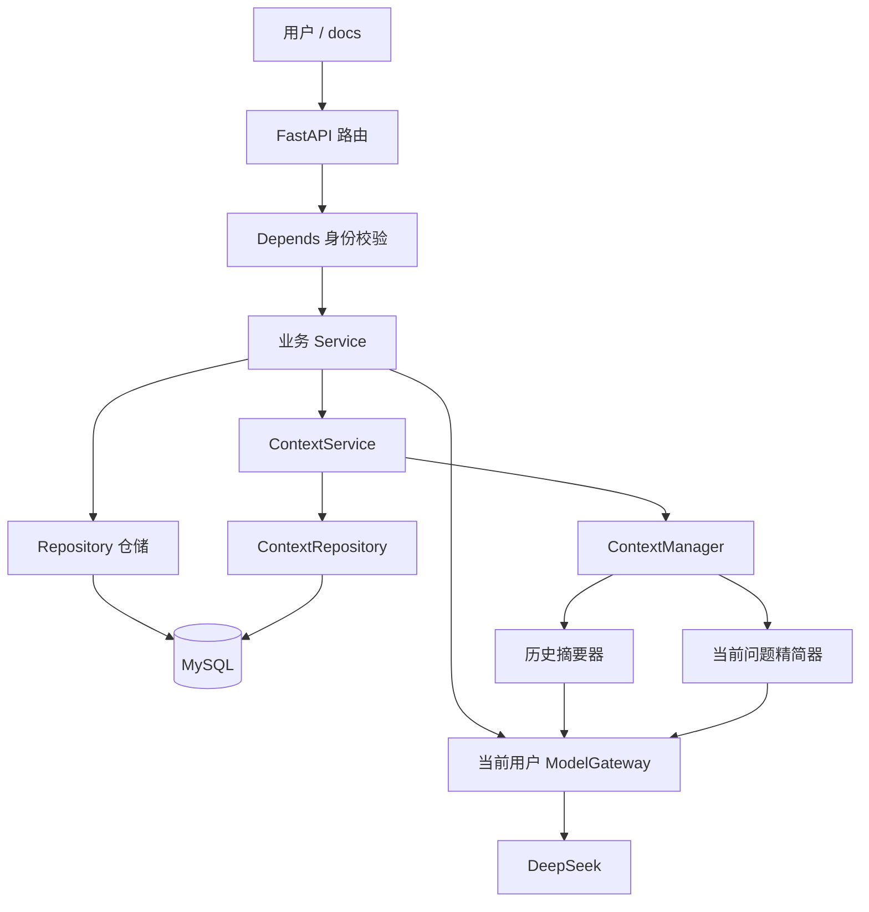

# 系统模块、技术栈与摘要持久化说明

更新日期：2026-10-26。项目位置：E:\code\LangChian_New。

本文先解释现在有什么，再逐个说明模块，最后沿调用顺序解释本次完成的摘要保存与恢复。表中的“已实现”表示代码和对应测试已完成，不代表所有功能都已经挂接到 HTTP 或完成生产部署。

## 1. 本次已经完成什么

- 新增 MySQL 表 chat_context_summaries：一个聊天会话保存一份当前摘要。
- 新增 ContextRepository：按会话归属读取摘要和未总结原文，使用短事务保存一致快照；按版本和消息末尾序号拒绝旧结果覆盖。
- 新增 ContextService：异步读取快照，调用 ContextManager，存在新历史摘要时条件保存。
- 补充数据库初始化及 --context-summary-schema 增量建表命令。
- 摘要随所属会话删除；原始消息不因生成摘要而删除或替换。
- 完成单元测试和真实本机 MySQL 独立临时库联调；未调用收费模型。

后续接入阶段已完成：正式 /messages 和 /retry 已使用 ContextService、部署预算估算和生成任务校验，并补齐上下文 HTTP 错误映射。完整新调用顺序、配置与手动验收见 [聊天接口接入上下文与任务校验说明](聊天接口接入上下文与任务校验说明.md)。

数据库诊断阶段也已完成：增加只读容量检查、有限会话统计和查询计划报告，并在独立临时库验证。使用方式、模块和各项限制见 [数据库容量检查与查询验证说明](数据库容量检查与查询验证说明.md)。继续使用共享业务表。

实验记录管理已完成：新增 experiments 表及带身份校验的创建、分页列表和详情接口，详见 [实验记录管理接口与模块说明](实验记录管理接口与模块说明.md)。

运行记录阶段已完成：experiment_runs、参数与定义快照、幂等创建、分页、详情及本人最近训练查询；容量工具现跟踪十四张表（包含服务器配置、执行绑定和指标报告）。详见 [实验运行记录与最近训练查询说明](实验运行记录与最近训练查询说明.md)。受控脚本执行基础见第 19 节；聊天结果工具尚未接通，用户的真实训练服务器也尚未验证。

用户已明确要求服务器连接和联网文献检索，建议必须关联真实运行证据与可核查来源。SSH 配置和 Runner 基础已完成本地验证；检索和证据建议仍待实现，约定见 [服务器连接与有据建议设计](服务器连接与有据建议设计.md)。

## 2. 实际使用的技术栈

版本来自当前 requirements.txt 与本机运行环境；服务器阶段新增安装 AsyncSSH 和 bcrypt，其他包沿用已有环境。

| 技术 | 当前版本或实现 | 用在什么地方 |
| --- | --- | --- |
| Python | 本机解释器 3.12.15，Conda 环境 langchain | 整个后端 |
| FastAPI | requirements 固定 0.143.3 | 定义接口、Depends 依赖注入、生成 OpenAPI 与 /docs |
| Uvicorn | 本机 0.54.0，本次补入 requirements | ASGI 服务进程，运行 app.main:app |
| Pydantic | requirements 固定 2.14.1 | 请求与响应模型，UUID、SecretStr、额外字段限制 |
| MySQL | 本次联调服务 8.0.46，InnoDB | 用户、登录记录、会话、消息、轮次、个人凭据和摘要持久化 |
| mysql-connector-python | 26.7.0 | Python 同步连接 MySQL、参数化 SQL、事务、提交与回滚 |
| langchain-deepseek | 1.1.1 | ChatDeepSeek 模型适配与异步 ainvoke |
| OpenAI SDK | langchain-deepseek 使用的底层依赖；项目也引用其异常类 | HTTP 模型请求及连接、超时、供应商状态异常识别 |
| argon2-cffi | 25.1.0 | Argon2id 登录密码哈希与核对 |
| cryptography | 50.0.2 | Fernet 加密与解密个人模型 API Key 和 SSH 凭据，分别校验用途 |
| AsyncSSH | 2.24.1 | SSH 异步连接、主机指纹核验和认证测试 |
| bcrypt | 5.0.0 | 带口令 OpenSSH 私钥所需 KDF 支持；不替代 Argon2 登录密码哈希 |
| python-dotenv | 1.2.4 | 从 config/.env 补充本地部署配置，不覆盖已设置的环境变量 |
| asyncio | Python 标准库 | async/await 调度、to_thread 包装同步数据库调用、模型超时控制 |
| logging / contextvars | Python 标准库，项目自定义脱敏日志 | 持久日志、请求关联、操作耗时与安全异常链 |
| unittest / unittest.mock | Python 标准库 | 单元测试、假模型、模拟数据库、异步 Mock |
| httpx.MockTransport | 已有 SDK 测试依赖中的 HTTP 模拟工具 | 离线核对真实 SDK 请求序列化，测试不出网 |

目前没有使用 Redis、向量数据库、RAG、Celery、LangGraph 或 Kubernetes 部署。runner 已有独立监督器实现；agents、workers 等仍含预留结构，不能把目录存在当作多 Agent 或分布式调度已经实现。

## 3. 分层关系



路由负责 HTTP 输入输出和状态码；Service 负责业务顺序；Repository 负责执行 SQL 和事务；数据对象负责携带结果；安全模块负责哈希与加密。依赖注入负责组装对象，不是继承，也不是自动把所有对象的方法复制到 service 上。

## 4. app 根目录的模块

| 文件 | 职责与关键入口 |
| --- | --- |
| app/main.py | 创建 FastAPI app，注册认证、会话、历史、个人 Key、聊天、实验定义、运行和服务器配置路由，安装请求日志和参数校验异常处理；提供 /health |
| app/config.py | get_mysql_password、get_model_encryption_key 读取服务器凭据；get_context_settings 读取上下文预算和租约配置；get_server_settings 读取 SSH 允许网段、超时与每进程并发上限。get_deepseek_api_key 是早期练习辅助函数，个人聊天不回退使用它 |
| app/database.py | get_connection 建立同步连接；initialize_database 初始化及增量迁移；本次新增 _ensure_context_summaries 和选择性建表命令。当前连接位置仍是本机 127.0.0.1:3306，账号配置写在此模块 |
| app/errors.py | 业务异常，例如登录失败、会话不存在、重复请求冲突。只表达业务含义，不直接返回 HTTP |
| app/validators.py | 正整数及 BIGINT 范围校验、UUID 标准化、必填字符串和消息正文校验。正文保留空格和换行 |
| app/logging_config.py | 自定义持久日志、请求上下文、logged_operation 装饰器、安全异常链与固定原因分类。不是简单 print，也没有把密码或正文写入日志 |
| app/chat_cli.py | 早期本地命令行练习，选择已有会话或创建会话并显示历史；手工输入 user_id 不能替代 HTTP 登录认证 |
| 各目录的 __init__.py | Python 包标识；当前空文件本身不包含业务逻辑 |

## 5. API 层：app/api

| 文件 | 职责与主要依赖 |
| --- | --- |
| schemas.py | RegisterRequest、LoginRequest、UserResponse、会话及消息请求响应等 Pydantic 模型。SecretStr 隐藏对象展示中的密码或 Key，不等于加密或哈希 |
| dependencies.py | 构造 AuthService、CurrentUserService、UserChatService 等服务及仓储。lru_cache 复用固定协作者，不缓存某一个用户的当前身份或个人网关 |
| auth_dependencies.py | HTTPBearer 识别凭证；get_bearer_token 只提取 Token；require_current_user 调用业务验证有效身份并返回 UserResponse |
| auth_routes.py | 注册、登录、查看当前用户和退出登录等 HTTP 入口；把业务或数据库异常转为响应 |
| session_routes.py | 创建、列出、删除自己的聊天会话。user_id 取自认证结果，创建时由服务端生成会话 UUID |
| history_routes.py | 分页展示自己的原始历史；点击会话只读数据，不触发模型，也不把浏览器分页历史当作模型的完整上下文 |
| model_credential_routes.py | 保存、查询配置状态、删除当前用户的 DeepSeek Key。公开查询只返回是否配置，不返回原始 Key 或数据库密文 |
| chat_routes.py | 发送问题与重试等待回复的问题；传递 request_id，区分参数、权限、供应商、连接和超时错误 |
| error_handlers.py | 把请求结构校验错误转换成固定、安全的响应，不回传包含敏感输入的校验明细 |
| request_logging.py | 请求日志中间件，记录请求关联 ID、路由、状态码和耗时，不记录请求正文与认证凭据 |

文件里保留的一些 TODO 注释属于教学过程，是否完成要看实际函数和测试；例如某些 return 后仍有旧占位语句，不会被执行。本次未顺带改动无关路由。

## 6. 业务层：app/services

| 文件 / 对象 | 具体负责什么 |
| --- | --- |
| auth_service.py / AuthService | register：校验用户名、计算密码哈希、创建注册用户；authenticate：读取账号、验证密码，返回用户标识 |
| login_service.py / LoginService | 成功验证账号密码后，生成安全随机 Token，保存哈希与到期时间，返回 LoginResult |
| current_user_service.py / CurrentUserService | 校验 Token 格式、计算哈希、查询未过期且未撤销的登录记录，返回用户 ID 和用户名 |
| logout_service.py / LogoutService | 核对 Token 格式和哈希，撤销对应登录记录，不删除用户或聊天 |
| chat_session_service.py / ChatSessionService | 异步创建、列出、删除会话，包装同步仓储调用并处理会话不存在的情况 |
| chat_history_service.py / ChatHistoryService | 校验分页参数，读取供界面展示的原始历史 |
| model_credential_service.py / ModelCredentialService | 校验并加密个人 Key 后保存；读取状态；删除配置；仅后端内部 get_api_key 解密并返回本人 Key |
| user_model_gateway_factory.py / UserModelGatewayFactory | create_for_user 根据当前用户取得本人 Key 并创建网关；不回退到平台共享 Key |
| user_chat_service.py / UserChatService | 每次请求取得个人网关，组装 ChatContextFactory 和 ChatService，调用发送或重试；结束、失败和取消时清理客户端资源 |
| chat_service.py / ChatService | 保存问题、领取生成尝试，调用 ContextService 准备上下文，再通过任务网关回答并保存回复；失败仍保留原问题 |
| model_gateway.py / ModelGateway | invoke 封装 ChatDeepSeek.ainvoke，返回 content 和 usage；可为精简任务限制单次输出；aclose 清理客户端 |
| context_contracts.py | TokenCounter、InputCompressor、SummaryGenerator 三个 Protocol，规定可注入协作者应提供的方法，不是自动实现 |
| context_manager.py / ContextManager | 校验历史、标记缺口、计数、保留近期组、触发问题精简或历史摘要、完整重计数，返回 PreparedContext；不直接读写 MySQL |
| history_summarizer.py / ModelHistorySummarizer | 将旧摘要和较早原文分批交给模型，片段保留真实角色、序号和字符范围，限制请求大小、调用次数及等待时间 |
| input_compressor.py / ModelInputCompressor | 当前问题过长时提取问题和必要材料；分块和有限次数精简，只替换本次请求副本，不覆盖用户原文 |
| context_service.py / ContextService | 读取数据库快照 → 调用 ContextManager → 有新历史摘要时按任务、版本和消息末尾保存；同步 MySQL 操作放到线程执行 |
| chat_context_factory.py / ChatContextFactory、AttemptGateway | 每个生成尝试单独组装上下文协作者；每次摘要、精简、最终回答请求前校验会话与任务，不自行关闭原始网关 |
| token_budget.py / Utf8BudgetCounter | 正式路径使用的 UTF-8 字节与封装余量估算，不是供应商精确 tokenizer |
| session_service.py / prepare_session | 早期 CLI 辅助：通过已有会话 ID 进入历史，或创建新会话；不是 HTTP 身份校验入口 |

2026-10-28：移除未实现的空文件 change_service.py、orchestrator.py，后续真正实现对应功能时再创建。实际 Worker 与服务不受影响。

## 7. 仓储层：app/repositories

“仓储操作”就是把数据对象和数据库读写连接起来，例如执行 SELECT、INSERT、UPDATE、DELETE，处理提交和回滚。仓储不会因为名称中有 Repository 就自动持久化，必须实际执行 SQL。

| 文件 / 对象 | 具体数据操作 |
| --- | --- |
| user_repository.py / UserRepository | 创建用户、创建带哈希的注册用户、读取用户和登录核对资料 |
| login_session_repository.py / LoginSessionRepository | 保存登录 Token 哈希、查询有效身份、撤销登录记录 |
| session_repository.py / SessionRepository | 创建 UUID 会话、按用户列出或查询会话、在同一事务中删除轮次、消息与会话；新增摘要通过外键级联删除 |
| message_repository.py / MessageRepository | 消息和轮次持久化；按归属读取历史；生成尝试领取、租约、幂等检查、成功写回和失败标记 |
| model_credential_repository.py / ModelCredentialRepository | 按用户和供应商保存、读取或删除加密 Key；不负责解密 |
| context_repository.py / ContextRepository | 读取摘要及未总结原文，按任务、版本和真实来源条件写入摘要；check_attempt 检查当前生成尝试和租约 |
| examples/json_chat_repository.py / ChatRepository | 早期 JSON 文件读写练习，已移出正式仓储目录；正式多用户聊天使用 MySQL |

SQL 参数通过 cursor.execute(sql, parameters) 传递，不把用户名、正文、UUID 拼进 SQL 文本。服务器数据库密码只用于连接，不返回给普通用户。

## 8. 数据对象与安全模块

| 文件 | 作用 |
| --- | --- |
| models/login_result.py | LoginResult 携带登录成功结果，供路由转换为公开响应 |
| models/chat_turn.py | ChatTurn 携带轮次状态、用户消息 seq、attempt_id 和租约有效性；TurnAlreadyCompletedError 用于复用已经保存的回复 |
| models/context_state.py | ContextMessage 是真实消息；HistoryGap 是缺失范围；ContextSummary 是摘要及覆盖点、版本；PreparedContext 是本次模型输入。还定义预算、精简、摘要、存储格式和冲突异常 |
| models/context_snapshot.py | ContextSnapshot 是数据库一致快照；ContextAttempt 是轮次和生成尝试 UUID；validate_summary 检查摘要字段，不连接数据库 |
| models/context_settings.py | ContextSettings 保存并校验不可变的部署预算、近期组数、超时及租约，不包含用户或 Key |
| security/passwords.py | Argon2id 慢哈希与核对，不可逆。新注册密码按现有约定为 8～32 字符，登录兼容此前允许的旧长密码 |
| security/tokens.py | secrets.token_urlsafe(32) 生成随机登录凭证；数据库存 SHA-256 哈希；默认有效期 3 天。当前不是 JWT，也不是把会话 UUID 当登录 Token |
| security/api_key_cipher.py | Fernet 可逆加密个人 API Key；密文绑定用户 ID 和供应商，解密时核对身份。与登录密码哈希用途不同 |

需要分清：登录 Token 是凭证，token 数量是模型输入计量，session_id 是聊天会话 ID，request_id 是一次发送的幂等 ID，attempt_id 是一次模型生成尝试 ID，五者不能互相代替。

## 9. 数据库中各张表存什么

| 表 | 一行表示什么 | 关键数据 |
| --- | --- | --- |
| users | 一个应用用户 | 用户名、密码哈希、内部 ID |
| login_sessions | 一次登录记录 | user_id、Token 哈希、到期时间、撤销时间 |
| chat_sessions | 一个聊天会话 | UUID、所属用户、标题和更新时间 |
| chat_messages | 一条原始消息 | session_id、真实 seq、role、正文 |
| chat_turns | 一轮提问及其生成状态 | user_seq、pending/running/failed/completed、attempt_id、租约与错误代码 |
| model_credentials | 一个用户对一个供应商的个人模型配置 | provider、encrypted_key；不保存明文 Key |
| chat_context_summaries，本次新增 | 一个会话的当前历史摘要 | 摘要正文、覆盖 seq、version、missing_ranges、更新时间 |
| experiments，实验阶段新增 | 一个用户的实验定义 | UUID、user_id、title、kind、description、UTC 创建及更新时间；不存某次训练运行状态 |
| experiment_runs，运行阶段新增 | 某个实验的一次运行登记 | 运行/请求 UUID、参数及定义快照、状态、UTC 时间、退出码和受控结果/日志引用；目前创建为 created |

所有用户共用这些表，通过外键与 user_id 区分归属，不按用户名动态创建表。

### 新摘要表字段

| 字段 | 类型 | 含义 |
| --- | --- | --- |
| session_id | CHAR(32)，主键及外键 | 每个会话最多一份当前摘要，归属从 chat_sessions 获取，不重复保存可能不一致的 user_id |
| content | LONGTEXT | 模型生成的历史摘要，不是当前问题精简稿 |
| summarized_until_seq | BIGINT UNSIGNED | 摘要覆盖到哪条真实消息 |
| version | BIGINT UNSIGNED | 首次为 1，后续更新加 1；用于检测并发覆盖 |
| missing_ranges | JSON 数组 | 已总结原文中的缺失序号区间 |
| updated_at | DATETIME(6) | MySQL 记录创建与更新时刻 |

外键 ON DELETE CASCADE 表示父会话成功删除时，这份摘要在同一事务中删除。消息与轮次仍按原有删除顺序处理，其他会话与登录凭证不受影响。

## 10. 本次摘要保存与恢复的完整顺序

### 第一步：ContextService.prepare(user_id, session_id, attempt=本次生成任务)

user_id 必须由已经认证的服务端身份提供，不能信任请求正文里的任意用户 ID。服务先校验正整数和 UUID，然后：

```python
snapshot = await asyncio.to_thread(
    repository.load_context, user_id, session_id,
)
```

to_thread 把同步 MySQL 操作放到工作线程；await 等待最终结果。数据库等待期间事件循环可以处理其他请求。它不会把数据库操作变成无需提交的操作。

### 第二步：ContextRepository.load_context

1. 开启连接，SELECT ... FOR UPDATE 锁住该用户拥有的会话；不存在或不属于用户统一抛 SessionNotFoundError。
2. 读取摘要，JSON 解码缺口，重建 ContextSummary。已存格式损坏时抛 ContextStorageError，不当作“没有摘要”。
3. 查询当前最大 seq，记录为 tail_seq。
4. 只查询 seq > summarized_until_seq 的原文；没有摘要时从 0 之后读取。保持真实序号，不从 1 重新编号。
5. 验证记录格式和消息末尾一致，返回 ContextSnapshot(summary, messages, tail_seq)。
6. 提交并释放锁。模型调用期间不持有数据库锁。

快照的 messages 是 ContextMessage 元组；version 属性在没有摘要时返回 0，已有摘要时返回其真实版本。

例如摘要覆盖到 10，数据库原文有 1～15，那么模型准备只读取 11～15；历史展示接口仍可分页显示 1～15。

### 第三步：ContextManager.prepare

ContextService 把快照中的消息转成列表传给 manager.prepare，并传入旧摘要。没有等待回复的 human 问题时，抛 NoPendingReplyError，不调用模型。正式路径的摘要器、精简器和最终回答都通过本次 AttemptGateway，每次调用前检查任务。

ContextManager 自己完成预算判断、历史分组、保留近期原文、必要时生成新摘要及完整重计数。摘要模型与问题精简模型都由注入的网关调用，本次测试用假对象代替。

### 第四步：有新历史摘要才保存

```python
if prepared.was_compacted:
    await asyncio.to_thread(
        repository.save_summary,
        user_id, session_id, prepared.summary,
        expected_version=snapshot.version,
        expected_tail_seq=snapshot.tail_seq,
    )
```

普通短输入或只精简当前问题时，不写历史摘要表。新摘要版本必须为预期版本加 1；覆盖点必须向前推进，并且小于本次待答问题的 seq，不能把当前问题提前写进历史摘要。

save_summary 再次锁定会话并校验归属，检查数据库中的版本和消息末尾仍与快照相同，再核对新增覆盖范围的真实序号及缺口。不能宣称覆盖一条不存在的消息，也不能伪造或漏报缺失范围。

首次使用 INSERT；更新使用带预期 version 条件的 UPDATE。受影响行数不是 1 时视为冲突，回滚并抛 ContextConflictError。没有无限重试，也不自动重复消耗模型调用。

### 第五步：返回 PreparedContext

prepared.model_messages 是准备交给回答模型的完整上下文；prepared.summary 是最新摘要；was_compacted 表示是否更新历史摘要；input_compressed 表示当前问题是否使用了精简稿。

ContextService 不负责生成最终聊天回复，不创建新用户问题，也不把当前问题精简稿保存成原始消息。重建服务对象后，下一次仍能从 MySQL 恢复摘要，已总结原文不会重复进入上下文。

## 11. 并发和删除怎样保护

两个请求都读到摘要版本 1 后各自计算，先保存者更新为 2，后保存者发现版本不符而失败；不会用旧结果覆盖新摘要。

如果计算期间追加了新回复或新问题，tail_seq 改变，原结果不能提交。若会话被删除，再次锁会话时找不到记录，旧结果不能重新插入摘要。保存和删除同时发生时，双方争用同一会话行锁，最终删除不会留下孤立摘要。

现在消息原文由应用新增或整段删除；若以后支持编辑旧消息，需要增加消息修订号或使摘要失效，不能只靠最大 seq 检测原文编辑。正式链路已经同时检查 attempt_id、租约、摘要版本和消息末尾；各项校验不能互相代替。

## 12. 现有 HTTP 登录和聊天如何衔接

一次聊天请求先进入 chat_routes，Depends(require_current_user) 会先执行。get_bearer_token 提取 Authorization 中的原始凭证；CurrentUserService 计算其哈希，由 LoginSessionRepository 核对未过期、未撤销且用户存在的登录记录；成功后返回 UserResponse。

路由把这个身份的 user_id 交给 UserChatService。UserModelGatewayFactory 通过 ModelCredentialService 获取本人的数据库密文，用 ApiKeyCipher 解密并核对身份，创建 ModelGateway。不是从用户输入中取得 MySQL 密码，也不使用其他人的 Key。

ChatService 先提交问题和 pending 轮次，再领取 attempt_id，调用模型并保存回复。网络失败时保留问题，重试补上回复，不重复保存一句“继续”。

目前已在领取生成尝试之后、调用回答模型之前接入 ContextService，并为新异常补上 HTTP 映射。ContextService、ContextManager 和 AttemptGateway 在当前用户本次尝试中组装，不作为包含某人 Key 的全局 lru_cache 单例共享给其他用户。

## 13. SQL、配置、测试和预留目录

| 目录或文件 | 内容与当前状态 |
| --- | --- |
| sql/init.sql | 初始库、用户、会话、消息结构；其他增量表由 app.database 顺序补建 |
| sql/create_context_summaries.sql | 本次新增摘要表、检查约束和级联外键 |
| sql/load_context_summary.sql | 按归属读取并锁定当前摘要 |
| sql/load_context_messages.sql | 读取摘要覆盖点之后的原文 |
| sql/load_context_covered_seqs.sql | 保存时核对新增覆盖范围中的真实消息序号 |
| sql/insert_context_summary.sql | 首次写入摘要，同时限制会话归属 |
| sql/update_context_summary.sql | 仅在版本吻合、覆盖范围推进时更新摘要 |
| sql 其他文件 | 用户、登录、会话、消息、轮次和个人凭据的参数化 SQL，由对应仓储加载 |
| config/.env | 本地部署配置；不属于普通用户可修改的聊天资料，不写入说明或日志 |
| requirements.txt | 第三方依赖版本；本次补充当前已安装的 Uvicorn 声明，未执行联网安装 |
| tests/ | 常规单元及集成式模拟测试，不连接收费模型或真实 MySQL |
| scripts/verify_context_storage_mysql.py | 本次新增的真实 MySQL 隔离临时库验证，结束仅清理自己创建的临时库 |
| scripts/check_context_manager.py | 使用假计数器、假摘要器和假精简器验证上下文算法 |
| scripts 其他 verify_* | 分阶段真实本机 MySQL 验证脚本，按各文件说明选择执行，不是后台守护进程 |
| docs/ | 开发约定、分阶段练习、流程说明及测试记录 |
| logs/ | 运行时日志；包含安全错误分类，不保存敏感凭据或聊天正文 |
| app/agents、app/runner、app/workers | runner 已有独立监督器；agents/workers 尚未接监控 Agent 或消息队列消费者 |

## 14. 如何运行与验证

在项目根目录、已激活 langchain 环境下执行。数据库服务须已启动，服务器配置需已设置 MYSQL_PASSWORD，不需要在请求中输入数据库密码。

```powershell
# 已有库只补摘要表；可重复执行，不清空记录。
python -m app.database --context-summary-schema

# 摘要仓储、业务和迁移单元测试。
python -m unittest tests.test_context_repository tests.test_context_service tests.test_context_storage_migration -v

# 使用已有本机 MySQL，创建独立临时库，测试完成后清理该临时库。
python -m scripts.verify_context_storage_mysql

# 原上下文算法练习。
python -m scripts.check_context_manager --part all

# 正式 HTTP 服务；发送和重试已使用摘要准备服务。
python -m uvicorn app.main:app --reload
```

上下文接入阶段完整常规回归为 674 项，容量阶段 693 项，实验阶段 729 项；运行阶段新增 48 项后，最新完整回归 777 项通过。运行真实 HTTP/MySQL 验收 15 组通过，原实验 12 组、聊天上下文 16 组、容量 8 组也重新通过。临时库均已清理，状态只由测试模拟，没有训练或收费模型调用。

FakeTokenCounter 仅用于练习测试，正式链路改用 Utf8BudgetCounter 预算估计；它仍不是 DeepSeek 实际 tokenizer。HTTP 摘要链路已经使用真实数据库与假模型验证，真实供应商调用、摘要语义质量、精确 tokenizer 和 K8s 部署不属于本次已验证能力。

本次先完成并验证 MySQL 摘要存储；Redis 热缓存和多 Agent 通信仍是后续阶段。

## 15. 数据库容量检查与共享表设计

保持 users → chat_sessions → chat_messages 的关系，用当前用户身份限制会话归属；不按用户名动态创建表。chat_context_summaries 单独保存会话摘要，摘要不会自动删除原始消息。

| 新增模块或文件 | 职责 |
| --- | --- |
| app/repositories/capacity_repository.py | 固定十四张表（含 experiments、experiment_runs、server_connections、run_executions、run_metric_streams、run_metric_events、run_reports）的元数据和索引、指定归属会话的有限消息统计、两条现有业务 SQL 的安全 EXPLAIN 投影；使用只读快照 |
| app/services/database_capacity_service.py | 将安全的诊断结果生成 Markdown，区分估计值、有界精确统计及查询计划 |
| scripts/check_database_capacity.py | 维护者 CLI，默认仅查看元数据，打印并新建报告文件；不挂载普通用户路由 |
| sql/capacity_*.sql（六个文件） | 固定表元数据、索引、会话归属、摘要覆盖、有限统计及后续消息检查 |
| scripts/verify_database_capacity_mysql.py | 独立随机临时库验收；显式 --benchmark 时生成多会话模拟数据，计时后清理本次库 |
| tests/test_database_capacity.py | 19 项专项：只读边界、输入与范围、归属、异常回滚、计划脱敏、报告保护及验收库保护 |
| docs/数据库容量检查与查询验证说明.md | 本阶段完整使用、模块、包、SQL、验证和限制说明 |
| docs/数据库容量检查示例报告.md | 来自临时库的有界会话统计与真实 EXPLAIN 示例 |
| docs/数据库查询计时记录.md | 12,000 条额外模拟消息下的本机顺序查询样本，不能视为并发容量承诺 |

```powershell
python -m scripts.check_database_capacity
python -m scripts.verify_database_capacity_mysql --benchmark
```

第一条对现有项目库只读，默认只查元数据；第二条会创建并清理它自己生成的随机临时库。新工具不需要 Redis，不安装新依赖，不执行模型请求，也不实现定时监控、自动删除或归档。

## 16. 实验记录管理

| 模块 | 作用 |
| --- | --- |
| app/models/experiment.py | 实验概览、详情、分页对象和共享字段/UUID 校验 |
| app/api/experiment_schemas.py | 创建请求、公开详情和有界列表响应；拒绝额外 user_id 或 command |
| app/api/experiment_routes.py | POST /experiments、GET /experiments、GET /experiments/{experiment_id}；复用 require_current_user |
| app/repositories/experiment_repository.py | 参数化 SQL、用户归属、事务创建、时间和 ID 游标分页 |
| app/services/experiment_service.py | 异步业务层，通过 asyncio.to_thread 执行同步仓储 |
| app/api/dependencies.py | 新增 get_experiment_service，仅缓存固定协作者，不缓存用户或连接 |
| sql/create_experiments.sql | 新表、用户外键、CHECK 和用户/创建时间/ID 索引 |
| sql/create_experiment.sql、get_experiment.sql、get_experiment_cursor.sql、list_experiments.sql、list_experiments_before.sql | 创建、详情、归属游标与分页查询 |
| app/database.py | --experiment-schema 仅补实验表，默认完整初始化也包含它 |
| app/main.py | 用 include_router 挂载实验路由，正式 /docs 可见 |
| tests/test_experiment_*.py | 仓储、业务、工厂、HTTP 和迁移共 36 项新增专项 |
| scripts/verify_experiment_api_mysql.py | 真实注册登录、HTTP、临时 MySQL 和安全日志，12 组验收 |
| scripts/_chat_api_test_app.py | 本机练习与联调应用同步挂载实验路由，所有实验 SQL 限制在临时库 |

```powershell
python -m app.database --experiment-schema
python -m scripts.verify_experiment_api_mysql
```

实验定义接口只登记定义，不执行命令或申请模型；独立运行记录接口见第 17 节。实验标题可同名，每次成功创建定义都会产生一个 UUID；当前定义接口没有编辑/删除或请求幂等键，运行创建接口则已具备幂等性。完整定义调用链、导入包、HTTP 错误和 /docs 测试步骤见 [实验记录管理接口与模块说明](实验记录管理接口与模块说明.md)。

## 17. 实验运行记录与最近训练查询

| 模块 | 作用 |
| --- | --- |
| app/models/experiment_run.py | 不可变运行对象；参数 JSON 结构、UTF-8 预算、规范文本、SHA-256 和运行 UUID/状态校验 |
| app/repositories/experiment_run_repository.py | 本人实验归属、原子创建、唯一键冲突后的新事务重试读取、运行详情和分页及四种最新查询 |
| app/services/experiment_run_service.py | 提前校验并复制参数，通过 to_thread 调用同步仓储 |
| app/api/experiment_run_schemas.py | 创建请求、运行概览/详情/创建/列表/最新查询响应，不公开内部路径或摘要 |
| app/api/experiment_run_routes.py | 创建/列表 /experiments/{experiment_id}/runs，详情 /runs/{run_id}，静态 /runs/latest-training |
| app/api/dependencies.py | get_experiment_run_service 只缓存固定协作者 |
| app/database.py | --experiment-run-schema；旧父表补复合归属索引后建运行表，不运行聊天回填 |
| sql/create_experiment_runs.sql | 参数合法性、状态时间、结果引用约束，用户/实验复合外键、请求唯一键和查询索引 |
| sql/experiment_run_owner_index.sql、add_experiment_run_owner_index.sql | 校验并补 experiments 的 (id, user_id) 唯一父键；新建父表 DDL 也包含该键 |
| sql 运行读取和创建文件 | 创建、归属、幂等查询、游标分页，以及可选实验/状态的最近训练查询；均使用参数值 |
| tests/test_experiment_run_*.py | 48 项模型、仓储、HTTP、业务/工厂和迁移专项 |
| scripts/verify_experiment_runs_mysql.py | 15 组临时库真实联调，包含并发幂等/冲突、回滚、模拟状态与旧父表升级 |

```powershell
python -m app.database --experiment-run-schema
python -m scripts.verify_experiment_runs_mysql
```

首次创建运行返回 201，相同用户请求编号和配置重试返回 200，改变配置复用编号返回 409。最近查询默认包括所有训练运行状态，不把最新失败/运行中记录替换成旧成功记录；没有训练时为 run=null。

这里已实现运行基础；第 18 节补充 SSH 连接测试。第 19 节已补 Runner 基础；第 21 节已补指标和事实报告；尚未接通联网搜索或聊天工具调用。接着完善模型工具，再按 [训练结果对话与建议设计](训练结果对话与建议设计.md) 与 [服务器连接与有据建议设计](服务器连接与有据建议设计.md) 接入完整工作流。


## 18. 服务器配置与 SSH 连接基础

新增共享表 server_connections 与五个带登录依赖的 /servers 接口。私钥、带口令私钥和密码认证通过本地真实 SSH 验证；保存配置不连接，测试连接不执行命令。所有操作从 Token 确定用户，不接收调用者声明的 user_id。

| 模块 | 职责 |
| --- | --- |
| app/models/server_connection.py | 连接、分页和部署策略对象；IP、用户名、目录、指纹及凭据校验 |
| app/security/server_credentials.py | 独立用途与用户、配置绑定的 Fernet 凭据 |
| app/repositories/server_connection_repository.py | 本人密文创建、详情、分页、删除及短事务 |
| app/services/server_connection_service.py | 业务组装、加密、在线程中读写仓储、测试后的归属复查 |
| app/services/ssh_connector.py | 部署网段检查、异步 SSH 认证、固定指纹、超时、并发名额和清理 |
| app/api/server_connection_schemas.py | SecretStr 输入、严格字段和不含凭据的公开响应 |
| app/api/server_connection_routes.py | 五个路由，依赖身份与服务；安全错误状态映射 |
| app/config.py、app/api/dependencies.py | 部署设置与固定协作者工厂；不缓存个人明文凭据 |
| app/database.py | --server-schema 仅创建新表；不触发训练或旧聊天回填 |

部署默认拒绝 SSH 出站，维护者须设置 SSH_ALLOWED_NETWORKS；支持字面 IP，用户名与可信主机 SHA256 指纹必填。沿用既有部署主密钥但区分加密用途，未改写 .env。工作目录现在只校验格式，没有检查远端存在性或权限。

新增 41 项单元测试，完整 818 项通过；服务器 10 组、容量 8 组、运行 15 组、上下文 16 组临时库回归通过。没有调用收费模型，也没有连接用户的真实训练服务器。完整流程、技术栈、包和 SQL 职责、/docs 操作及后续边界见 [服务器连接配置与SSH工具基础说明](服务器连接配置与SSH工具基础说明.md)，逐文件变更见 [服务器连接阶段文件变更清单](服务器连接阶段文件变更清单.md)。


## 19. Runner 执行绑定、状态和日志

RunnerSettings 维护部署脚本注册表；RunnerRepository 通过短事务固定启动快照及 job_id，run_executions 的复合外键强制本人归属。RunnerService 组织查库、解密、远端操作与观测持久化，RunnerTransport 通过固定 SSH bootstrap 发送 JSON。远端 app/runner/remote_agent.py 用标准库监督进程管理脚本、心跳、有界 stdout/stderr、取消及超时。

六个接口为脚本列表、start、execution、refresh、stop、logs。创建 run 仍不自动训练；暂未接后台轮询或模型工具，调用方显式 refresh。部署注册表默认为空，示例注册表不自动启用。连接中断不被当成训练失败，不对不确定启动自动重跑。

完整 854 项单元与新 8 组联调通过；旧服务器 10 组、运行 15 组、容量 8 组、上下文 16 组回归通过。本地 Windows 微型进程和真实 SSH 协议已验证；Linux flock/进程组分支、真实训练服务器及 GPU 训练尚未验收。详见 [Runner执行与状态日志说明](Runner执行与状态日志说明.md) 和 [Runner阶段文件变更清单](Runner阶段文件变更清单.md)。

## 20. Skill 与论文 RAG（规划）

后续将会话上下文、按需 Skill、知识检索和实际 Runner 工具分开：Skill 提供任务流程，RAG 提供带来源的证据，Tool 实际查询/执行。用户上传与联网取得的资料共用入库链，检索必须有用户/项目权限及页码引用。完整设计见 [Skill与论文RAG接入规划](Skill与论文RAG接入规划.md)，当前尚未实现这些服务。


## 21. 训练指标与事实报告

新增 run_metric_streams、run_metric_events、run_reports；指标由真实 Runner 日志中的 JSONL 解析，保留源字节位置、半行、有限缓冲及质量标记。事件和游标一起提交，版本冲突有界重试；日志来源变化保留旧事件并使报告过期。

| 模块 | 作用 |
| --- | --- |
| app/models/training_metrics.py | 严格 JSONL、数值/预算、半行解析、来源边界和纯事实报告 |
| app/repositories/metric_repository.py | 归属、状态摘要、CAS、事件分页、JSON/窗口聚合及报告原子保存 |
| app/services/metric_service.py | 有界远端同步与读取/报告业务；读取不创建 SSH 协作者 |
| app/api/metric_routes.py | sync、分页、latest、生成/读取报告五个鉴权接口 |
| app/runner/remote_agent.py、app/services/runner_transport.py | 扩展原始字节及文件大小/边界协议，避免展示解码破坏 JSON |
| app/database.py | --metrics-schema 只建三张表，不回填、不启动任务 |

普通日志不猜指标，缺失数值不补零；首末值和 delta 不自动等同于收敛或效果改善。报告可在运行中生成，但标注采集完整性与质量；同一数据/运行状态复用版本，变化后 GET 标记 is_stale，POST 才重建。

完整 893 项单元、新 9 组真实 HTTP/MySQL/回环 SSH/微型进程验收通过；旧 Runner 8 组、运行 15 组、容量 8 组、上下文 16 组回归通过。没有收费模型调用，真实 Linux/GPU 训练仍待验收。当前显式调用 sync，没有后台自动采集；模型解释、聊天工具、Skill 和 RAG 尚未实现。

技术栈沿用，无新依赖。完整包/模块/SQL、调用顺序、/docs 示例及限制见 [训练指标采集与事实报告说明](训练指标采集与事实报告说明.md)，逐文件变更见 [训练指标与报告阶段文件变更清单](训练指标与报告阶段文件变更清单.md)。


## 2026-10-26 更新：多方向评测配置已接入

实验支持独立的 evaluation 声明（任务类型、数据集版本、协议、指标单位/方向/范围），每次 run 保存不可变副本。指标和报告按 dataset＋split＋metric_name 隔离，未标注数据集的旧记录保留为 unspecified，不自动猜测。新增 experiment_evaluation_specs、run_evaluation_specs，共 16 张共享业务表。

完整 916 项单元测试、评测 HTTP/MySQL 8 组、扩展指标 SSH 链路 10 组、运行回归 15 组、容量回归 8 组通过。现有项目库执行了增量迁移；没有调用付费模型或真实 GPU。当前仍需显式 sync，不包含后台监控、模型工具、论文检索、Skill/RAG 或产物接口。

详细模块、技术栈、/docs 测试和兼容说明见 [多方向评测配置与数据集隔离说明](多方向评测配置与数据集隔离说明.md)，逐文件清单见 [多方向评测阶段文件变更清单](多方向评测阶段文件变更清单.md)。后续主线：接入带身份范围的只读运行/报告工具，让新会话能够按需询问最近训练结果；再补有来源的研究建议。


## 2026-10-26 更新：聊天只读训练工具已接入

普通聊天可直接回答；查询训练时，模型按需调用 get_latest_training_run、get_run_report、get_run_logs，后端使用真实登录身份校验本人范围。会话运行关联和工具审计保存在新增的 chat_run_bindings、chat_tool_calls 中，共 18 张业务表。工具不启动/停止任务，不同步指标或生成报告。

支持服务重建和历史摘要后的连续追问，查询循环/结果/超时有界，失败保留原问题可重试；删除会话级联清理关联和审计，不删除实验运行。详情见 [聊天只读训练工具与会话运行关联说明](聊天只读训练工具与会话运行关联说明.md)，完整文件清单见 [聊天只读工具阶段文件变更清单](聊天只读工具阶段文件变更清单.md)。下一步补真实模型验收、联网研究与引用依据，再扩展后台监控与任务协作。
