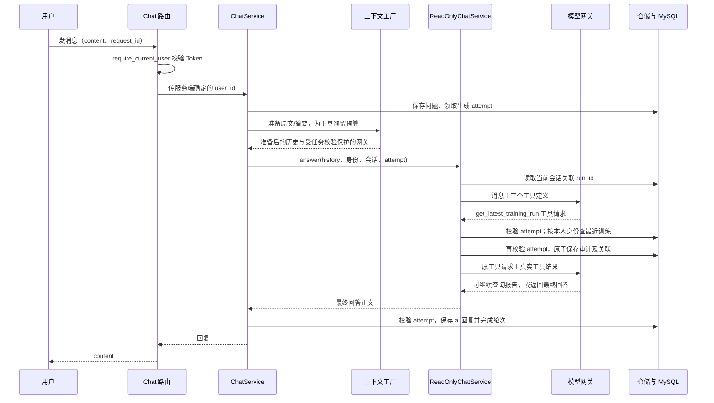

# 聊天只读训练工具与会话运行关联

日期：2026-10-26。项目：`E:\code\LangChian_New`。

## 1. 这次完成了什么

聊天已经接入三个按需查询工具。用户可以在一个全新会话中询问“我最近一次训练怎么样”，由模型查询本人最近提交的训练，再查询已有报告或必要的日志。

“最近一次”包括尚未启动、排队、运行中、失败、取消和成功的训练，不静默跳到旧的成功任务。普通问候可以直接回答，不需要查训练，更不会启动训练。

已完成：模型工具协议、参数校验、本人数据隔离、会话运行关联、摘要后的连续追问、工具审计、预算/超时限制、失败重试与删除会话时清理关联记录。

当前工具不能启动/停止训练、修改配置/代码、同步指标、生成报告、联网检索论文。联网研究、Skill/RAG、后台监控及修改闭环仍是后续阶段。提示词可以要求模型如实引用，但后端工具正确并不等于模型文字永远不会出现推断错误，真实模型回答质量仍需使用者验收。

## 2. 请求完整走一遍



工具循环不是“解析模型文字里是否出现了某个函数名”。网关读取供应商返回的结构化 tool_calls；后端只分发登记的函数名，并校验参数，然后按工具消息协议把真实结果交回模型。

实现参考 [DeepSeek 官方 Tool Calls 文档](https://api-docs.deepseek.com/guides/tool_calls/)。当前持久化历史只保存最终回答，不保存供应商内部推理，因此工具回答请求明确使用非 thinking 模式，避免工具循环要求回传完整 reasoning_content 而既有历史没有保存的问题；相关协议见 [Thinking Mode 官方说明](https://api-docs.deepseek.com/guides/thinking_mode/)。摘要/问题精简调用不绑定工具，保留原有路径。

本阶段只实现模型生成的工具调用，不把历史审计行伪造成曾经的模型工具消息插回供应商会话。下一次用户提问加载的是聊天原文、摘要及可信的 run_id 关联提示；需要新数据时重新查询。

## 3. 三个工具及参数

工具不是新增三个公开 HTTP 执行接口。它们是后端开放给模型的受限函数定义，仍使用原来的聊天发送接口。

| 工具 | 参数 | 行为 |
| --- | --- | --- |
| get_latest_training_run | 可选 experiment_id | 查本人最近提交的 training 运行；不自动刷新 SSH 状态 |
| get_run_report | 可选 run_id、dataset、split、metric_name、offset | 读取已有报告的有界投影；省略 run_id 使用会话关联；每页最多 8 条指标序列 |
| get_run_logs | 可选 run_id、offset、limit | 读取本人运行的一小段日志；省略 offset 默认读尾部；默认 1024、最多 2048 个源字节 |

三个工具都没有 user_id、server_id、command、password 等参数。模型若传入额外参数，得到 INVALID_ARGUMENTS，不会把这些参数注入仓储或 Runner。

报告工具保留数据集、split、指标、单位、优化方向、数据集版本、评测协议、报告版本、过期状态和采集质量提示。当前运行状态与报告生成时状态分别返回，避免把旧报告里的状态误当成最新状态。

如果旧版报告可能混合数据集，则返回 REPORT_REBUILD_REQUIRED，要求先由已有报告接口显式重建，工具不会自动重建或把旧混合数值当成新分组结果。

日志工具在确认运行属于本人后，才创建 SSH 协作者。默认尾读先读取大小，再取尾部字节，因此可能进行两次小额 SSH 读取。它不启动/停止任务，但现有 Runner 日志读取会保存最新执行观测；这里的“只读”指不提供训练控制和修改能力，并非整个数据库绝对零写入。

## 4. 身份、归属和生成任务为什么分别校验

`require_current_user` 回答“请求者是谁，Token 是否有效”。

会话归属校验回答“这个用户能不能访问这个聊天”。运行仓储继续限制“这个 run 是否属于当前用户”。即使模型看到别人提供的 UUID，也不能越权读取。

`ContextAttempt(turn_id, attempt_id)` 回答“这次模型生成现在是否仍有资格写回”。用户删除会话、生成租约过期或新尝试接管之后，旧任务不能写审计、覆盖会话关联或保存回复。

工具执行前检查一次 attempt；网络/数据库查询完成后，保存审计与关联时在短事务内再次检查。这两个检查防止的是查询期间状态变化，并不是重复验证用户名和登录密码。

模型、SSH 等网络等待期间不持有会话行锁。真正写回时才锁定会话并校验 attempt，遵循现有消息/摘要的锁顺序。

## 5. 连续追问如何关联运行

新表 `chat_run_bindings` 每个聊天最多一条：session_id、user_id、run_id、更新时间。

查询最近训练成功后关联到实际 run；明确查询本人的某个运行时也会切换关联。报告未生成但运行归属已确认时仍可关联该运行。越权、参数无效或查询不可用不会覆盖原关联。查询最近训练确实没有结果时会清除旧关联，避免继续指向不相关的旧任务。

之后用户问“这个为什么失败”，模型可以省略 run_id 调用报告或日志工具，由后端解析当前关联，而不是从聊天文字里猜 UUID。每次加载的关联仍按身份校验，不把模型输出当作可信身份。

关联存在 MySQL 中，重建应用服务对象或压缩聊天历史后仍可恢复。它表示本会话最近实际选择/读取的运行，不等于它永远是全局最新运行；每次问“最近一次”仍应重新调用最近训练工具。

## 6. 工具审计保存什么

新表 `chat_tool_calls` 保存：

- 自增记录 ID、用户/会话/轮次/生成尝试标识。
- 供应商工具调用 ID、本次尝试内的调用顺序和工具名。
- 已校验的查询参数；未知工具或无效参数不保存原始参数正文。
- 结果状态、耗时、结果字节数和 SHA-256 摘要。
- 查询得到的 run_id、报告版本、是否裁剪，以及请求的工具名。

不保存完整日志摘录、模型内部推理、Key、密码、私钥或原始异常正文。报告/日志通过原来的受控接口查询，不把工具结果重复写入聊天原文。结果摘要用于排查一致性，不代表系统已经永久归档每一版完整报告或日志。

审计与会话关联在同一事务里提交，任意一部分失败都会回滚。如果读操作后进程中断、来不及写审计，重试可以重新读取；这是只读查询，不承诺第三方网络读取恰好执行一次。

新接口：

```text
GET /sessions/{session_id}/tool-calls?after_id=0&limit=20
```

返回 active_run_id、items、next_after_id。记录按自增 ID 稳定分页，limit 为 1～100；只返回本人会话。这个审计读取接口独立组装数据库依赖，不需要个人模型 Key、模型加密主密钥或 SSH 连接。

## 7. 数据库约束及删除行为

项目现在共 **18 张共享业务表**，新增两张，仍然按用户隔离，不是给每个用户建表。

会话补充 `(id,user_id)` 唯一索引，轮次补充 `(session_id,id)` 唯一索引。审计复合外键确保会话归属和轮次所在会话一致；绑定复合外键确保 run 属于相同用户。每次尝试的 call_id 和调用序号分别唯一，序号限制为 1～4。

删除聊天时，工具审计随轮次/会话删除，运行关联随会话删除，聊天原文仍按原有事务删除；实验、run、报告与远端训练不会因此被删除或停止。

已有项目增量迁移命令：

```powershell
conda activate langchain
cd E:\code\LangChian_New
python -m app.database --chat-tools-schema
```

以此前实验/运行、聊天轮次等结构已安装为前提。全新环境继续使用完整 `python -m app.database`。迁移可重复执行，校验已有索引形状，不改写旧聊天、运行或指标记录。大表新增索引的部署时间需要按实际规模评估。

本次交付已对现有项目库执行迁移并复核原表记录数；迁移不调用模型，不连接真实训练服务器。

## 8. 预算、超时和故障处理

| 限制 | 当前行为 |
| --- | --- |
| 工具调用数 | 每次生成尝试最多 4 次；最多 5 次回答阶段模型请求，不含原有摘要/精简调用 |
| 继续调用 | 达到上限后 tool_choice=none；若模型仍要求调用则安全失败，不执行第五个工具 |
| 输入预算 | 上下文准备先预留 6000 个 UTF-8 预算单位；每次模型请求前把工具定义、工具消息和历史一起检查 |
| 结果大小 | 单结果目标最多 2600 字节，累计结果目标 4500 字节；预算不足返回 RESULT_BUDGET，发送前仍有总量硬检查 |
| 参数大小 | 单次模型工具参数最多 2048 字节，并经过 Pydantic 字段校验 |
| 查询超时 | 单工具 30 秒；回答工具循环整体 180 秒 |
| 审计失败 | 不把尚未审计的结果继续交给模型；HTTP 503，问题保留供重试 |
| 上下文过长 | HTTP 413，问题原文保留，不静默丢弃当前问题 |
| 协议错误/循环超限 | HTTP 502，保留问题；调用记录保留已经完成的查询 |

沿用项目的 UTF-8 预算刻度，不是供应商精确 token 数量或计费数量。默认完整输入预算 12000 时，普通历史有效预算约 6000，其余空间用于工具说明和返回证据。若自定义预算小到不能容纳摘要和工具，会明确报错，需要调整后端预算或缩小输入。

裁剪报告时按完整指标行移除并返回 next_offset，不切坏 JSON，不改数值；日志摘录可能继续裁剪，会标注 truncated、display_truncated、has_more 等范围信息，源字节游标仍对应原日志。

日志脱敏覆盖常见 Key、Bearer、密码/Token 字段、私钥块及控制字符，但无法保证识别任意业务自定义秘密，训练脚本本身仍不应输出凭据。工具结果属于不可信资料，不能改变系统工具允许列表；后端没有执行任意函数名、SQL、路径或 shell 命令的入口。

## 9. 每个核心 Python 模块与包

| 文件 | 职责 | 主要技术/包 |
| --- | --- | --- |
| app/models/chat_tools.py | 三个参数模型、函数说明、查询策略、预算和脱敏工具 | pydantic、typing、uuid、json、re |
| app/services/read_only_chat_service.py | 循环调用模型，验证工具请求，分发查询，裁剪结果，保存审计 | asyncio、hashlib、time、logging；现有运行/报告/Runner 服务 |
| app/repositories/chat_tool_repository.py | 当前关联、审计写入/分页、归属和 attempt 事务检查 | mysql-connector、Path；复用 ContextRepository 的任务校验 |
| app/api/chat_tool_routes.py | 本人审计 HTTP 接口及分页参数 | FastAPI APIRouter/Depends/Query、UUID |
| app/services/model_gateway.py | bind_tools、ainvoke，返回结构化 tool_calls 和正文 | langchain-deepseek；保留原有客户端清理 |
| app/services/chat_context_factory.py | 为工具预留预算，再构建上下文准备服务 | 原有 ContextManager、摘要器、输入精简器 |
| app/services/chat_service.py | 原有消息轮次生命周期接入只读工具回答；最终保存 ai 回复 | asyncio.to_thread、ContextAttempt、现有消息仓储 |
| app/services/user_chat_service.py | 按用户创建网关，传入工具协作者，完成后关闭资源 | asynccontextmanager、个人网关工厂 |
| app/api/dependencies.py | 组装固定协作者；审计依赖独立于模型凭据 | functools.lru_cache、依赖注入 |
| app/api/chat_routes.py | 工具预算/协议/存储异常转换为安全 HTTP 响应 | HTTPException、现有日志工具 |
| app/main.py | 挂载审计 router；原聊天接口不变 | FastAPI.include_router |
| app/errors.py | 新增工具协议、预算和审计存储异常类型 | Python 异常继承 |
| app/database.py | 专用增量迁移和完整初始化顺序 | argparse、MySQL DDL、独立 SQL 文件 |
| app/repositories/capacity_repository.py | 只读容量检查覆盖新表 | 原有 MySQL 元数据查询 |

`Pydantic` 校验模型工具的入参；`json` 编解码结构化消息；`re` 校验标识符及脱敏；`uuid.UUID` 规范化 ID；`hashlib` 为实际返回结果生成摘要；`perf_counter` 测量耗时；`asyncio.timeout` 限制等待；`asyncio.to_thread` 将同步数据库访问移到线程执行。

`@lru_cache` 缓存的是固定服务对象，不缓存某个用户的 Token、run_id、历史或工具结果。用户数据在方法参数和当前请求局部变量中，run_id 关联则保存到有归属约束的 MySQL 行中。

技术栈沿用 Python 3.12、FastAPI、Pydantic v2、MySQL 8、mysql-connector-python、LangChain DeepSeek、AsyncSSH、现有凭据加密和日志机制。没有新增运行依赖、Redis 或新的付费平台账户。

## 10. 在 /docs 里怎样测试

重启后端后：

1. 注册/登录，通过 Authorize 设置登录 Token。
2. 使用已有个人模型凭据接口配置自己的 DeepSeek Key。真实聊天测试会使用该 Key 调用供应商；本次自动验收未使用真实模型调用。
3. 使用 `POST /sessions` 创建全新聊天，记录 session_id。
4. 使用 `POST /sessions/{session_id}/messages`，输入：

```json
{
  "content": "查询我最近提交的一次训练。请说明运行 ID、状态，以及 COD10K 和 CAMO 的已保存评测结果；没有报告就直接说明。",
  "request_id": "6f383acf-5b82-48f6-b9d9-2c8eb6cf09bd"
}
```

5. 没有训练记录时应明确没有记录；有运行但没有报告时，不应该编造指标。已有报告必须通过此前采集/生成接口准备，本阶段不会自动采集。
6. 同一会话再问“这个在 CAMO 上的 MAE 是多少？报告是否已经过期？”，新问题使用新的 request_id。
7. 用 `GET /sessions/{session_id}/tool-calls` 查看 active_run_id、工具名、参数、状态、报告版本和耗时。
8. 完成请求重复提交相同 request_id，应返回原回复而不重复查询；失败后用 `/retry` 重试，不另存同一个用户问题。

上面的 request_id 是合法格式示例，每个新问题应重新生成；可以在 PowerShell 运行 `[guid]::NewGuid().ToString()` 生成。登录 Token、聊天 session_id、消息 request_id 和训练 run_id 各有用途，不能互相代替。

可补充测试：普通“你好”不产生工具审计；传别人的 run_id 不应读到数据；让模型“启动训练”时只能说明当前查询能力；删除会话后其关联和审计消失，但训练记录仍保留。

## 11. 验证与范围

运行命令：

```powershell
python -m unittest discover -s tests -q
python -m scripts.verify_chat_tools_mysql
python -m scripts.verify_context_chat_mysql
python -m scripts.verify_experiment_runs_mysql
python -m scripts.verify_database_capacity_mysql
```

本阶段新增参数/循环/预算/SDK/迁移单元测试，并进行了真实 HTTP、MySQL、回环 SSH 与微型脚本联调；验证普通聊天、全新会话、失败运行、数据集隔离、服务重建、摘要后追问、越权拒绝、写入回滚、租约失效、循环上限、日志脱敏和删除级联。最终数量和结果见 [聊天只读工具阶段文件变更清单](聊天只读工具阶段文件变更清单.md)。

真实 SDK 测试用 httpx.MockTransport 截获请求，验证 assistant tool_calls、tool_call_id、tool_choice 和 thinking 参数，没有实际供应商调用。模拟模型验证的是后端处理结构化调用的能力，不等于已测出真实模型的自主工具选择率、回答质量或生产服务器可用性。真实 Linux/GPU 任务仍待验收。

## 12. 下一步

先由使用者在 /docs 验收自己的模型与实际运行数据。接下来补联网资料检索、来源引用和有证据的建议；再接后台采集、Redis Streams、多 Agent 任务协作和修改审计闭环。本阶段不会根据一段日志自行修改项目或重新启动训练。
