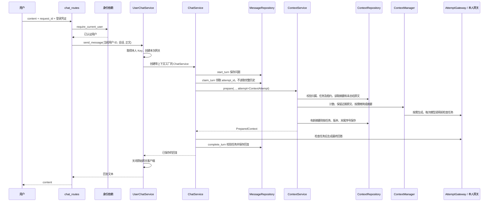

# 聊天接口接入上下文、摘要与任务校验

2026-10-25，项目 E:\code\LangChian_New。本阶段已将原本独立的 ContextService 接入正式发送与重试路由，增加部署计数策略、每次生成尝试的隔离与任务校验，并补齐 HTTP 错误映射。所有联调模型均为假网关，没有真实收费请求。

项目全部模块与原有技术栈见 [系统模块与摘要持久化说明](系统模块与摘要持久化说明.md)；本文集中解释这次实际接入后的顺序和变化。

## 1. 接口使用方式有没有改变

没有新增一套聊天地址，仍使用：

| 接口 | 用途 |
| --- | --- |
| POST /sessions/{session_id}/messages | 保存问题并生成回复，内部自动准备上下文 |
| POST /sessions/{session_id}/retry | 继续处理已经保存但未完成的问题，不新增一句“继续” |
| GET /sessions/{session_id}/messages | 分页显示全部原始消息，不触发模型 |

发送请求仍然只提交 content 和 request_id，用户身份从 Bearer Token 得到，个人模型 Key 从本人配置取得。浏览器不能提交摘要、历史消息、attempt_id 或预算配置来替代服务端状态。

```json
{
  "content": "继续解释刚才的学习率设置",
  "request_id": "调用前生成的本次问题 UUID"
}
```

上面 request_id 的文字是说明，实际必须填合法 UUID。新问题使用新 UUID，同一问题因网络问题重发时复用原 UUID。PowerShell 可用 [guid]::NewGuid().ToString() 生成。

## 2. 完整顺序图



重试从 get_unfinished_turn 找到已有轮次，再走 claim_turn 及其后的同一管线。已经完成的同一 request_id 直接读取数据库原回复，不再生成摘要或回答。

## 3. 身份验证和业务依赖怎样执行

chat_routes 中 current_user = Depends(require_current_user) 会先执行。HTTPBearer 识别 Authorization；get_bearer_token 只提取原始凭证，不代表已经登录。

require_current_user 调用 CurrentUserService.get_current_user。业务检查 Token 格式并计算哈希，由 LoginSessionRepository 查找未过期、未撤销且用户存在的登录记录，返回 UserResponse。失败时不会继续执行聊天业务。

另一个依赖 get_user_chat_service 读取固定服务器配置，创建 MessageRepository、ContextRepository 和个人网关工厂，取得 ContextSettings，构造 UserChatService。它可以使用 lru_cache 复用，因为只持有固定仓储、配置和工厂，不持有某个用户的原始 Key、Token 或当前消息。

用户自己的网关在 _open_chat(user_id) 内才创建；每次请求都由 UserModelGatewayFactory 通过 ModelCredentialService 读取并解密本人的 Key。没有共享平台 Key 的回退，也不会把某个人的网关放进全局缓存。

## 4. 这次各模块改了什么

| 文件 | 本次职责与变化 |
| --- | --- |
| app/api/dependencies.py | 正式工厂始终注入 ContextRepository 和 ContextSettings，使 /messages、/retry 走新管线；构造时不查询个人 Key、不发模型请求 |
| app/services/user_chat_service.py | 在本次个人网关作用域内创建 ChatContextFactory，再传给 ChatService；成功、异常与取消时仍关闭原始网关 |
| app/services/chat_service.py | 领取任务后通过工厂创建上下文服务，使用 prepared.model_messages 回答；保留问题先落库、请求幂等、失败重试和回复原子写回 |
| app/services/chat_context_factory.py，新增 | 为每个已领取的 attempt 单独组装计数器、摘要器、精简器、ContextManager、ContextService 和 AttemptGateway |
| app/services/token_budget.py，新增 | Utf8BudgetCounter 对文本、角色和消息封装计算预算估计；为摘要及精简限制输出并生成字节长度提示 |
| app/models/context_settings.py，新增 | 不可变 ContextSettings，校验部署预算、近期组数、摘要调用数、超时与租约 |
| app/config.py | get_context_settings 从服务器环境变量或 config/.env 读取上述配置，不含个人凭据 |
| app/models/context_snapshot.py | 新增 ContextAttempt(turn_id, attempt_id)，标准化 UUID，表示已领取的一次生成尝试 |
| app/services/context_service.py | prepare 新增 attempt 参数；正式管线读取快照和保存摘要时始终传入它 |
| app/repositories/context_repository.py | check_attempt 检查会话归属、running 状态、attempt_id、租约和消息末尾；读取、保存摘要也执行相同检查 |
| app/repositories/message_repository.py | claim_turn 新增 load_history=False 路径：只确认当前问题，避免先读全历史、后面又按摘要再读一次 |
| app/services/history_summarizer.py | 使用新计数器时限制实际输出并提示 UTF-8 字节目标；任务、会话、数据库错误直接传递，不误包装为供应商失败 |
| app/services/input_compressor.py | 同样适配字节预算与任务错误；仍保留当前问题原文 |
| app/api/chat_routes.py | 新增上下文冲突、过长、生成失败和持久化格式异常的固定安全响应 |
| tests/test_context_chat_pipeline.py | 新增计数、配置、任务隔离、领取优化、错误映射及管线单元测试 |
| scripts/verify_context_chat_mysql.py | 新增真实 HTTP、真实认证、个人 Key 解密、真实临时 MySQL 与假模型的端到端联调 |
| scripts/_chat_api_test_app.py | 本机假模型应用也接入摘要表与上下文链路，全部 SQL 限制在临时库 |
| scripts/verify_user_chat_service_mysql.py | 同步升级旧联调脚本的摘要仓储与临时表隔离 |

旧的独立 ChatService / UserChatService 构造仍允许不注入上下文协作者，用于早期 CLI 与兼容测试；正式 FastAPI 工厂始终注入。HTTP 请求没有关闭上下文处理的参数，也不会在处理失败时暗中回退到全历史。

## 5. 为什么每个 attempt 都重新创建上下文对象

ChatContextFactory 本身属于本次个人网关的作用域。create(user_id, session_id, attempt) 创建两个结果：ContextService，以及同一个用户同一个任务的 AttemptGateway。

```python
attempt = ContextAttempt(turn_id, attempt_id)
context, answer_gateway = context_factory.create(user_id, session_id, attempt)
prepared = await context.prepare(user_id, session_id, attempt=attempt)
response = await answer_gateway.invoke(prepared.model_messages)
```

摘要器、问题精简器、最终回答都通过这个 AttemptGateway。不同用户、不同请求和不同重试尝试不会共享它的 user_id、session_id、attempt 或消息。底层仍是该用户本次创建的原始 ModelGateway，没有再创建一个平台模型客户端。

AttemptGateway 不负责关闭原始网关；只由 UserChatService 在整次请求结束时统一关闭，防止摘要完成后就把后续回答还要使用的客户端关掉。

## 6. 任务校验到底验证什么

ContextRepository.check_attempt 在短事务中先锁住当前用户拥有的会话，再查询对应轮次，并检查：

1. 轮次确实属于这个会话。
2. status 仍然是 running。
3. 数据库 attempt_id 与本次一致，尚未被新重试替换。
4. lease_until 仍晚于数据库当前时间。
5. 当前消息末尾仍是该轮保存的用户提问。

检查通过提交事务，释放锁，才调用模型。没有持有数据库行锁等待模型网络回复。

读取摘要之前、每一批摘要或精简模型请求之前、最终回答之前、摘要写回时都会检查。最终回复写回继续使用 MessageRepository.complete_turn 的任务及租约校验。

已经发出去的网络请求无法靠数据库检查撤回；如果期间会话被删或任务失效，后续检查和写回会拒绝结果，避免复活消息或覆盖新任务。

ContextRepository 的独立工具调用仍可省略 attempt；这只用于普通仓储检查。正式 HTTP 路径由 ChatService 创建 ContextAttempt 并逐层传递，始终启用任务校验。

## 7. 正式路径使用什么计数方式

以前 FakeTokenCounter 只为测试提供确定性刻度，正式路径现在使用 Utf8BudgetCounter：

```text
预算估计 = 64 的请求余量
        + 每条消息的 24 封装余量
        + 每条角色字符串的 UTF-8 字节数
        + 每条正文的 UTF-8 字节数
```

例如 a 为 1 个 UTF-8 字节，“中”为 3 个；这能区别中文、多字节符号和英文，不会把一整条很长的消息只算作 1。

这是本系统的文本预算估计，包含自行选择的固定余量，不是 DeepSeek tokenizer，也不宣称是供应商真实 token 的严格上界。配置名称沿用 TOKENS，但当前比较的是这套估算刻度；不能直接据此计费或声称是模型窗口规格。

DeepSeek 的实际用量以模型响应中的 usage 为准，官方也说明换算因模型而异，并提供离线 tokenizer 参考：[DeepSeek token 用量说明](https://api-docs.deepseek.com/quick_start/token_usage/)。本次未下载 tokenizer 或安装额外模型依赖，后续可以替换 TokenCounter 实现。

摘要与问题精简时不能把字节预算直接当作供应商 max_tokens，因此会扣掉消息封装后压低单次输出上限，并在提示中加入字节目标。这个换算是保守应用策略，仍需对返回正文和最终完整上下文重新计数；不达标时明确失败，不截断原文。

ModelGateway 内部仍返回 content 和 usage，但现有公开聊天响应只返回 content，尚未建立真实 token 用量或费用统计表。

## 8. 配置项与默认值

不填写新增配置时使用默认值；需要调整时由部署者设置，普通用户不能通过请求修改服务器环境变量。

| 环境变量 | 默认值 | 用途 |
| --- | --- | --- |
| CHAT_MAX_INPUT_TOKENS | 12000 | 最终回答输入的预算估计上限 |
| CHAT_COMPACT_AT_TOKENS | 9600 | 旧历史摘要软触发阈值 |
| CHAT_MAX_SUMMARY_TOKENS | 2000 | 摘要正文连同一条消息格式的预算估计上限 |
| CHAT_KEEP_RECENT_TURNS | 4 | 保留最近历史组数，另保留当前问题 |
| CHAT_MODEL_REQUEST_TOKENS | 12000 | 摘要或精简模型每次请求的输入预算估计上限 |
| CHAT_MAX_SUMMARY_CALLS | 16 | 一次历史摘要最多逻辑网关调用数 |
| CHAT_CONTEXT_TIMEOUT_SECONDS | 180 | 一次摘要或问题精简的整体等待时间 |
| CHAT_CONTEXT_LEASE_SECONDS | 1800 | 正式管线领取生成任务的有效秒数，最多 3600 |

所有值必须是正整数；摘要预算小于软阈值，软阈值不超过硬预算；摘要预算不能超过当前适配器允许的 4096；配置错误由依赖工厂转换成通用 503，不把私有配置回显给用户。

应用输入预算与供应商真实窗口不是一回事。部署时需按实际选择的模型配置预算并为输出预留空间；默认值是本系统保守设置，不是 DeepSeek 模型规格。

一次问题精简仍有原来的 3 轮、24 次逻辑调用、每轮 16 块限制。SDK 自身可能重试，因此逻辑调用数不等于 HTTP 尝试数。租约不自动续期；过期后旧任务被拒绝，用户可在适合重试时发起新尝试。

固定依赖使用 lru_cache，修改部署配置后需要重启进程以重建服务。不要把含真实 Key 的 .env 内容复制到文档或聊天中。

## 9. 成功与失败怎样返回

| 情况 | HTTP / 行为 |
| --- | --- |
| 正常回答 | 200，只返回已保存的 content |
| 同一请求已经成功 | 200，复用原回复，不重复生成 |
| 身份无效 | 401，不进入聊天业务 |
| 会话不存在或属于其他用户 | 404，不泄露实际归属 |
| 摘要版本变化、任务过期或被新尝试替换 | 409，“会话状态已更新，请刷新后重试。” |
| 处理后仍放不下必要内容 | 413，“上下文处理后仍然过长，请缩短材料或拆分任务。” |
| 摘要或问题精简服务失败 | 502，“上下文处理暂时不可用，请稍后重试。” |
| 已存摘要损坏、数据库或配置不可用 | 503，“请稍后重试。” |
| 最终回答供应商超时 | 504，沿用原来的超时说明 |

供应商限流、个人 Key 被拒绝和其他原有错误继续使用原来的映射。不会把摘要正文、SQL、数据库地址、Key 或供应商原始错误体返回给用户。

问题先落库，所以摘要失败、回答失败或 413 时，原问题仍然保留。重试不会额外插入消息。413 表示现有材料在当前策略下无法容纳，重复重试同样内容通常不能解决；当前尚无编辑待答问题的接口，可新建聊天提交拆分后的必要材料，或按用户意愿删除原会话。

轮次 error_code 区分 CONTEXT_PREPARATION_FAILED 和 MODEL_REQUEST_FAILED，取消仍使用 MODEL_REQUEST_CANCELLED。日志同时记录具体上下文模块与异常类型，便于判断失败发生在哪一阶段。

## 10. 本阶段使用的技术

没有新增第三方依赖。新增代码主要使用 Python 标准库 dataclasses、uuid、os、asyncio 和字符串 UTF-8 编码；已有 MySQL Connector 负责同步查询和事务，to_thread 将数据库等待移出事件循环。

FastAPI 的 Depends 触发身份和业务工厂，Pydantic 校验 UUID 与请求结构；langchain-deepseek 封装实际模型调用；Fernet 保护个人 Key；Argon2id 与安全随机登录 Token 继续负责账号认证。这些机制分别解决不同问题，任务 attempt_id 不能代替登录 Token。

真实 MySQL 测试使用本机已有 8.0.46 服务和随机临时库；HTTP 使用 FastAPI TestClient；全部生成使用假网关，真实 SDK 的构造被测试钩子禁止。日志复用项目原有持久化安全日志。

## 11. 如何验证与在 docs 里查看

在项目根目录、langchain 环境中执行：

```powershell
# 新增单元测试，无真实数据库或模型调用。
python -m unittest tests.test_context_chat_pipeline -v

# HTTP + 真实本机临时 MySQL + 假模型，结束清理自己的临时库。
python -m scripts.verify_context_chat_mysql

# 原聊天接口和个人业务的回归联调，同样只用假模型。
python -m scripts.verify_chat_api_mysql
python -m scripts.verify_user_chat_service_mysql
```

本次完整常规回归 674 项通过，新增管线单元测试 20 项通过，新的 HTTP + MySQL 上下文联调 16 组通过；旧的 HTTP 与个人聊天业务真实临时库联调也通过。测试覆盖正常摘要、恢复、幂等、权限隔离、摘要失败与回答超时后的重试、长问题精简、413、租约过期、分批任务检查、尝试替换、生成中删除、存储损坏和日志脱敏。

如果想在 /docs 手动练习而不调用真实供应商，可运行：

```powershell
python -m scripts.run_chat_api_demo --port 8001
```

浏览器打开 http://127.0.0.1:8001/docs，注册测试账号、登录并 Authorize、创建聊天、保存假 Key，再发送问题。这个应用使用独立临时库和假网关，响应是模拟文本，用来检查接口行为；Ctrl+C 正常退出后清理临时库。

正式服务仍通过 python -m uvicorn app.main:app --reload 启动；已接入本阶段逻辑。正式入口使用用户真实个人 Key，并不等于假模型演示入口；本次没有主动调用它进行收费验证。

摘要生成需要历史达到软阈值，短对话不一定立即出现摘要记录。可在本机 MySQL 中只读查看摘要元数据：

```sql
SELECT session_id, summarized_until_seq, version, updated_at
FROM experiment_assistant.chat_context_summaries;
```

本文测试通过不等于已验证真实模型摘要质量、精确 tokenizer、Redis、RAG 或 K8s 部署。完整聊天原文继续保存在 MySQL，界面分页历史与模型上下文读取仍然分开。
