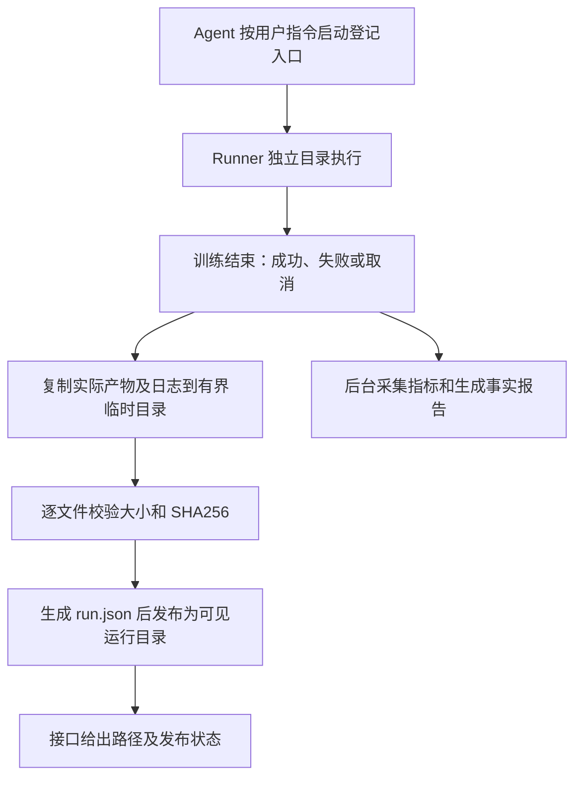

# 训练产物可见目录与保存位置配置说明

日期：2026-10-27。项目：`E:\code\LangChian_New`。

## 1. 用户如何找到权重

训练完成后，系统自动将该次运行的真实产物发布到服务器项目内的可见目录：

```text
<服务器项目目录>/training_outputs/<run_id>/
├── artifacts/
│   ├── last.pth
│   ├── PRNet.log
│   ├── metrics.jsonl
│   ├── result.json
│   ├── provenance.json
│   ├── source/
│   └── summary/
├── output.log
└── run.json
```

可见目录中的产物是普通文件副本，不是符号链接。普通 ls、SFTP 和编辑器都能看到 training_outputs。原始运行目录继续保留证据副本，发布不删除、不移动原文件，因此会增加磁盘使用。本次没有自动清理原始权重。

每个 run_id 独立一个目录，重复查询不会覆盖产物，也不会开启新训练。last.pth 代表最后一轮权重，不等于经过验证的最佳权重。只有原训练入口实际生成的文件会被发布，其他项目没有 last.pth 时不会伪造一个权重。

本次已实际发布已有的完成运行，未重新训练：

```text
/mnt/Data/HOME/gsx/PRNet/training_outputs/cbadeeed40854c8e8337a880b52db299/artifacts/last.pth
```

本次发布 14 个产物文件，另有 run.json 清单。权重大小为 53,361,123 字节；可见副本与原权重 SHA256 都为：

```text
fbc931ef7132613a48cca424aebf43736563842f3f6b3ea3ed6a0315b3178f44
```

## 2. 指定保存到哪个目录

部署者可在后端 config/.env 或进程环境变量中指定：

```dotenv
RUNNER_OUTPUT_DIRECTORY=training_outputs
```

例如改成 results/PRNet，新运行的输出位置就是：

```text
/mnt/Data/HOME/gsx/PRNet/results/PRNet/<run_id>/artifacts/last.pth
```

这是服务器项目内的相对路径，不是 Windows 本地路径。支持英文字母、数字、下划线、连字符及层级分隔 `/`；拒绝绝对路径、`..`、隐藏目录和符号链接跳转。文件名由已登记的训练入口决定，不接受模型任意指定 shell 路径。

每次创建执行绑定，将目录冻结在 launch 快照的 output_directory 中。改变配置只影响新的执行绑定，已绑定的运行仍使用旧快照。旧记录没有这个字段时使用 training_outputs，不需要改旧数据、任务配置或脚本摘要。

更新后需要重启 API 和监控 Worker：它们都缓存了配置及 RunnerTransport。无需改 PRNet 原代码、重新登记适配器或重新训练已完成运行。

## 3. 发布的流程



新监督器收尾时自动发布。旧监督器启动的已完成运行，可通过新版本 POST /runs/{run_id}/refresh 发布；Worker 状态观测也会补做。运行中返回 not_ready，不发布未写完的检查点。

只复制实际文件，不调用模型、不调用训练 start、不修改已冻结参数。旧运行的 job_id 和 launch_digest 保持不变。

## 4. 接口与前端约定

没有增加接口路径。已有接口仍需本人 Bearer Token，校验运行和服务器归属。

### GET /runs/{run_id}/execution

响应增加可空字段 output_directory，表示预定的可见产物目录。例如：

```json
"output_directory": "/mnt/Data/HOME/gsx/PRNet/training_outputs/cbadeeed40854c8e8337a880b52db299"
```

此接口只查数据库，不连接 SSH；返回预定路径不等于发布已完成。其他原有字段不变。

### POST /runs/{run_id}/refresh

路径填本人 run UUID，无请求体，成功 200。响应中的 execution 为执行状态，observation.outputs 增加以下结构：

```json
{
  "status": "published",
  "directory": "/mnt/Data/HOME/gsx/PRNet/training_outputs/cbadeeed40854c8e8337a880b52db299",
  "error_code": null,
  "file_count": 14
}
```

这是 observation.outputs 的内容，不是整个 refresh 响应。

| 字段 | 含义 |
| --- | --- |
| status=not_ready | 尚未进入训练终态，产物还不能发布 |
| status=published | 已完成复制并提交整个批次；不能据此判断训练成功 |
| status=unavailable | 发布失败，训练状态和原产物保留 |
| directory | 该次运行固定的可见输出目录 |
| error_code | 失败固定为 OUTPUT_PUBLICATION_FAILED，不返回系统原始异常 |
| file_count | 实际发布文件数，不含 run.json；不能据此推断一定有权重 |

run.json 包含 run_id、job_id、launch_digest、参数、脚本编号、训练状态、退出码和各文件相对路径、大小、SHA256。重复发布检查运行绑定及文件存在、大小；不会每次重新计算所有大文件哈希。首次复制进行完整哈希核对。

刷新仍保留 401 未登录、404 无记录或无权访问、409 绑定冲突、422 UUID 错误及现有 SSH/存储错误映射。发布失败单独反馈，不篡改训练退出码，也不自动重训。

前端可展示“保存位置”和“产物发布状态”，提供复制路径按钮。published 与 execution.status 分开显示。当前没有新增文件下载、任意目录浏览或实时推送接口。

### 后台监控

训练终态且指标已采集，但产物发布 unavailable 时，保留已生成的事实报告，将 monitor.status 设为 attention，last_error_code 为 OUTPUT_PUBLICATION_FAILED。处理权限、磁盘空间或目录冲突后，可调用原 POST /runs/{run_id}/monitor/retry 重试监控，不会重训。

旧 completed 监控不会自动重新排队；本次指定运行已显式发布，其他旧运行可以显式 refresh。

## 5. 发布边界与保护

- 只处理当前 job 下的 artifacts 及 output.log，不扫描项目所有文件。
- 拒绝源文件、目录及目标目录的符号链接，不允许跳出项目。
- 最多遍历 256 个产物目录/文件条目，单文件最多 512 MiB，总文件最多 1 GiB。超过时明确失败并保留原件；大型权重后续需要分块或对象存储方案。
- 首次复制核对源与目标大小、SHA256，临时目录完成后再发布成最终目录。
- 已有目标必须属于同一 run/job/启动摘要，不覆盖其他记录。
- 可见文件被删除或大小变化时明确报错，不自动覆盖用户修改。
- 发布失败在原 job 目录记录 publication_error.json，包含安全错误分类、操作阶段、异常类型和源码行号，不记录异常原文或变量值；接口只返回固定安全错误码。
- 远端路径判断兼容系统 Python 3.8；PRNet 自己的固定训练环境保持不变。

## 6. 模块与技术栈

| 模块 / 技术 | 职责 |
| --- | --- |
| RunnerSettings / dataclasses | 校验可见目录配置 |
| app.config / python-dotenv | 读取后端配置，环境变量优先 |
| RunnerService | 冻结新执行目录，提供预定路径 |
| RunnerRepository / MySQL | 兼容新旧快照，不修改旧启动记录 |
| remote_agent / pathlib / shutil | 真实文件复制、路径边界、有界遍历 |
| hashlib / json | 完整性校验和发布清单 |
| JobLock / Linux flock | 同一 job 发布串行，保留训练启动幂等 |
| RunnerTransport / AsyncSSH | 固定协议，验证响应路径与快照一致 |
| FastAPI / Pydantic | HTTP 响应字段及 OpenAPI |
| MonitorService | 发布失败独立 attention，保留报告 |
| unittest / CPU 子进程 | 路径、幂等、失败保护及真实执行回归 |

没有新增依赖、付费服务、数据库表或模型调用，没有修改研究源码或重新训练。

## 7. 验证

1,081 项单元回归通过；8 组 HTTP/MySQL/真实回环 SSH/CPU 脚本 Runner 验收通过；12 组后台 Worker 自动采集、恢复、租约与报告验收通过。回环验收均使用随机临时数据库，已清理。

真实 Linux 服务器上对本次已完成运行重复发布两次并核对权重哈希，普通文件、副本大小和原件一致，job_id 与启动摘要不变，未启动新训练、未调用模型。

逐文件变更清单见下一节。

## 8. 逐文件变更清单

修改 16 个文件：

- `app/config.py`
- `app/api/runner_routes.py`
- `app/models/monitor.py`
- `app/models/runner.py`
- `app/repositories/runner_repository.py`
- `app/runner/remote_agent.py`
- `app/services/monitor_service.py`
- `app/services/runner_service.py`
- `app/services/runner_transport.py`
- `tests/test_monitor.py`
- `tests/test_remote_runner.py`
- `tests/test_runner_api.py`
- `tests/test_runner_core.py`
- `config/.env.example`
- `docs/API接口总览与前端接入约定.md`
- `docs/api/openapi.json`

新增 2 个文件：

- `tests/test_visible_outputs.py`
- `docs/训练产物可见目录与保存位置配置说明.md`

共 18 个文件。实际 .env、数据库结构、用户训练任务及 PRNet 适配器注册表均未修改。
