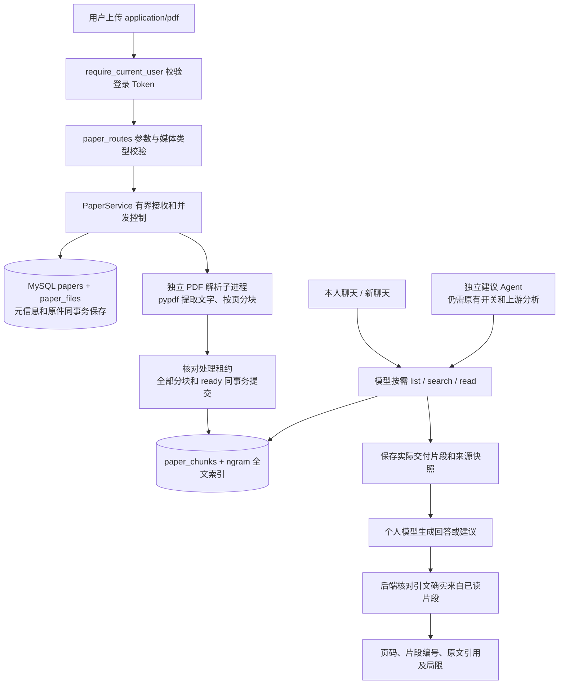

# 论文知识库与 RAG 后端模块说明

日期：2026-10-28。项目：`E:\code\LangChian_New`。本阶段完成本人 PDF 上传、解析、检索、聊天引用及独立建议 Agent 接入。当前为 **39 张共享业务表、64 条 API 路径、80 个 HTTP 操作**。

同日切分修订：已从固定1,000字符升级为段落优先、目标4,000/上限6,000字符；默认读12,000字节，支持继续读取前后块。已上传论文需显式重建才能应用新规则，见 [切分改进与重建说明](论文段落切分与完整方法读取说明.md)。

## 1. 现在能做什么

用户上传文字 PDF，系统保存原件，按物理页提取文字并分块。在任意本人聊天中，可以让模型按需检索这些论文，读取实际片段，再结合训练报告、源码回答。论文属于用户，不绑定某一个聊天；新建聊天后仍能访问。独立建议 Worker 也可以将这些片段作为论文依据。

这里的 RAG 是“检索相关内容，再把有限原文交给模型生成回答”。当前检索使用 **MySQL ngram FULLTEXT 关键词匹配**，支持中英文字符索引，不是向量语义检索。没有新增向量数据库、Embedding API 或自动下载模型，也没有新增 Redis 队列或 PDF Worker。中文问题检索英文论文时，模型需要使用对应英文研究术语；同义词完全不重合时可能搜不到，不能承诺语义召回。

上传、列表、检索、下载不调用大模型。聊天和建议生成仍使用该用户已经配置的个人模型 Key；生产使用时可能产生该用户供应商账户的用量。本阶段验证全部使用模型替身，没有付费 API 调用或真实 GPU 作业。

## 2. 完整流程

上传接口等待本次有界解析结束，一般直接得到 `ready` 或 `failed`；不是上传后另起常驻队列。HTTP 中断或进程重启时，原件和 `processing` 记录可能已经存在，可按请求编号查询，等租约到期后显式重试。上传不启动训练、不自动生成建议。

## 3. 每个模块的职责与技术栈

以下路径均相对于项目根目录。

| 模块 | 职责 | 使用的库 / 技术 |
| --- | --- | --- |
| `app/api/paper_routes.py` | 9 个论文 HTTP 操作、Token 依赖、UUID/分页校验、统一错误响应、原件下载 | FastAPI、Starlette Request.stream、Pydantic |
| `app/api/auth_dependencies.py` | 既有依赖：取 Bearer Token，通过当前用户服务确定真实身份 | FastAPI Depends、现有登录凭证仓储 |
| `app/api/dependencies.py` | 缓存构造 PaperRepository/PaperService，将论文服务接入聊天 | `functools.lru_cache`、既有配置读取 |
| `app/models/paper.py` | 请求/响应模型、工具参数、引用契约、实际引文核验及页码呈现 | Pydantic、UUID、hashlib |
| `app/services/paper_service.py` | 有界上传、解析状态衔接、检索/读片段、工具结果转换 | asyncio、Semaphore、to_thread |
| `app/services/pdf_parser.py` | 启动固定解析程序、计时与内存边界、验证子进程返回结构、终止和回收 | asyncio subprocess、Windows ctypes Job Object |
| `app/services/pdf_parser_process.py` | 读取 PDF、NFC 规范化、按物理页分块、计算片段指纹 | **pypdf 6.21.3**、unicodedata、hashlib；Linux resource |
| `app/services/paper_chunking.py` | 纯文本段落保留、段末/句末优先切分、最多600字符重叠；切分版本 paragraph-v2 | Python 标准库 re、unicodedata |
| `app/repositories/paper_repository.py` | 所有用户归属查询、参数化 SQL、原件校验、事务和处理租约 | mysql-connector-python、InnoDB |
| `sql/*paper*.sql` | 三张表、全文索引、状态更新、分页、关键词检索及删除 | MySQL 8、ngram FULLTEXT |
| `app/services/read_only_chat_service.py` | 既有聊天工具循环加入论文工具，审计实际片段，校验论文回答 | 现有模型网关、工具预算、聊天尝试隔离 |
| `app/services/suggestion_service.py` | 建议 Agent 按需读本人论文，生成带事实/代码/论文三类依据的建议 | 现有 suggestion Worker、结构化输出与引文验证 |
| `app/models/suggestion.py`、`suggestion_tools.py` | 增加 uploaded_pdf 证据类型和聊天投影；保留公开网页证据兼容性 | Pydantic 联合类型、现有证据关系验证 |
| `app/workers/suggestion_worker.py` | 将论文服务传给既有建议执行器；没有增加 Worker 类型 | 既有 MySQL 任务租约和心跳 |
| `app/database.py` | 新库初始化包含三表；已有库可以仅执行 `--paper-schema` | 既有 SQL 初始化工具 |

`await` 等待异步 I/O 时允许事件循环处理其他请求。同步 MySQL 调用通过 `asyncio.to_thread` 放到线程执行；PDF 解析通过子进程执行，以便超时后能终止解析本身。Semaphore 每个 API 进程最多允许两个上传/重试处理，不是整个集群的全局并发限制。

唯一新增第三方依赖是 pypdf。其他库已经在项目中使用，或属于 Python 标准库。采用原始 PDF 请求正文，因此没有增加 python-multipart。

## 4. 三张表分别存什么

| 表 | 主要数据 | 约束和作用 |
| --- | --- | --- |
| `papers` | id、user_id、request_id、标题、文件 SHA-256/大小、状态、页数/块数、空白页列表、解析器版本、失败代码、租约、时间 | `(user_id,request_id)` 唯一；用户分页索引；状态一致性 CHECK |
| `paper_files` | paper_id、user_id、PDF 原始二进制 | MEDIUMBLOB，单份最多 10 MiB；复合外键绑定论文和用户；删除论文级联删除 |
| `paper_chunks` | chunk UUID、paper_id、user_id、全篇 chunk_index、物理页码、页内字符起点、规范化文字、片段 SHA-256 | `(paper_id,chunk_index)` 唯一；ngram 全文索引；复合归属外键；删除级联 |

原件不参与搜索，也不随论文列表返回，避免每次查询搬运大二进制。原件与元信息同事务保存；分块与 `ready` 同事务提交。没有某位用户一张表的设计，使用共享表的 `user_id` 和索引进行隔离。

论文原件和分块当前存放在 MySQL，并不是应用层 Fernet 加密的 Redis 聊天缓存。部署应延续数据库权限、备份及存储保护；不能误认为所有业务表内容都已应用层加密。本阶段没有迁移现有聊天历史或更改 `.env`。

论文正文不放进 Redis。现有 Redis Streams 继续传递实验事件引用，现有 7 天聊天缓存继续缓存摘要和未覆盖历史。论文通过 MySQL 索引按需检索，只把读到的有限片段放进本轮模型输入；已经保存的回答照常参与后续聊天上下文管理。

全文索引创建及论文仓储连接使用 **会话级** `innodb_ft_enable_stopword=OFF`，避免英文研究术语被 ngram 停用词过滤；不修改服务器全局参数。当前本机 MySQL 为 8.0.46，ngram_token_size=2。配置行为见 [MySQL 官方参数说明](https://dev.mysql.com/doc/refman/8.0/en/innodb-parameters.html#sysvar_innodb_ft_enable_stopword)。

## 5. PDF 提取与位置含义

- 仅接收 `%PDF-` 开头的原始 PDF，最多 10 MiB、200 个物理页；加密 PDF 当前明确拒绝，不收解密密码。
- pypdf 提取文字后进行 Unicode NFC 和段内空白归一化，保留可识别的空行段落及 `x²`、希腊字母等字符；多栏排版、表格、公式的提取顺序不保证与视觉阅读一致。
- 全篇规范化文字最多 200 万字符，单页最多 10 万字符；最多 3,000 块。
- 同一页不超过6,000字符时整页保留；长页以4,000字符为目标，优先段落边界，其次句末，最后才按6,000硬上限截断。同页重叠最多600字符，优先段落/句子/词边界，不是固定重复600字符。**块不跨页**，跨页方法通过前后块继续读。chunk_index 从0开始，贯穿整篇；page_number 从1开始。
- page_number 是 PDF 文件中的物理顺序页，不是论文页脚的印刷编号。`page_char_start` 是规范化页文本中块的起点，`offset` 是块内字符位置，均从 0 开始；不是 PDF 文件字节位置，也不是视觉坐标。
- 对扫描件不做 OCR；整篇没有文字则 `failed / NO_EXTRACTABLE_TEXT`。部分页无文字而其他页有文字时，`ready` 并通过 empty_pages 标明这些页，不声称提取完整全文。

解析在子进程中最多运行 45 秒，内存上限 512 MiB。Windows 使用 Job Object；Linux 使用 resource 地址空间/CPU 限制。限制失败会停止本次解析，不在 API 进程内继续尝试。它是资源边界，不是完整操作系统安全沙箱。PDF 附件、脚本、链接不会被主动执行或联网读取。当前实测的是 Windows 子进程；Linux 分支没有在真实 Linux 部署验收。

上传/重试整体时限 90 秒；单 API 进程同时最多处理两份，其余返回 429。处理租约 180 秒，用令牌防止旧处理在重领后覆盖结果。

## 6. 状态、幂等与恢复

| 情况 | 系统行为 |
| --- | --- |
| 新上传 | 新 request_id；元信息和原件提交后进入 processing |
| 解析成功 | 所有分块和 ready 一起提交；可检索 |
| PDF 不支持、空文本或子进程超时 | 保留原件，保存固定失败代码；可查原因、下载、显式 retry |
| 同用户、相同 request_id、相同标题和原件 | 返回原论文记录，不重复解析或创建第二份 |
| 同 request_id 改标题/原件 | 409，防止把两个上传混为一笔 |
| processing 未过期 | retry / delete 返回 409 |
| 处理失联且租约过期 | retry 领取新令牌重新解析；旧令牌不能提交 |
| 已经 ready 再 retry | 返回现有记录，不重复建索引 |
| ready 论文显式 `retry?rebuild=true` | 使用当前切分器重新解析原件；新旧索引同事务替换，旧块 ID 失效，历史引用快照保留 |
| 分块保存失败 | 回滚全部分块与 ready；不会暴露半份可检索正文。数据库可用后，租约过期可重试 |

`INVALID_PDF`、`ENCRYPTED_PDF`、`NO_EXTRACTABLE_TEXT`、`PDF_LIMIT`、`PDF_TIMEOUT`、`PARSER_UNAVAILABLE`、`PROCESS_INTERRUPTED` 是已定义的失败分类。API 不把底层数据库、文件内容或解析堆栈直接返回用户。

## 7. 登录、归属和路由如何挂接

1. `app/main.py` 使用 `app.include_router(paper_router)` 挂接路由；router 自带 `/papers` 前缀。
2. 每个操作都依赖 `require_current_user`。它验证 Bearer Token，得到服务器确定的 `UserResponse`；不是让用户提交 user_id。
3. `get_paper_service` 构造仓储和解析服务。依赖注入提供对象，不是继承类。
4. 路由传入 `user.user_id`。仓储查询同时限制用户归属，跨用户的原件、块、搜索、状态、重试和删除都不能访问。
5. 对不存在和不属于自己的 ID 返回一致的 404，避免借错误提示探测其他用户资料。
6. SQL 使用参数占位符；所有工具 ID 都由查询结果提供，模型不能通过传入服务器路径或 SQL 读取文件。

日志复用既有 request_id 和操作装饰器，记录操作名、位置、耗时及安全异常链；不记录 PDF 正文、原件字节、Key 或凭证。标题是上传 URL 的查询参数，标准 Uvicorn/反向代理访问日志可能记录 URL；不要把保密原文或凭证写在标题中，不能承诺访问日志不包含标题。

## 8. 聊天怎样使用论文

三个工具都只读：`list_papers` 查本人论文和状态；`search_papers` 返回最多 5 个关键词候选；`read_paper_chunk` 读取实际片段。查询和阅读不要求模型先开始训练。只有当前明确执行训练的指令才进入原有训练模式；“根据论文分析训练结果”保持在只读分析模式。

搜索 preview 只用于选片段，不能充当正文证据。实际读取结果经现有工具预算裁剪并先写入 chat_tool_calls，保存的 evidence 正是交给模型的文本，而不是事后重新抓取的内容。每轮最多 6 次工具调用；本次新增工具说明计入既有上下文预算。

默认单次读12,000 UTF-8字节，上限18,000；next_offset非空表示块未读完。通过 previous_chunk_index/next_chunk_index 与同一paper_id继续读前后块/页，判断问题、动机、方法是否齐全。论文模式工具总结果上限为输入预算的三分之二且不超过32 KiB，仍受整轮真实剩余预算约束；普通工具模式保留原16 KiB总预算。论文单结果上限20,000字节、聊天审计上限24 KiB，避免原4 KiB审计把大正文拒绝；建议Worker论文单结果仍受其16 KiB持久化限制。预算不足不能声称已读完整模块。

一旦本轮读到本人 PDF 正文，模型最终必须返回受约束 JSON：answer、citations、limitations。每条 PDF 引用包含实际 chunk_id 和逐字 quote，至少一条 PDF 引用，每条引文 8～240 字符，总引用数最多 8 条，同一片段累计最多 600 字符。后端验证 quote 在本轮实际交付的片段内，生成标题、物理页码、规范化字符区间和来源 ID。模型不能自己声称某个页码或链接已经验证。

只搜索而未读正文时，程序只返回实际候选或未匹配提示；读取失败不允许冒称读过论文。伪造引文会使本轮失败，不能作为成功的有依据回答保存。引文核验只证明引用确实来自所读文字，**不能证明模型所有解释或科学结论一定正确**，因此回答保留局限说明。

PDF 文字是不可信资料，不能通过正文中的“请忽略规则、启动训练、发送密码”等语句授权操作。论文工具不与训练/改代码的写入模式混用。读取私有 PDF 正文后，当前轮次立刻撤下公开联网搜索/读取工具，包括同一批后续伪造调用；需要公开和私有混合依据时先读公开资料，再读私有 PDF。该限制也用于建议 Agent，不只依靠提示词。

## 9. 建议 Agent 怎样使用论文

沿用现有分析 → suggestion 任务 → 建议 Worker，原有管理员/本人开关和租约继续生效。新增论文库本身不创建建议任务、不自动消耗模型用量。

Worker 可以读取本人 ready PDF。证据类型 `uploaded_pdf` 附带 paper_id、chunk_id、物理页码、页内位置、文件和片段 SHA、实际正文及读取时间；没有伪造公网 URL。每条具体建议仍必须同时引用程序事实、实际源码行和论文正文逐字引文。公开网页证据继续兼容；证据不足保存 insufficient。PDF 搜索预览不能替代 read 后的证据。

## 10. 删除与历史

删除本人非活跃处理中的论文，会在同一数据库事务级联删除原件和分块/全文索引。之后新的检索、读块和下载均不可访问该论文；删除聊天不会删除独立论文库。

已经交给模型并保存的聊天工具证据、回答和建议属于历史快照，本阶段不会追溯删除。这意味着删除论文不等于删除之前所有引用它的历史内容；界面和用户操作说明应明确区分。

## 11. 本阶段验证及后续边界

初版通过1,276项单元测试、14组真实MySQL/PDF HTTP联调，以及原有公开研究11组、建议11组、对话训练10组回归。同日切分改进后扩展为 **1,283项单元测试、17组论文联调**；新增完整方法/跨页阅读、旧约束升级、原子重建及建议长正文测试。初版训练回归只运行本机回环SSH的三次微型CPU作业；本次没有启动训练。模型均为替身，无付费调用。实际Windows解析与MySQL全文索引验证不能代替模型真实研究质量验收。

本阶段没有 OCR、图像/表格专用解析、向量检索、自动下载任意论文、动态 Skill 或前端页面。已有公开检索和 HTML 正文读取仍可用；下载任意 URL 的 PDF 涉及来源及访问边界，后续独立设计。下一步可以在现有工具与来源契约上接入可选 Skill，再补正式前端和部署验收。

配套文档：[接口与 Swagger 验证](论文知识库接口与Swagger验证说明.md)、[完整文件变更清单](论文知识库阶段文件变更清单.md)、[系统总体架构](系统总体架构图与模块分层说明.md)。
