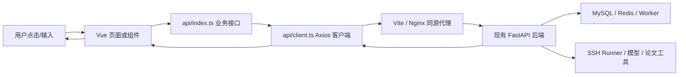

# 前端模块与技术栈

日期：2026-10-29。配套代码在同级项目的 `src/` 中。所有页面使用真实后端接口，不内置演示训练结果。

## 先理解这条链

例如在聊天框点“发送”：`ChatView.vue` 读取用户输入与选定 Skill，生成这一轮的 `request_id`，调用 `api.send()`。Axios 自动从当前登录状态取得 Bearer Token，放在请求头。Vite 将 `/api/sessions/.../messages` 转发成后端真实的 `/sessions/.../messages`。后端验证 Token、会话归属、请求编号，再决定调用模型或工具。回复结束后，页面重新读取已保存历史，使用数据库的真实 `seq` 显示消息。

这里没有把 SQL、MySQL 密码、SSH 连接实现搬到浏览器。前端只负责展示与用户交互，权限最终由后端判断。

## 技术栈与包的作用

| 包 | 当前锁定版本 | 作用 |
| --- | --- | --- |
| Vue | 3.5.44 | 页面组件、响应式状态、表单与条件展示 |
| TypeScript | 5.9.3 | 检查请求、响应、状态和组件参数的类型 |
| Vite | 8.3.5 | 开发服务器、热更新、开发代理、生产打包 |
| Vue Router | 5.4.0 | `/chat`、`/training` 等页面路由及登录守卫 |
| Pinia | 4.1.0 | 在页面间共享登录、会话列表、当前 Skill、待完成消息 |
| Element Plus | 2.14.7 | 输入框、选择器、对话框、抽屉、消息提示等交互组件 |
| @element-plus/icons-vue | 2.3.2 | 导航与操作按钮图标 |
| Axios | 1.21.0 | HTTP 请求、Bearer 注入、错误统一处理、取消读取 |
| ECharts | 6.1.0 | 按实际指标绘制训练曲线；按需引入折线、图例和缩放组件 |
| markdown-it | 15.0.3 | 渲染模型回复和 Skill 指令中的 Markdown，关闭原始 HTML |
| openapi-typescript | 7.13.0 | 从后端 OpenAPI 生成 TypeScript 类型 |
| Vitest / Vue Test Utils | 5.0.5 / 2.5.1 | 验证请求约定、错误处理、表单和聊天状态 |
| jsdom | 30.1.3 | 为组件测试提供 DOM 环境，不替代浏览器视觉检查 |
| ESLint / Prettier | 10.13.0 / 3.9.10 | 检查代码问题、统一源码格式 |

`package.json` 说明依赖，`pnpm-lock.yaml` 锁定完整依赖树。生产只需要 `dist/` 的静态文件，测试包不会成为后端服务。

## 入口与路由

| 文件 | 职责 |
| --- | --- |
| `index.html` | 浏览器 HTML 入口、语言、主题色、图标和 viewport 设置 |
| `src/main.ts` | 创建 Vue 应用，依次安装 Pinia、Router、Element Plus 中文语言包，加载样式 |
| `src/App.vue` | 顶层路由占位，不在这里堆业务逻辑 |
| `src/router/index.ts` | 定义页面和登录守卫；无 Token 时转到登录页，保留站内返回地址 |
| `src/layouts/WorkspaceLayout.vue` | 桌面侧栏、聊天列表、手机顶栏与底部导航、新建/删除会话、退出登录 |
| `src/styles/theme.css` | 颜色、间距、排版、三栏布局及手机/平板断点 |

桌面聊天页为“导航＋聊天＋当前关联运行”；小于 1200px 时运行面板改为抽屉；小于 768px 时导航改为底部五个入口，历史聊天从左侧抽屉打开。手机与电脑共用同一套接口和业务状态。

## API 和类型

| 文件 | 职责 |
| --- | --- |
| `src/api/client.ts` | 单一 Axios 实例、请求头、身份代次、错误分类和 GET/POST/PUT/DELETE 基础方法 |
| `src/api/index.ts` | 按业务命名的接口函数，例如 `send`、`createTask`、`start`、`prepareChange` |
| `src/types/api-schema.d.ts` | 自动生成的后端类型，不手工维护接口字段 |
| `src/types/domain.ts` | 常用类型别名，以及后端部分未声明响应模型的接口所需类型 |
| `docs/api/openapi.json` | 本轮使用的完整接口快照；后端接口变化后应重新导出并生成类型 |
| `scripts/check-api-contract.mjs` | 解析接口封装中的调用路径/方法，与 OpenAPI 对照；不能证明服务业务正确 |

Axios 捕获 401 才触发登录失效。404、409、429、503 等分别留给页面处理。5xx 使用简洁文案，并附上后端 `X-Request-ID` 便于查看日志。页面不会打印 Axios 原始配置，避免把 Authorization 或表单凭据写进控制台。

“身份代次”用于处理真实的异步竞争：用户退出 A 账号、登录 B 账号后，A 的迟到响应会被丢弃；A 的迟到 401 也不能把 B 退出。它不代替后端鉴权。

## 共享状态

| 文件 | 保存什么 | 生命周期 |
| --- | --- | --- |
| `src/stores/auth.ts` | 当前 Token、用户资料、恢复登录状态 | Token 放内存和 sessionStorage；关闭浏览器会话或退出后清理 |
| `src/stores/workspace.ts` | 会话列表、公共及本人 Skill 列表、下一轮选择的 Skill | 当前账号的前端页面会话 |
| `src/stores/chat.ts` | 各会话草稿、正在发送的原问题、原 request_id、原 skill_id、错误状态 | 当前账号当前页面会话；换账号清空 |

不会把整个 MySQL 历史数据库再复制到 Pinia。历史从后端读取；Redis 缓存仍由后端负责，浏览器不直接连接 Redis。用户模型 Key、SSH 密码与私钥只暂存在输入表单中，保存成功或关闭表单后清空，不进入 sessionStorage。

## 页面职责

| 页面文件 | 功能与调用逻辑 |
| --- | --- |
| `views/AuthView.vue` | 注册、登录、密码长度与两次密码检查；只保留一个原生 form，阻止浏览器 GET 提交 |
| `views/ChatView.vue` | 读取完整分页历史、发送/原请求重试/末轮重试、选择 Skill、工具记录、训练计划、关联运行面板 |
| `views/TrainingView.vue` | 实验与运行列表、创建实验、配置对话训练任务、创建尚未启动的运行记录 |
| `views/RunView.vue` | 运行状态、串行轮询、日志、指标、报告、监控恢复、启动/停止、派生训练与对比入口 |
| `views/ServersView.vue` | 服务器列表、新增密码/私钥配置、测试连接、删除配置；凭据与主机指纹按实际认证方式填写 |
| `views/LibraryView.vue` | 原始 PDF 上传、索引状态、检索、分块正文、前后片段、原件下载、删除、重建索引、会话来源、Skill 目录与个人 Skill 创建 |
| `views/SettingsView.vue` | 当前用户、个人模型 Key 状态与保存/删除、分析/建议 Agent 偏好 |
| `views/NotFoundView.vue` | 未匹配页面及返回工作台入口 |

训练参数不是前端硬编码成 PRNet：`ParameterFields` 读取登记入口给出的 `int / float / str / bool` 规则、必填和上下限。评测定义独立于训练参数，可按伪装目标检测、目标检测、点云、跟踪等任务填写。

## 组件职责

| 组件 | 作用 |
| --- | --- |
| `BrandMark.vue` | 显示用户选定的药老品牌图，提供普通、紧凑、大图三种尺寸 |
| `StatusBadge.vue` | 状态文字与颜色；训练完成、监控完成、排队等分开显示 |
| `SectionState.vue` | 明确区分读取中、读取失败、确实没有记录三类状态 |
| `MarkdownText.vue` | 只渲染经过统一 Markdown 处理的模型内容 |
| `DataTree.vue` | 展示后端动态结构、参数、依据与版本；使用文字绑定，HTTP(S) 来源可点击 |
| `ParameterFields.vue` | 根据脚本登记规则生成参数表单，不执行或解析命令 |
| `ExperimentForm.vue` | 创建实验；收集评测协议、数据集版本、指标定义、主指标 |
| `MetricChart.vue` | 按 metric/dataset/split 分系列绘图；ResizeObserver 调整尺寸，卸载时释放实例 |
| `ReportSummary.vue` | 展示报告采集完整性、范围提示、指标末值和协议允许的观测最优值；完整原始字段折叠保存 |
| `RunSummary.vue` | 聊天右侧运行概览，末值来自最新指标接口，曲线展示首批事件并标注范围，提供完整监控入口 |
| `RunAgents.vue` | 后台任务、报告分析、有据建议、来源证据、任务重试与修改计划生成 |
| `RunCode.vue` | 目录与源码分页读取、SHA256 对照、修改计划/实际 diff/检查结果、独立副本应用及派生训练准备 |

## 辅助模块与重要细节

| 文件 | 为什么需要 |
| --- | --- |
| `lib/history.ts` | 后端只有向后分页接口，所以按 after_seq 读到尾部；发现游标回退中止读取，允许 seq 有缺口 |
| `lib/logs.ts` | 日志偏移单位是字节，不能用中文字符串长度推进；TextDecoder 处理跨页 UTF-8 字符，页面保留最近 256K 字符 |
| `lib/markdown.ts` | 禁用原始 HTML 和危险协议；外链添加隔离属性，不自动加载模型给出的远端图片 |
| `lib/format.ts` | UUID 展示、32/36 位 UUID 归一比较、日期与数值格式、状态中文名、站内返回路径检查 |
| `lib/ui.ts` | 统一操作确认和安全错误提示 |
| `composables/useSerialPoll.ts` | 前一次读取完成后再安排下一次；后台标签页暂停，卸载取消，避免定时请求堆积 |

正常问题每次生成新 request_id；网络失败重发时沿用原问题、原编号和原 Skill。刷新页面后若最后一条为 human，显示“重试最后一轮”，由后端决定继续原轮次。不会补一条假的 AI 消息来掩盖失败。

训练页面的定时操作主要读取已保存状态。连接远端刷新状态、采集指标、生成报告等有独立按钮；日志只在打开日志区域时读取。用户切换会话不会让已经发出的训练指令自动取消，取消训练需要明确点击“停止训练”。

## 2026-10-29：通用训练资源选择

新增 `TrainingTaskForm.vue`，在任务配置中从本人服务器读取环境和项目文件；新增 `ServerGpuInfo.vue`，供服务器卡片和训练配置共用。`WorkspaceLayout.vue` 的新聊天会先输入标题。后端复用 AsyncSSH 只读通道，增加环境发现和固定 nvidia-smi 查询。完整模块与包说明见 [本模块说明](07-服务器资源与通用训练配置.md)。

## 2026-10-29：历史原文回查与流式聊天

新增 src/lib/sse.ts 解析真实 SSE，api/client.ts 复用 Axios 身份处理，ChatView.vue 将生成片段与持久化消息分开。后端复用上下文和工具循环，增加当前会话历史原文搜索/读取。

详情见 [模块文档](09-历史原文回查与流式聊天.md)。
