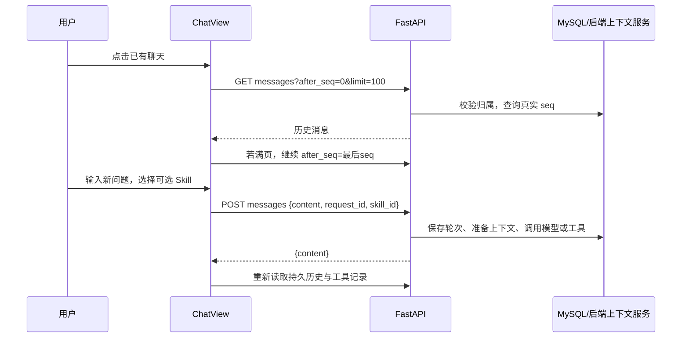

# 接口与交互说明

本轮对照的后端快照位于 `api/openapi.json`，共 67 个路径、83 个 HTTP 操作。前端所有 HTTP 访问集中在 `src/api/index.ts`。页面中的 UUID 从响应和下拉选项取得，用户不需要复制到普通表单中。

## 身份

| 页面动作 | 接口 | 说明 |
| --- | --- | --- |
| 注册 | `POST /auth/register` | body 为 username、password；成功后转为登录表单 |
| 登录 | `POST /auth/login` | 返回 access_token、expires_in 和 user |
| 恢复用户 | `GET /auth/me` | 检查 Token 当前是否仍有效 |
| 退出 | `POST /auth/logout` | 后端撤销登录；前端 finally 清理本地状态 |
| 查看/更新/删除个人模型 Key | `GET / PUT / DELETE /me/model-credentials/deepseek` | PUT 成功是 204 空响应；GET 只返回 configured |
| 分析与建议开关 | `GET / PUT /me/analysis-settings`、`/me/suggestion-settings` | enabled 是个人偏好，不是 Worker 存活证明 |

后续请求头为 `Authorization: Bearer <access_token>`。用户身份由后端解析，页面不提交 user_id 来决定归属。只有 401 会进入登录失效流程；服务暂不可用时保留登录凭证供重试。

## 聊天

| 接口 | 前端用途 |
| --- | --- |
| `GET /sessions` | 会话侧栏，只有 id 和 title，不编造时间戳 |
| `POST /sessions` | 点“新聊天”或首次发送时创建；UUID 由服务器生成 |
| `DELETE /sessions/{session_id}` | 删除本人的聊天及内容；需确认，不等于停止训练 |
| `GET /sessions/{session_id}/messages` | after_seq 向后分页读取历史，使用实际 seq |
| `POST /sessions/{session_id}/messages` | 新问题；request_id 为前端生成 UUID；同一轮重试不改变 |
| `POST /sessions/{session_id}/retry` | 没有本地原请求快照时，继续后端保存的最后一轮 |
| `GET /sessions/{session_id}/tool-calls` | 工具名、参数、结果元信息、耗时、关联运行；继续分页用 after_id |
| `GET /sessions/{session_id}/training-plan` | 查看最近保存计划，不启动训练 |
| `GET /sessions/{session_id}/turns/{turn_id}/skill` | 查看该轮冻结的 Skill 指令与版本 |

当前聊天是完整 HTTP 回复，不提供逐 token 流式接口。页面显示“正在处理”而不是假装逐字生成。浏览器中断不表示后端执行取消；请求结果不明时应重试原轮次或查看原记录。

## 实验、任务、运行

1. `POST /experiments` 创建实验。`evaluation` 描述实际评测协议、数据集和指标；`kind=training` 才能配置对话训练任务。
2. `GET /servers` 和 `GET /runner/scripts` 提供可选目标与入口，脚本响应包含参数类型和限制。
3. `POST /training-tasks` 保存 name、experiment_id、server_id、script_id、default_parameters。此动作不开始训练。
4. 在聊天中明确说“启动 任务名称”，后端 Agent 使用已有任务工具查询、准备计划并执行。仅询问结果、阅读论文、讨论修改不自动启动。
5. 手动方式：`POST /experiments/{id}/runs` 创建参数已保存的运行；`POST /runs/{id}/start` 在确认后启动。重复同一 run 的启动由后端保证幂等。

列表接口分别使用 `next_cursor / before_id`、`next_offset`，不要混用。前端实验列表、服务器列表、训练任务、运行列表均有继续加载入口。服务器选项会读取已有分页结果，不让用户输入任意 server_id。

## 监控与报告

| 接口 | 特性 |
| --- | --- |
| `GET /runs/{id}` | 持久化运行状态、参数、评测定义 |
| `GET /runs/{id}/execution` | 已登记执行信息和预期输出目录，不直接连接 SSH |
| `POST /runs/{id}/refresh` | 主动查询远端；observation.outputs 才反映此次确认的实际产物状态 |
| `POST /runs/{id}/stop` | 停止原运行；成功提交不代表状态已经变为 cancelled |
| `GET /runs/{id}/logs` | SSH 读取日志；使用服务器返回的字节 next_offset |
| `GET /runs/{id}/metrics` | 查询已采集指标；after 是 source_offset，按数据集/分组/指标区分 |
| `GET /runs/{id}/metrics/latest` | 每组指标的末值、最小值和最大值 |
| `POST /runs/{id}/metrics/sync` | 用户主动采集一批日志指标，不是前端伪造上传 |
| `GET / POST /runs/{id}/report` | 读取 / 生成事实报告；显示 version、generated_at、is_stale |
| `GET /runs/{id}/monitor`、`POST .../retry` | 后台监控任务及恢复 |

活跃页面通常每 7 秒串行读取状态；后台标签页暂停。运行终态但监控还未完成时，仍可跟进采集状态。指标图只使用真正返回的数值，不推测“完成百分比”或伪造 epoch 进度。

“训练成功”“日志采集完整”“报告生成”“建议完成”是不同条件。输出目录字段也不保证权重已经存在；点击刷新后检查 outputs 的 published/not_ready/unavailable 状态，并到指定目录核对。

## Agent、修改与结果对比

1. `GET /runs/{id}/events` 查看报告事件分发；`GET .../agent-tasks` 查看分析和建议任务。
2. `GET .../analyses` 与 `GET .../suggestions` 读取结果；前端明确显示旧报告标记、推断、局限和证据。
3. 任务详情和重试必须包含所属运行：`/runs/{run_id}/analysis-tasks/{task_id}`、`/runs/{run_id}/suggestion-tasks/{task_id}`。不能省掉 run_id。
4. 建议工具证据：`GET /runs/{id}/suggestion-tasks/{task_id}/evidence`。
5. 从某条建议 `POST /runs/{id}/code-changes` 生成修改计划。传入 suggestion_task_id、1 起算的 suggestion_index 和本次准备的 request_id；会用模型，但不写源码。
6. 查看计划后 `POST /code-changes/{id}/apply`。后端应用到独立副本并运行已登记检查；前端展示 old/new、实际 diff、文件版本与检查状态，不声称原项目已被覆盖。
7. `POST /code-changes/{id}/training-runs` 预检并创建派生运行；`POST /runs/{new_id}/revision/start` 才是真正启动。
8. `GET /runs/{new_id}/comparison` 读取原/新报告比较。协议不兼容或报告缺失时显示 reasons，不计算虚假的提升幅度。

源码读取使用 `/runs/{id}/code/files` 和 `/code/file`。文件分段跟随 next_line，并传 expected_sha256，防止把不同版本内容接在一起。目录列表不代表源码正文已经被读取。

## 论文和 Skill

- 上传：`POST /papers?request_id=...&title=...`，请求体是原始 PDF 字节，Content-Type 必须是 application/pdf，不能包在 JSON 或 multipart 中。
- 论文状态、列表、原文件：`GET /papers`、`GET /papers/{id}`、`GET /papers/{id}/file`。原件请求通过 Axios 带 Token，下载用临时 Blob URL，之后释放。
- 检索：`POST /papers/search`。当前是 MySQL ngram 关键词检索，不宣称向量语义检索或完整论文已经被模型读过。
- 分块目录与正文：`GET /papers/{id}/chunks`、`GET /papers/chunks/{id}`。展示物理页码、块编号、文本位置、SHA256，支持块内继续读取及前后邻块。
- `/papers/{id}/retry?rebuild=true` 重建索引需要确认；删除原件与索引也需要确认。
- 会话已保存资料与建议：`/sessions/{id}/references`、`/research-advice`，最多读取最近 50 条并标注范围。
- Skill 目录与指令：`GET /skills`、`GET /skills/{id}`。包含公共部署目录和本人创建的 Skill。
- 创建个人 Skill：`POST /skills`，请求体为 `{ "title": "名称", "instructions": "提示词" }`，返回 201 和后端生成的 SkillSnapshot。用户身份从 Token 取得，正文最多 6144 UTF-8 字节；跨用户读取个人 ID 返回 404。页面不安装 GitHub 插件。

## 错误怎么处理

| 情况 | 页面行为 |
| --- | --- |
| 400 / 422 | 检查输入；未落库的错误问题允许恢复草稿后修改 |
| 401 | 清理当前登录状态，转登录页 |
| 403 / 404 | 显示不可访问/不存在，不当成“空记录读取成功” |
| 409 | 展示状态或版本冲突，先读取原记录，避免新建请求重跑 |
| 429 | 显示暂忙/请求频繁，保留原请求供用户重试 |
| 网络中断 / 超时 | 不声称后端已取消，保留原请求编号 |
| 5xx | 显示稍后重试和追踪号；具体原因由后端日志定位 |

生产代理和上游超时时间需要覆盖当前完整回复接口；配置示例设为 660 秒。这里没有自动重发 POST 的拦截器。

## 2026-10-29：资源选择与删除契约

新增 `POST /training-projects/environments` 和 `POST /training-projects/resources`，请求体均为 `{ "server_id": "UUID" }`，读取当前用户服务器的环境/GPU快照。`POST /training-projects/files` 用于训练前浏览目录。用户自选项目以 `project` 分支提交 `/training-tasks`，与 `script_id` 二选一。

`DELETE /servers/{id}` 已改为清空连接密文并设置删除标记，历史关联保留；活动执行返回 409，已删配置后续不可访问。新聊天使用已有 `POST /sessions` 的 title 参数。字段、返回值与步骤见 [本模块接口说明](07-服务器资源与通用训练配置.md)。

## 2026-10-29：资料库直接删除

资料卡片和详情共用 `DELETE /papers/{paper_id}`。确认后删除本人 PDF 原件、元数据、正文分块及检索索引项，历史聊天和引用快照保留。仍有有效解析租约时暂不删除。后端接口未改动。详见 [资料库删除](08-资料库删除.md)。

## 2026-10-29：历史原文回查与流式聊天

新增 POST /sessions/{session_id}/messages/stream 和 POST /sessions/{session_id}/retry/stream，使用原有登录 Token；事件为 status/reset/delta/done/error。原非流式接口保留。新问题生成 request_id，同一问题重试复用原 ID。

详情见 [模块文档](09-历史原文回查与流式聊天.md)。

## 2026-10-29：训练配置删除

DELETE /training-tasks/{task_id} 使用本人登录 Token，无请求体，成功 204。保留历史计划和运行，不停止训练；已删除任务不可再用于准备或启动。同名可重建。见 [模块文档](10-训练配置删除.md)。

## 2026-10-29：通用指标采集

新增 GET/PUT /runs/{run_id}/metrics/parser；本人运行、零有效指标时可配置规则并重置游标补采。原 POST /runs/{run_id}/metrics/sync 新增 new_events；读到日志但没有有效指标时前端提示格式问题。规范 JSONL 输出为推荐方案，不含项目专用解析器。见 [模块说明](11-通用指标日志与零指标诊断.md)。

## 2026-10-29：中文训练详情与解析规则表单

训练详情只展示白名单业务字段，复用已有实验/服务器详情接口读取名称，不展示内部编号；接口仍保留内部操作所需字段。解析规则改为中文表单，保存时自动转成既有 MetricParserRequest，没有新增接口。见 [详细说明](12-中文训练配置与解析规则说明.md)。

## 2026-10-29：工具调用与报告分析链路

没有新增 HTTP 接口。原生工具调用正文过滤、日志单次上限 16KiB、事实报告及分析空状态说明已更新；查询已保存分析不等于触发生成。新增维护 CLI 默认只读预览，执行模式限定用户和运行。详见 [13-工具调用修复与事实报告分析链路.md](13-工具调用修复与事实报告分析链路.md)。

## 2026-10-29：个人 Skill 删除与 Redis 1 号库

新增 DELETE /skills/{skill_id}，无请求体，沿用登录 Token，成功返回 204。只删除本人个人 Skill 及缓存，保留历史轮次快照；公共部署模板不可删除。个人正文按需缓存到 Redis DB1，不设 TTL。详见 [14-个人Skill与Redis一号库.md](14-个人Skill与Redis一号库.md)。

## 2026-10-30：Key 复用与真实分析结果

同账号各 Agent 复用已有模型凭据，无新增接口或 Key 字段。本次运行已保存分析与建议处理结果，后者证据不足，具体建议为空。详见 [15-Key复用与本次分析生成.md](15-Key复用与本次分析生成.md)。

## 2026-10-30：实验与运行永久删除

新增 DELETE /experiments/{experiment_id} 与 DELETE /runs/{run_id}，均使用登录 Token、无请求体，成功返回 204。实际清除数据库关联数据，活动训练等情况返回 409。服务器文件和聊天原文保留。详见 [16-实验与运行永久删除.md](16-实验与运行永久删除.md)。

指标与日志规则忽略大小写的请求、保存和查询约定见 [模块17](17-指标与日志规则忽略大小写.md)。接口路径及身份校验不变。

主网络选择、就绪检查、手动分析及 code_findings 的接口约定见 [模块18](18-主网络选择与手动分析建议.md)。设置页不再提供自动分析开关。
