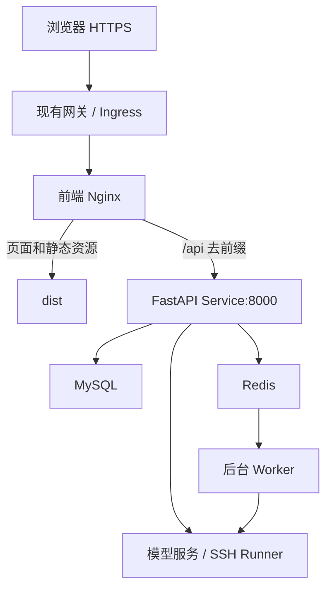

# 部署与故障排查

## 前后端放在哪里

前端源码单独放在桌面目录，后端仍在原来的 E 盘工程。生产构建的 `dist/` 可交给 Nginx 或 Kubernetes 中的前端静态服务。FastAPI、Redis、MySQL、Worker 和训练服务器的部署继续使用后端工程的配置。



浏览器不直接访问 MySQL、Redis 或 SSH，也不保存服务器部署用密码。生产域名使用 HTTPS，由现有网关/Ingress 处理证书，避免在传输中暴露登录、模型和 SSH 凭据。

## 构建与同源代理

```powershell
pnpm install --frozen-lockfile
pnpm build
```

将 `dist/` 的**内容**复制到 Nginx 静态根目录，参考 `deploy/nginx.conf`。

- `/api/` 转给 `http://backend:8000/`，末尾的 `/` 表示去掉 `/api/` 前缀。
- `backend` 需要替换成实际后端服务名；在 Kubernetes 中通常是后端 Service DNS 名。
- 页面路由如 `/runs/...` 返回 `index.html`，交给 Vue Router 处理。
- API 404 保持 API 404，不能落入 SPA 的 index.html 回退。
- `/assets/` 是带内容 hash 的静态资源，未找到时返回 404；不要把 HTML 当作脚本发回。
- 请求体上限示例为 11 MiB，支持后端 10 MiB PDF 限制；Ingress 和其他代理也应允许同等范围。
- 完整回复接口的代理读取/发送超时示例为 660 秒。后端本身仍负责模型和任务超时，不在前端无限自动重试。

如果你选择让 Ingress 直接把 `/api` 转到 FastAPI，去前缀只做一次，不能在 Ingress 和 Nginx 各去一次。最简单是让现有 Ingress 将整个前端域名转给前端 Nginx，由所附配置统一代理 API。

## 环境变量的含义

| 变量 | 在哪使用 | 可否包含秘密 |
| --- | --- | --- |
| VITE_API_BASE | 构建到浏览器，默认 `/api` | 不可以，内容是公开的 |
| API_PROXY_TARGET | 只给 Vite 开发代理使用 | 只填后端地址，不填凭据 |
| MYSQL_PASSWORD / 加密密钥等 | 后端服务器环境 | 不属于前端，不复制到前端目录 |

生产构建后再改变服务器上的 VITE_API_BASE 不会改变已有 JS 文件。当前推荐保持 `/api`，通过同源代理适配域名和后端地址，无需每个用户填写服务地址。

## 常见问题

| 现象 | 检查方式 |
| --- | --- |
| 5173 打不开 | 查看运行终端是否启动成功、端口是否被占用；前端未提供后台自动启动服务 |
| 登录提示连接失败 | 先确认后端 8000 可访问；核对 API_PROXY_TARGET，改变后重启 Vite |
| 请求返回一段 HTML | API 被转到 SPA 回退，检查 `/api/` 路由、proxy_pass 和去前缀配置 |
| POST 登录出现在地址栏 | 正确源码通过单一 el-form 阻止默认提交；确认不是旧缓存或旧开发实例 |
| GET /auth/me 是 401 | 登录已失效，重新登录；不要把 503 当成错误密码 |
| 模型 Key 保存成功但没正文 | PUT 成功是 204，无需期待 JSON；查看 GET 状态是否 configured=true |
| 没有脚本可选 | Runner 注册表尚未登记；在后端配置，前端不开放任意 shell 输入 |
| 创建了任务但服务器没跑 | 创建任务仅配置；必须有本轮明确启动指令或手动确认启动 |
| 训练完成但没看到权重 | 检查 execution 的输出目录、refresh 的 outputs 状态，以及脚本是否真的保存了权重；状态成功不证明产物已发布 |
| 图表为空 | 查看实际 metrics 接口，确认脚本上报格式、采集是否完成、dataset/split/metric_name 是否对应 |
| 建议一直 queued | 检查后端 Worker、Redis 消费、个人开关和模型 Key；前端不会自己消费队列 |
| 提示稍后重试 | 复制页面给出的追踪号，在后端日志按 request_id 定位；不要向用户暴露 MySQL 或供应商原始异常 |
| 页面刷新后 404 | Nginx 的页面 history fallback 未配置；API 与页面 fallback 要分开 |
| 论文显示 ready 但某些页没有正文 | 物理页可能是扫描图或空白；查看 empty_pages，当前不包含 OCR |
| 源码版本冲突 | 重新读取最新文件，再决定是否重新生成计划，不能把旧片段接到新文件后面 |

## 当前功能范围

已接入现有接口支持的登录、会话、聊天工具、训练任务与监控、报告、分析、建议、源码、修改、派生运行、比较、PDF、Skill 和个人设置。

当前没有后端契约的功能没有放置假按钮：会话重命名、任意服务器命令、任意文件操作、直接下载权重、在页面安装 GitHub Skill。后续需要这些功能时，应先补后端契约再接 UI。


## 2026-10-29：解析和维护日志

Windows 使用 `uvicorn --reload` 时出现的 PDF 子进程 NotImplementedError 已修复，不需要为此关闭热重载。其他环境部署本次更新后运行 `python -m app.database --skill-schema`，增量创建个人 Skill 表。

排错日志只保存在后端机器供维护者查看；桌面前端目录的 `查看系统日志.ps1` 是本机工具，不由网页执行。选择对应服务进程的日志，按 request_id 定位文件、函数、行号与异常链。没有新增前端系统日志页面或公开日志读取 API。具体步骤见 [本次说明](06-PDF解析与个人Skill及本机排错.md)。


## 2026-10-29：服务器删除迁移

其他环境部署后运行 `python -m app.database --server-schema`，增量添加 deleted_at 并调整密文检查约束；当前数据库已迁移。删除成功后连接密文为空，列表和详情排除已删配置，历史记录保留；存在排队/运行任务仍返回 409。环境和 GPU 读取依赖 SSH 可连接，nvidia-smi 缺失不会被当成“0 张可用卡”。详情见 [本模块说明](07-服务器资源与通用训练配置.md)。

## 2026-10-29：流式聊天

聊天页面已接入 SSE。后端响应 X-Accel-Buffering: no，Nginx 继续使用既有长请求超时；其他网关/Ingress 需允许流式传输。读到 done 才算业务完成，不能只看 HTTP 200。Redis 连接与 7 天 TTL、本机认证配置见 [模块说明](09-历史原文回查与流式聊天.md)。
