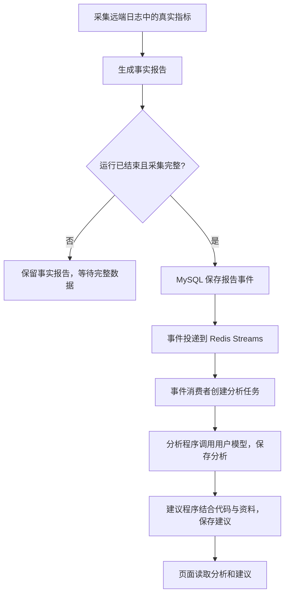

# 工具调用修复与事实报告、分析、建议

更新日期：2026-10-29。本文对应桌面前端与 `E:/code/LangChian_New` 后端。

## 1. 三种结果分别是什么

| 页面内容 | 输入 | 做什么 | 是否调用模型 |
| --- | --- | --- | --- |
| 事实报告 | 已采集的真实指标、运行状态、评测配置 | 汇总指标数量、末值、极值、异常和采集完整性 | 否 |
| 分析 | 冻结的事实报告 | 解释表现和局限；推断必须指向报告中的证据 | 是，使用本人保存的 Key |
| 有据建议 | 已保存的分析、相关源码及论文证据 | 提出可验证的改进方案；证据不足时说明不足 | 是，必要时只读源码、检索公开资料 |

例如，事实报告可以记录“验证 MAE 的观测最小值是多少”；分析可以说明“现有曲线是否支持持续改善”；修改某个模块的具体建议还需要代码与资料支持。观测到最小值不代表已验证最佳权重。

“后台 Agent”在这里指独立执行的分析程序。它等待任务、调用模型、保存结果，页面随后读取结果。它不是另一轮训练，不会因为打开此页面就自动重新训练或修改代码。



正常常驻模式使用 Redis 投递事件，MySQL 保存报告、任务、结果与审计记录。运行结束包括成功、失败或停止；“结束并采集完整”才会发布供分析使用的报告事件。

## 2. 为什么这次没有分析

本次只读检查的运行：`54538fbf51c74296a30d2f34447e80f5`。

- 运行状态为已停止，已存在第 1 版完整事实报告，145 条有效指标。
- 本人分析、建议开关均已开启。
- 服务器全局分析与建议开关处于关闭状态；报告事件存在，但没有本次分析任务。

因此，空白不是“训练没有结束”，也不是前端漏画已有分析，而是分析还没有执行。个人开关表示用户允许处理；服务器还需要启用并运行相应服务。

此前拟启动全局 Worker 的操作被自动审批拒绝，原因是它可能处理其他用户的待办数据并调用外部模型产生费用。全局开关已经恢复关闭；没有启动这批 Worker，也没有产生真实模型调用。不能把下面的预览成功理解为报告已分析完成。

页面现在改成“分析处理进度”，并解释事实、分析、建议的先后关系。系统错误仍记录在后端本机日志，不新增面向用户的系统日志页面。

## 3. DSML 标记为什么会出现在聊天里

原来模型把类似 `<｜｜DSML｜｜ invoke ...>` 的工具协议输出在正文里。正式工具调用需要 SDK 返回结构化 `tool_calls`；正文中的这些字符不能证明工具已执行。相关协议说明见 [DeepSeek 官方工具调用文档](https://api-docs.deepseek.com/guides/tool_calls/)。

修复后的处理：

1. 网关在流式输出中保留可能尚未完整到达的标记前缀，防止跨块泄漏。
2. 正文出现工具标记时，不从正文解析或执行工具。
3. 同时存在有效原生调用时，仅使用原生调用；否则抛出明确的协议异常。
4. 对话编排最多纠正一次，要求模型改用正式调用或正常文字。不会重新执行已经执行过的工具，也不会重置工具次数预算。
5. 再次格式异常时按失败处理，不假称已经查询成功。
6. 旧的异常助手消息在展示和本轮模型上下文中替换为失败说明；不改写数据库原始历史。用户自己的文字保持原样。

## 4. 完整日志怎样读取

`get_run_logs` 单次允许最多 16384 字节，默认 2048 字节。明确要求完整日志时，从 `offset=0` 开始，优先用较大的 `limit`，按照 `has_more` 和 `next_offset` 继续读取。

原来约 14.5KB 的日志被 2KB 单次上限拆成多次读取，容易耗尽每轮工具额度。现在这类日志在预算充足时可以一次读到。48KiB 输入预算下的模拟编排测试已验证 14526 字节日志完整进入回答模型的工具结果。

这里的大小单位是字节，不是字符或精确 token 数。总上下文预算、总工具结果预算和调用次数仍存在；大日志并不能无限塞给模型。窗口被截断、日志变化或来源不稳定时，必须说明未读完整。结果裁剪后不能直接跳到未展示内容之后，避免漏读却声称已看完。

聊天模型可以基于已经读取的日志写自然语言分析。查询工具尚未取得“已保存分析”只表示后台持久化结果未就绪，不表示模型完全不能分析。聊天说明与页面中已保存的后台分析是两种结果。

## 5. 本次运行的维护入口

新增 `app/process_run_analysis.py`。它面向服务器维护者，不是开放给前端任意指定用户身份的接口。

默认只读检查：

```powershell
cd E:\code\LangChian_New
python -m app.process_run_analysis --user-id 2 --run-id 54538fbf51c74296a30d2f34447e80f5
```

此命令已经实测，返回 `mode=inspect_only`、`model_called=false`；不会入队、读取远端代码或调用模型。检查会验证运行归属、报告完整性与有效性、对应报告事件和个人开关。

只有明确决定处理这次数据时才添加 `--execute`：

```powershell
python -m app.process_run_analysis --user-id 2 --run-id 54538fbf51c74296a30d2f34447e80f5 --execute
```

执行模式会把本次报告事件交给现有任务接收逻辑，最多领取本用户、本运行的一项分析和一项建议。它不启动常驻 Worker，不修改全局开关，不清理全局队列，不启动训练。重复执行仍受已有任务状态、租约、个人开关和结果去重约束。

分析使用冻结事实报告；建议还可能读取相关代码、论文片段并检索公开资料。模型目的地为本项目网关使用的 `api.deepseek.com`，使用用户已保存的 Key，可能计费。**本轮仅验证了预览和模型替身测试，尚未执行这条真实处理命令。**

`analysis_task_claimed=true` 仅表示领取过任务，不代表成功；应检查返回的任务状态及页面结果。失败原因按已有错误分类写入任务和本地日志。

## 6. 文件和模块职责

| 文件 | 本轮职责 |
| --- | --- |
| 后端 `app/services/tool_protocol.py`（新增） | 识别并阻止正文工具标记泄漏，处理跨流式块的标记 |
| `app/services/model_gateway.py` | LangChain DeepSeek 网关；原生工具调用与流式过滤 |
| `app/services/read_only_chat_service.py` | 权限检查、工具编排、一次协议纠正、日志窗口和证据覆盖说明 |
| `app/models/chat_tools.py` | Pydantic 工具参数、日志大小上限、结果裁剪与提示词 |
| `app/models/analysis_tools.py` | 区分聊天分析与已保存后台分析 |
| `app/repositories/analysis_repository.py` | 按归属与运行领取分析，保留事务和租约约束 |
| `app/repositories/suggestion_repository.py` | 复用任务生命周期，使用建议阶段的限定领取 SQL |
| `app/services/analysis_service.py` | 将限定范围传给仓储；建议服务继承同一执行生命周期 |
| `sql/next_run_analysis_task.sql`（新增） | 仅领取指定用户、运行的分析任务 |
| `sql/next_run_suggestion_task.sql`（新增） | 仅领取指定用户、运行的建议任务 |
| `app/process_run_analysis.py`（新增） | 默认预览、显式单次处理的维护入口 |
| 前端 `src/lib/format.ts` | 历史异常助手消息的显示处理 |
| `src/views/ChatView.vue` | 聊天显示、流式预览、复制正文使用上述处理 |
| `src/views/RunView.vue` | 说明事实报告生成条件和后续分析 |
| `src/components/RunAgents.vue` | 说明分析进度和空状态 |
| `src/views/SettingsView.vue` | 说明个人开关及服务执行条件 |

技术栈沿用原项目：Python asyncio、LangChain DeepSeek SDK、Pydantic、MySQL Connector、Redis Streams；前端 Vue 3、TypeScript、Element Plus、Vite。Python `re` 处理协议标记，`unittest` 和模型替身验证后端；前端沿用 Vitest。没有新增运行时依赖、数据库表或 HTTP 接口。

## 7. 对应已有接口

| 接口 | 用途 |
| --- | --- |
| `GET /runs/{run_id}/report` | 读取事实报告 |
| `GET /runs/{run_id}/events` | 查看报告事件投递状态 |
| `GET /runs/{run_id}/agent-tasks` | 查看分析、建议任务状态 |
| `GET/PUT /me/analysis-settings` | 本人分析开关 |
| `GET/PUT /me/suggestion-settings` | 本人建议开关 |
| `GET /runs/{run_id}/analyses` | 读取已经保存的分析 |
| `GET /runs/{run_id}/suggestions` | 读取已经保存的建议 |
| `POST /sessions/{session_id}/messages/stream` | 流式聊天，可按需读取日志和已保存报告 |

这些接口依然先通过 Token 确认当前用户，再检查运行或会话归属。查询结果接口不会直接触发模型生成。

## 8. 本轮验证与边界

- 工具协议、聊天工具、流式历史：48 项测试通过。
- 分析、建议、限定范围处理：56 项测试通过。
- 前端：46 项测试、类型检查、Lint、生产构建、91 项 API 契约对照通过。
- 已完成真实数据库只读预览，核对本次报告、事件和个人开关。
- 未调用真实付费模型，未启动新的训练，未启动全局模型处理 Worker。

后端测试新增 `tests/test_tool_protocol.py`、`tests/test_scoped_analysis.py`，修改 `tests/test_chat_tools.py`；前端修改 `tests/core.test.ts`。完整新增与修改清单见 [文件清单](05-新增与修改文件清单.md)。

## 2026-10-30 后续状态

用户授权后已用同一账号原有 Key 执行本次运行：分析成功保存，建议处理结果已保存为证据不足。早先“未执行真实模型”的说明记录的是当时状态；当前结果和修复见 [Key 复用与本次分析生成](15-Key复用与本次分析生成.md)。全局 Worker 仍未启用。
